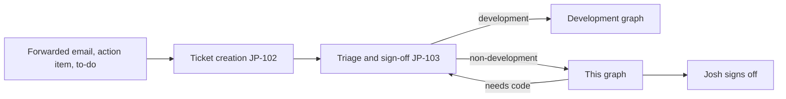
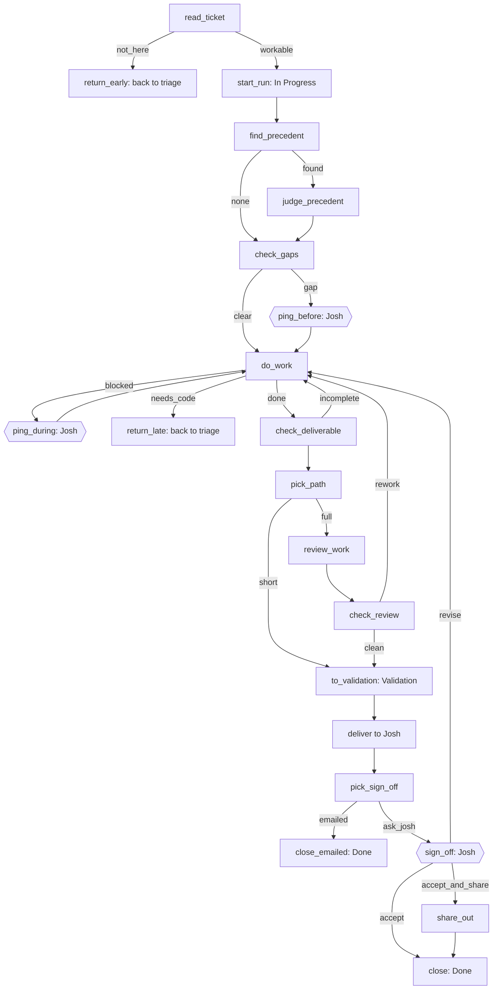

# Non-development graph: design

## Contents

- [Summary](#summary)
- [Where it sits](#where-it-sits)
- [Kinds of work it takes first](#kinds-of-work-it-takes-first)
- [The run, step by step](#the-run-step-by-step)
- [The short path and the full path](#the-short-path-and-the-full-path)
- [When it asks Josh](#when-it-asks-josh)
- [How every loop ends](#how-every-loop-ends)
- [Deliverables and where they live](#deliverables-and-where-they-live)
- [Evidence and sources](#evidence-and-sources)
- [Patient data from start to finish](#patient-data-from-start-to-finish)
- [Reads and writes](#reads-and-writes)
- [Jira status by stretch](#jira-status-by-stretch)
- [Parts and who owns them](#parts-and-who-owns-them)
- [How to tell it's working](#how-to-tell-its-working)
- [Rules](#rules)
- [Exact copy](#exact-copy)
- [Acceptance criteria](#acceptance-criteria)
- [Out of scope](#out-of-scope)
- [Choices made](#choices-made)
- [Questions for Josh](#questions-for-josh)
- [Josh's open questions, answered](#joshs-open-questions-answered)
- [As built (JP-123)](#as-built-jp-123)

Ticket JP-104. Status: approved by Josh on 16 November 2026. He answered both questions the same day (see [Questions for Josh](#questions-for-josh)). This file is the spec for the non-development graph. The build ticket JP-123 reads it, with its plan `docs/superpowers/plans/2026-11-16-non-development-graph.md`. There are no boards, because the graph has no screen. The draft graph file is `graphs/flows/non-development.yaml`, and it passes the checker (`python3 graphs/tools/check_graph.py`).

Sources: Josh's notes (`docs/source-notes/research-action-item-pipeline.md`), the vision (`docs/vision-and-roadmap.md`, "Agent graphs"), the graph convention (`graphs/CONVENTION.md`), the ticket rules (`conventions/tickets.md`), the inventory (`docs/inventory/features.md`, A27 Email Research Desk and S11/S12), and the desk worker skill that runs today (claude-harness `skills/desk-worker`).

## Summary

The graph takes one Ready ticket from JP whose deliverable is not code: an answer, a document, a reply for Josh to send, or a file to find. It ends with four things:

- the deliverable, saved outside any working folder;
- an evidence file that lists the sources behind it;
- Josh's sign-off, except for an emailed ask: that closes once the answer is in his inbox, and his reply to the email reopens it;
- a resolution comment on the ticket that the next run's lookup can find.

Process depth matches the weight of the task. A small ask, or one that an earlier ticket already answered, takes a short path with no second reviewer. Nothing goes to anyone but Josh unless he says yes at sign-off.

## Where it sits



- **Upstream does intake.** Ticket creation (JP-102) turns the raw input into a complete ticket with a Question, Sources and a Deliverable format, plus the work kind in the `action-triage.spec` property. Triage (JP-103) signs it off as Ready and records the route `non-development`. So this graph does no intake, no classification and no duplicate check of its own. It reads the ticket.
- **Triage's route rule** (JP-103): Bug and Story go to development. A Research or Task ticket goes to development when its Repository is a registry repository (for Research, only the design stretch, ending at an approved spec and plan), and to non-development when its Repository is `none`. A `spec.type` of `code` with Repository `none` is a conflict, and the ticket is sent back. So a design ticket like this one never reaches this graph, and a question whose answer lives in a repository is filed with Repository `none` by JP-102's drafter.
- **Code found mid-run goes back to triage.** If the work turns out to need code, the graph sends the ticket back through `return-to-triage`, the same door the development designer uses. It never starts the development graph itself.
- **The Email Research Desk** (action-triage `desk/`) keeps its watcher, which turns an email into a ticket, and its mailer, which replies on the thread to Josh only. This graph replaces the desk's worker session, the part that researches the question (Josh's answer to [question 1](#questions-for-josh)). When Josh replies on the thread of a closed ticket, the desk's watcher moves the ticket back to Ready with his reply as a comment, and the graph runs it again on the full path. Building that reopen into the watcher belongs to JP-123.

## Kinds of work it takes first

The work kind is the closed list action-triage already stores in the ticket's `action-triage.spec` property (`type`). JP-102's drafter sets it. A hand-written ticket with no property counts as `research`.

| Kind | In plain words | First? | Agent |
| --- | --- | --- | --- |
| `research` | Answer a question, usually with data; look into a reported problem without changing code | Yes | `answerer` |
| `doc` | Write a document for Josh | Yes | `drafter` |
| `email` | Draft a reply for Josh to send | Yes | `drafter` |
| `misc` | Find a file, a record or a fact and hand it over | Yes | `finder` |
| `meeting` | Prepare for, or follow up on, a meeting | Later | `answerer` for now |
| `code` | Not this graph | No | Triage sends it to development |

These are the four kinds the desk already handles, so the first runs have real work to compare against. Later kinds (meeting prep, access requests, a recurring report) add an agent and a row to the map in the graph file. They do not add steps.

## The run, step by step



| Step | Kind | Done by | Tier | Access | What it does |
| --- | --- | --- | --- | --- | --- |
| `read_ticket` | gate | `read-ticket` | none | read | Checks the ticket is in JP and routed here, and that its Question, Sources and Deliverable format are filled. Outputs search terms, and whether Josh gave the deliverable format or it was inferred. |
| `return_early` | gate | `return-to-triage` | none | josh | When the ticket is not workable here: back to Not Started, with the reason as an open question and the flag set. Ends the run. |
| `start_run` | gate | `move-ticket` | none | josh | Moves the ticket to In Progress. |
| `find_precedent` | role | `jira-searcher` | cheap | read | Finds tickets that may already answer this one (at most ten, the shared role's list from JP-102), closed ones with a resolution first. |
| `judge_precedent` | role | `precedent-judge` | mid | read | Runs only when candidates exist. Decides whether one of them really answers this ticket today, or is only related. |
| `check_gaps` | gate | `gap-check` | none | read | Fires a ping only on observable signals (see [When it asks Josh](#when-it-asks-josh)). |
| `ping_before` | ask | Josh | none | read | One sentence to confirm the deliverable before work starts. |
| `do_work` | role | `researcher`, agent by kind | mid | josh | Produces the deliverable and the evidence file in Josh's artifacts folder. Ends `done`, `blocked` or `needs_code`. |
| `ping_during` | ask | Josh | none | read | One missing fact, when no reachable source holds it. Loops back to `do_work`, at most twice. |
| `return_late` | gate | `return-to-triage` | none | josh | The work needs code: back to triage. Ends the run. |
| `check_deliverable` | gate | `check-deliverable` | none | read | The deliverable and evidence exist outside any repository, name at least one source, and list query files that exist. Otherwise back to `do_work`. |
| `pick_path` | gate | `pick-path` | none | read | Short or full path (see below). |
| `review_work` | role | `work-checker` | mid | read | Full path only. Lists defects, each quoting the ticket. |
| `check_review` | gate | `check-review` | none | josh | Drops defects that quote nothing, and saves the rest as feedback. Any left go back to `do_work`. |
| `decide_stuck` | ask | Josh | none | read | Only when a loop or the tier cap is reached: one more run, or stop. |
| `to_validation` | gate | `move-ticket` | none | josh | Moves the ticket to Validation. |
| `deliver` | gate | `deliver` | none | josh | A ticket comment with the path and summary. For an emailed ask, also a reply on the email thread through the desk mailer, to Josh only. |
| `pick_sign_off` | gate | `sign-off-rule` | none | read | `emailed` when the ticket came through the desk, otherwise `ask_josh`. |
| `close_emailed` | gate | `close-ticket` | none | josh | Emailed asks only: posts the resolution and moves the ticket to Done. Ends the run. |
| `sign_off` | ask | Josh | none | read | Every other ticket: accept, accept and share, or revise. |
| `share_out` | gate | `share` | none | shared | Only on "accept and share". Shares the signed-off deliverable with the one recipient named in the evidence. |
| `close` | gate | `close-ticket` | none | josh | Posts the resolution comment and moves the ticket to Done. |

Entry gate `ready` (owned by JP-103). Exit gate `no-loose-ends` (shared; JP-109). A run ends early in three places: it is sent back to triage (twice), or Josh says stop at a loop limit. Every other path reaches `close_emailed` or `close`, both after `check_deliverable`.

## The short path and the full path

`pick-path` decides with a script, not a model:

- **Short:** the precedent answers the ticket, or the kind is `misc`. There is no second reviewer. The deliverable goes straight from `check_deliverable` to Josh.
- **Full:** everything else, and always after Josh asks for a revision or reopens an emailed ask by replying. `review_work` checks the deliverable against the ticket, and `check_review` keeps only the defects that quote it.

Both paths go through `check_deliverable`, so even a short run cannot reach Josh without a saved deliverable and a source. `do_work` is on the mid tier for every kind. Splitting `misc` onto the cheap tier waits until the run costs in the ledger show it is worth a second work step.

## When it asks Josh

A run asks Josh in four places, all through the one Needs you queue plus the Jira flag. While it waits, the ticket is parked and other runs keep moving.

1. **`ping_before`, before any work.** `gap-check` fires only on signals a script can see, never on a model's confidence. Today that means no precedent was found and the ticket marks its Deliverable format as inferred rather than given by Josh. This is the "confident about the wrong deliverable" pitfall from Josh's notes: when an earlier answer exists or Josh named the deliverable, the run does not ask.
2. **`ping_during`, mid-work.** Only when the answer depends on a fact no reachable source holds. Before asking, the researcher comments on the ticket with what it searched. An assumption is not a question: an ambiguous ask gets the likelier reading, stated in the evidence.
3. **`sign_off`, at the end.** Every deliverable except an emailed ask's. An emailed ask closes once the answer is in Josh's inbox; it stays closed unless he replies to the email, and the reply reopens it. A reopen counts as "sent back" in the improvement figures.
4. **`decide_stuck`, at a limit.** Only when `do_work` has used its three runs, or a loop its two trips back (see [How every loop ends](#how-every-loop-ends)).

Josh answers a ping in one sentence. His reply lands on the ticket as a comment, and `do_work` reads every comment, so no new channel is needed. He can always type his own answer, and stopping a ticket is cancelling it in Jira.

## How every loop ends

Josh set two limits on 16 November 2026. First, every loop has a limit that ends at him (the convention's rule 4). Second, no role step runs more times in one run than its tier allows: `cheap` (Haiku) 5, `mid` (Sonnet) 3, `gate` (Opus) 2. The caps live in `graphs/tiers.yaml` as `max_runs` (JP-139). The count goes by tier, not by the model that answered. The walker (JP-114) counts every run of a step, whichever loop caused it. When the next run would pass the cap, the run goes to that loop's `at_limit` ask, and each yes from Josh allows one more run. This follows the triage spec (JP-103), "How every loop ends".

**Role steps and their caps.**

| Step | Tier | Cap per run | Runs again when |
| --- | --- | --- | --- |
| `find_precedent` | cheap | 5 | Never. It sits before every loop, so it runs once. |
| `judge_precedent` | mid | 3 | Never. It runs once, and only when candidates exist. |
| `do_work` | mid | 3 | Any of the five loops below. They share its three runs. |
| `review_work` | mid | 3 | Whenever `do_work` runs again on the full path, so never more often than `do_work`. |

**Loops back to `do_work`.** Every loop returns to the one work step, and every one ends at `decide_stuck`.

| Loop | `max_loops` | Runs of `do_work` it allows (`max_loops` + 1, at most 3) |
| --- | --- | --- |
| `ping_during` (Josh answered a missing fact) | 2 | 3 |
| `check_deliverable` incomplete | 2 | 3 |
| `check_review` rework | 2 | 3 |
| `sign_off` revise | 2 | 3 |
| `decide_stuck` retry | 1 | 2 |

So however the loops add up, one run uses at most three Sonnet work runs and three Sonnet reviews before Josh is asked. The fourth work run, and each after it, needs his yes at `decide_stuck`.

**Between runs.** A new run starts with fresh counts, so two rules bound repeats across runs:

- Only a ticket that is Ready and not in the backlog (Josh has moved it into a sprint), or Josh's own reply to an emailed ask, starts a run. Ready alone does not. The graph's own comments and edits never do (rule 16).
- A "needs code" or "not workable here" return is counted by triage, which takes a ticket back at most twice. The third return goes straight to Josh (rule 17).

**Inside a step.** A role session that never ends, or a gate script that keeps failing, is the binding's job. Every role step gets a turn cap and a time cap, and a failing gate stops the run instead of being retried (rule 19).

## Deliverables and where they live

A deliverable is a file Josh can open: an answer note (Markdown), a document, a reply draft, a spreadsheet, or a short note giving the path of a file that was found. It is never only a chat message or a ticket comment. The ticket comment points to it.

- **Where:** Josh's artifacts folder, `~/Development/active/.artifacts/<system>/`. `<system>` is the registry system triage recorded, or `josh-projects` when there is none. The desk's fallback project folder is `josh_projects`, so this matches. The folder is flat, and file names start with the ticket key (`JP-140-answer.md`, `JP-140-evidence.md`, `JP-140-query-1.sql`).
- **Why there:** it is outside every repository and worktree, so cleanup cannot remove it. It is the folder Josh's global rules already set aside for files made for his review, including files that hold patient data, and Session Atlas's artifact manager (S11) already scans it. No new store is created.
- **Gap 3 from the development draft** (working files vanish with the worktree) cannot happen here. The non-development graph never writes inside a worktree, and `check-deliverable` refuses a path that is inside one.

## Evidence and sources

The evidence file (contract `graphs/contracts/evidence.md`) sits beside the deliverable. It lists each source with its type (`query`, `file`, `ticket`, `doc`, `meeting` or `web`), its reference, and the claim it supports. It also gives the assumptions made, the precedent used, the intended recipient if it is not Josh, a short summary and the resolution text. Saved queries sit beside it, so `review_work` can run them again. `check-deliverable` refuses a run with no source.

## Patient data from start to finish

Patient data is read freely and written in exactly one place.

1. **Flag.** The ticket's `phi_risk` (from the spec property) becomes the run's `phi` input. It is true when the ticket does not say.
2. **Read.** The researcher may read any data Josh can read, with SELECT-only SQL.
3. **Write.** Patient data goes only into the deliverable, the evidence file and the saved queries, all in `.artifacts/<system>/`. It never goes into a repository, a scratch folder that outlives the session, the ledger or a ticket.
4. **Tell Josh.** When `phi` is true, the ticket comment, the reply email and the resolution give the path only. The evidence file's `summary` and `resolution` stay empty. This follows Josh's rule that patient-data files are referred to by path only, in email too.
5. **Share.** `share` refuses when `phi` is true. Josh shares such a file himself.
6. **Ledger.** The walker writes the step, outcome, tier, session and ticket for each step, never the content.

## Reads and writes

| Access | Steps | What they touch |
| --- | --- | --- |
| read | `read_ticket`, `find_precedent`, `judge_precedent`, `check_gaps`, `check_deliverable`, `pick_path`, `review_work`, and the four asks | Jira, repositories, project folders, meeting notes, SELECT queries |
| josh | `return_early`, `return_late`, `start_run`, `do_work`, `check_review`, `to_validation`, `deliver`, `close` | His own JP ticket, his artifacts folder, a reply to him on his own email thread |
| shared | `share_out` | One named recipient: an Outlook draft in Josh's mailbox addressed to someone else, or a comment on a ticket outside JP |

- The graph works only JP tickets, which are Josh's own. A ticket in CI or AD is moved and commented on by colleagues too, so `read-ticket` returns it to triage.
- **No email to anyone else is ever sent by the graph.** Even after Josh's yes, `share` puts a draft in his own mailbox and he presses Send. The step stays marked `shared`, and approved by `sign_off`, so the checker holds it to the approval rule and a later version that sends directly cannot skip the yes.

## Jira status by stretch

| Status | Steps | Moved by |
| --- | --- | --- |
| Ready | `read_ticket` | (already there) |
| Not Started | `return_early`, `return_late` | `return-to-triage` |
| In Progress | `start_run` through `decide_stuck` | `move-ticket` at `start_run` |
| Validation | `to_validation`, `deliver`, `sign_off`, `share_out` | `move-ticket` at `to_validation` |
| Done | `close` | `close-ticket` |

A non-development Research ticket moves to In Progress, not Design/Planning. `conventions/tickets.md` today says "Work starts on a Research ticket → Design/Planning". The plan changes that row to say Design/Planning is for tickets whose deliverable is a spec, a design or a plan, and that an answer counts as other work ([choice 4](#choices-made)).

## Parts and who owns them

| Part | Name | Owner | Notes |
| --- | --- | --- | --- |
| Role | `jira-searcher` (cheap, reads) | Shared with JP-102 | One role. Each graph's brief says what to look for. |
| Role | `precedent-judge` (mid, reads) | JP-104 | |
| Role | `researcher` (mid, may change) | JP-104 | Writes only in the artifacts folder and on its ticket. |
| Role | `work-checker` (mid, reviewer) | JP-104 | Followed by `check-review`, as rule 5 requires. |
| Agents | `answerer`, `drafter`, `finder` | JP-104 | All fill `researcher`. Per-system agents (for example a PIMS answerer) come later. |
| Gates | `ready` | JP-103 | Stub until the triage build (JP-122). |
| Gates | `no-loose-ends`, `move-ticket` | Shared | Whoever merges first adds the stub; JP-109 builds `no-loose-ends`. |
| Gates | `return-to-triage` | Shared with JP-103 | Moves to Not Started, writes the reason as an open question, sets the flag. |
| Gates | `read-ticket`, `gap-check`, `check-deliverable`, `pick-path`, `check-review`, `deliver`, `sign-off-rule`, `share`, `close-ticket` | JP-104 | `check-review` is generic (drops findings that quote nothing) and the development graph can reuse it. |
| Contracts | `evidence`, `feedback` | JP-104 | Both are written generically, so the development graph adds to them rather than writing its own. |
| Contract | `intake-record` | JP-102 | Not read here. This graph reads the ticket's own sections. |
| Tiers | `graphs/tiers.yaml` | JP-101 | Unchanged. |

Every gate script in the draft is a stub that refuses to run, so nothing can pass through a gate that does not exist yet. JP-123 builds them.

## How to tell it's working

Every number comes from the ledger rows the walker writes for each step (run, step, outcome, loop count, session, tier, ticket, start and end), joined to the session facts (cost) and to later runs on the same ticket. No model is needed to compute any of them.

| Question | Measure | Good direction |
| --- | --- | --- |
| Is the deliverable right first time? (effective) | Share of runs whose first `sign_off` is `accept` or `accept_and_share`, and, for emailed asks, share not reopened by Josh's reply within 14 days | Up |
| Does the earlier-answer lookup earn its keep? (effective) | Share of runs where `judge_precedent` says `answers`, and the share of those later revised or reopened | First up, second down |
| Does it spare Josh? (effective) | Asks per run (`ping_before`, `ping_during`, `decide_stuck`), and how long the ticket waits at each | Down |
| What does a deliverable cost? (efficient) | Model cost and `mid` step runs per closed ticket, split by short and full path and by kind | Down |
| How long does it take? (efficient) | Time from Ready to delivered, with the time waiting on Josh shown separately | Down |

How each run ends is scored in the graph file's `end_states` (JP-140): `finished` (through `close`) and `close_emailed.closed` are `success`; `return_early.returned` and `return_late.returned` are `neutral`, a routing miss that counts against triage's "Does Ready mean ready?"; `decide_stuck.stop` is `needs-josh`, and so is `exit_refused`, a run whose `no-loose-ends` gate refused. A revise, or a reopen by reply, counts as sent back.

To compare the graph before and after a change, each run records the version of the graph file it ran (`graph_version`) and each step the model that actually answered (`model`). Both are in the graph's `ledger` list, from JP-140.

## Rules

1. The graph starts only from a JP ticket routed `non-development` that is Ready and not in the backlog (entry gate `ready`; the start rule is the triage spec's, "Ready is not started").
2. It does no intake, classification or duplicate check. It reads the ticket.
3. A ping fires only on a signal a script can observe, never on a model's stated confidence.
4. Every ping is answerable in one sentence and lands on the ticket as a comment.
5. An ambiguous ask gets the likelier reading, stated in the evidence. It is not a question.
6. The researcher reads anything Josh can read, with SELECT-only SQL, and writes only its deliverable, evidence and saved queries in `.artifacts/<system>/` and comments on its own ticket.
7. Every deliverable passes `check-deliverable`: saved outside any repository or worktree, with at least one source.
8. The full path's reviewer can only cite the ticket's Question and Deliverable format. `check-review` drops anything else.
9. Every loop goes round at most twice, and no role step runs more often in one run than its tier allows (cheap 5, mid 3, gate 2). Either limit asks Josh, and each yes allows one more run.
10. Every deliverable waits for Josh's sign-off, except an emailed ask's, which closes when the answer is emailed to him and reopens only on his reply.
11. Nothing is sent to anyone but Josh. A share runs only on "accept and share", and an email to someone else is only ever a draft in Josh's mailbox.
12. When `phi` is true, the ticket, email, ledger and resolution carry paths only, and `share` refuses.
13. Work that needs code goes back to triage. This graph never starts another graph.
14. Only gate scripts move the ticket.
15. The closing resolution comment uses a fixed shape, so the next run's lookup can find it.
16. The graph's own comments and edits never start a run. Only Josh's reply to an emailed ask (through the desk watcher) or a ticket that is Ready and not in the backlog does: Ready alone does not, because Josh moves a ticket out of the backlog into a sprint when he wants it worked (his answer to the JP-146 review's question 3, 17 November 2026). This follows the triage spec (JP-103), "Ready is not started" and "How every loop ends".
17. A ticket sent back by `return-to-triage` is counted by triage, not here. Triage takes a ticket back at most twice, and the third return goes straight to Josh (JP-103).
18. A loop counter belongs to its arrow and never resets during a run, so `max_loops` really bounds `do_work` (rule for the walker, JP-114).
19. Each role step gets a turn and time cap in the runner's binding, and a gate script that fails stops the run rather than being retried (JP-103; bindings in JP-117).

## Exact copy

`ping_before` (built by `gap-check`, posted as a ticket comment and a Needs you item):

> `<KEY>`: before I start. Question: `<question restated>`. I'll deliver `<deliverable format>`, assuming `<assumption>`. Is that right? One sentence is enough, or reply "go".

`ping_during` (written by the researcher as its last comment; the ask points to it):

> `<KEY>` is stuck on one fact: `<the missing fact, as a question>`. Searched: `<sources>`.

`decide_stuck`:

> `<KEY>` has used its work runs (three per run) without a usable deliverable. Allow one more run, or stop and leave it with me?

`deliver` ticket comment, in the workflow's `result | evidence | next gate` shape:

> Deliverable ready | `<summary>` (or "summary withheld: patient data") · `<deliverable path>` · evidence `<evidence path>` | next gate: Josh's sign-off

`sign_off`:

> The deliverable for `<KEY>` is ready (path and summary in the ticket). Sign it off? Accept · Accept and share with `<recipient>` · Revise

`close-ticket` resolution comment (the lookup searches for `Resolution:`):

> Resolution: `<question restated>` | `<answer in one or two sentences>` | sources: `<refs>` | deliverable: `<path>` | next gate: none

When `phi` is true, the question and answer parts read "withheld: patient data", and only the path is given.

## Acceptance criteria

These are the ticket's four scenarios, with tags and their proof.

```gherkin
Feature: The non-development design

  @manual
  Scenario: Every run ends in a deliverable with sources
    Given any path through the design that reaches the end
    Then it produces a deliverable and the sources behind it

  @auto
  Scenario: A shared write is approved first
    Given a step that writes something shared
    Then an approval step comes before it

  @manual
  Scenario: Patient data stays out of tickets and the ledger
    Given a deliverable that holds patient data
    Then the design refers to it by path only

  @auto
  Scenario: The draft graph passes the checker
    Given the draft graph file
    When the checker runs
    Then it exits cleanly
```

| Scenario | Proof |
| --- | --- |
| Every run ends in a deliverable with sources | [The run, step by step](#the-run-step-by-step): `close` and `close_emailed` both come after `to_validation`, which needs `check_deliverable`, which refuses a run with no saved deliverable or no source. Every other ending hands the ticket back or stops at Josh's word. |
| A shared write is approved first | The checker's rule 6 on `share_out` (approved by `sign_off`, runs only on `accept_and_share`). The checker run is saved under `docs/proof/`. |
| Patient data stays out of tickets and the ledger | [Patient data from start to finish](#patient-data-from-start-to-finish), and the `phi` wording in [Exact copy](#exact-copy). |
| The draft graph passes the checker | `python3 graphs/tools/check_graph.py` output, saved under `docs/proof/`. CI's `suite` runs it on every change. |

## Out of scope

- Building the graph: the gate scripts, the real role briefs and the walker binding (JP-123, JP-114, JP-117).
- Any write to a shared database. The graph has no step that writes to one, and none is planned.
- Tickets outside JP, and kinds after the first four.
- Sending email to anyone but Josh.
- The Needs you queue and the Jira flag themselves (action-triage, JP-125). This graph only names where it asks.

## Choices made

Each of these can be undone, so it takes the recommended option and is recorded in `docs/decisions.md`.

| # | Choice | Taken | How to undo |
| --- | --- | --- | --- |
| 1 | Which kinds come first | `research`, `doc`, `email`, `misc`, the four the desk already handles. `meeting` later. | Change the agent map in the graph file. |
| 2 | Where deliverables live | `~/Development/active/.artifacts/<system>/`, flat, with the ticket key first in each file name; `josh-projects` when there is no system. | Change `check-deliverable` and the researcher's instructions. |
| 3 | Where the spec lives | This file, because JP-104 and JP-123 both name it. No copy under `docs/superpowers/specs/`. | Move it and update both tickets. |
| 4 | Status while working a non-development Research ticket | In Progress, not Design/Planning. The plan updates `conventions/tickets.md`. | Map the work stretch to Design/Planning. |
| 5 | Where the draft lives | The real tree (`graphs/flows/`, `roles/`, `agents/`, `gates/`, `contracts/`) with refusing gate stubs, the same as JP-103's draft, so CI checks it. | Move it under `docs/design/` and check it with `--root`. |
| 6 | Email to anyone but Josh | Never sent by the graph: an Outlook draft in his mailbox, after his yes. | Let `share` send after the yes. |
| 7 | Tickets outside JP | Returned to triage. | Allow CI or AD with an approval step before every write. |
| 8 | Tier of the work step | Mid for every kind. | Split `misc` into a cheap-tier step. |
| 9 | Where the run's work happens | On the laptop, through the walker's runner, where the database access, the mailer and the artifacts folder are. | A cloud binding for kinds that touch no data. |

## Questions for Josh

Both were put to Josh on 16 November 2026, ahead of the JP-106 sitting, and he answered both in the JP-104 thread. They are recorded in `docs/decisions.md`.

| Question | Options offered | Josh's answer |
| --- | --- | --- |
| 1. Should this graph replace the Email Research Desk's worker? | A. Yes, the graph becomes the desk's worker (recommended). B. Keep the desk separate. C. Replace the whole desk. | **A.** The desk keeps its watcher and its Josh-only mailer; the graph does the research. |
| 2. Should every deliverable wait for Josh's sign-off? | A. Yes, every one (recommended). B. Only full-path deliverables. | **Neither, as offered.** An emailed ask runs to completion without sign-off and closes; a reply to the email reopens it, and otherwise it stays closed. Every other ticket waits for sign-off. |

## Josh's open questions, answered

From section 7 of `docs/source-notes/research-action-item-pipeline.md`:

| His question | Answer in this design |
| --- | --- |
| Final intake fields and task-type list | Intake belongs to ticket creation (JP-102). The kind list is action-triage's `spec.type`. |
| How "similar ticket" is judged; is Haiku enough | The cheap tier only fetches candidates. A mid-tier judge decides whether one really answers, and only when there are candidates. |
| Live queries: autonomous or approved first | Autonomous and SELECT-only, under Josh's rule that reading anything he can read is allowed. Queries are saved with the evidence. |
| How the right project context is loaded | From the registry: triage records the system, and the brief names it. |
| "Find a file on my computer" | Runs on the laptop. The `finder` agent returns the path, and copies the file only when asked. |
| The line between light and heavy | `pick-path`: short for a precedent or a `misc` ask; full otherwise. Work that needs code goes back to triage for the development graph. |
| How state passes between steps | Step outputs in the graph file, the evidence file, and ticket comments. Josh's answers are comments too. |

## As built (JP-123)

Built on 17 November 2026 under Josh's ruling that any unblocked JP-94 ticket may be built without waiting for Ready. The gates, their tests and a run of the whole graph through the real walker are in the repository; the design above did not change, except as listed.

**Parts.** The eleven gates this graph owns are real scripts: `read-ticket`, `gap-check`, `check-deliverable`, `pick-path`, `check-review`, `close-ticket`, `deliver`, `sign-off-rule`, `share`, and the two shared ones, `move-ticket` and `return-to-triage`. `ready` (JP-122) and `no-loose-ends` (JP-109) are still stubs. How a gate is written, and the shared files in `graphs/gates/lib/`, are in `graphs/gates/README.md`. The shared Jira client is JP-121's `lib/jira.py`.

**Changes to the graph file.** Each carries a value a gate needed and the draft did not pass it.

| Step | Change | Why |
| --- | --- | --- |
| `read_ticket` | New output `reason` | `return_early` writes the reason on the ticket |
| `return_early` | New input `reason` | The same |
| `check_gaps` | New output `card` | The walker shows it to Josh on `ping_before`, so the exact copy reaches him |
| `check_review` | New input `evidence_path` | The feedback file is saved beside the evidence file |
| `deliver` | New output `card` | The walker shows the delivery comment on `sign_off` |
| `close_emailed`, `close` | New input `deliverable_path` | The resolution names the deliverable |

The researcher's instructions now say to read `<KEY>-feedback.md` when it lists defects, so a rework run knows what to fix.

**How the gates read the rules.**

- The inferred marker is `(inferred)` in the ticket's Deliverable format. JP-102's contract names no marker for the written ticket.
- `close-ticket` takes the question from the part of the evidence file's `resolution` before a ` | `, else from the ticket's own Question, and the answer from the rest.
- `return-to-triage` moves the ticket to Not Started, sets the flag and comments `Returned to triage | <reason> | next gate: triage`. It does not edit the description's Open questions section, which JP-103's design also names. A ticket outside JP is left untouched, because this graph never writes to a colleagues' ticket.
- Patient data: a run is `phi` when its input says so or the evidence file's `phi` is true. Either one makes every comment and the email name paths only, and makes `share` refuse.

**What still waits.** Task 7 of the plan, pointing the Email Research Desk at the graph (two skills in claude-harness and the desk README in action-triage), waits for the phase 1 close, JP-120. Three checks need Josh's laptop: the real desk mailer on an emailed ask, `outlook_tool.py draft` for `share`, and one run against real Jira.

