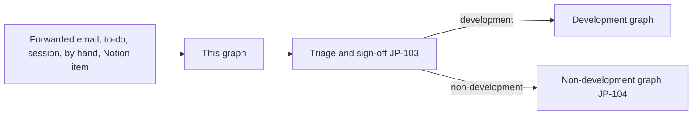
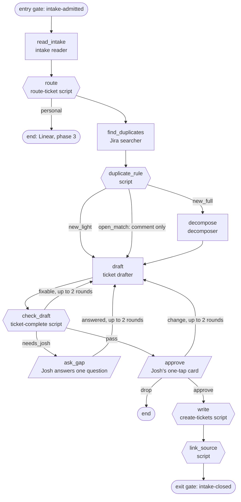

# Ticket creation graph: design

## Contents

- [Summary](#summary)
- [What is already decided](#what-is-already-decided)
- [Where tickets come from](#where-tickets-come-from)
- [The graph](#the-graph)
- [The parts](#the-parts)
- [The light path and the full path](#the-light-path-and-the-full-path)
- [Space, parent and no orphans](#space-parent-and-no-orphans)
- [The duplicate check](#the-duplicate-check)
- [What the agent may infer](#what-the-agent-may-infer)
- [The approval card](#the-approval-card)
- [How approval relaxes over time](#how-approval-relaxes-over-time)
- [Keeping tickets from piling up](#keeping-tickets-from-piling-up)
- [How to tell it's working](#how-to-tell-its-working)
- [What the graph hands to triage](#what-the-graph-hands-to-triage)
- [Patient data](#patient-data)
- [How every loop ends](#how-every-loop-ends)
- [Rules](#rules)
- [Acceptance criteria](#acceptance-criteria)
- [Out of scope](#out-of-scope)
- [Question for Josh](#question-for-josh)
- [Choices made while designing](#choices-made-while-designing)

Ticket JP-102. Builds in JP-121. Sources: Josh's notes (`docs/source-notes/jira-ticket-agent-context.md`), `conventions/tickets.md` and `conventions/registry.yaml` (JP-98), `graphs/CONVENTION.md` (JP-101), and `docs/vision-and-roadmap.md`. The draft graph is `graphs/flows/ticket-creation.yaml`; it passes `python3 graphs/tools/check_graph.py`.

## Summary

One loose input goes in: a forwarded email, a to-do, a session that has become ticket-sized work, or a ticket asked for by hand (and, a little later, a Notion action item). One complete ticket comes out, or a parent with its children, written in Josh's format and good enough for another agent to work without guessing.



On the way, a script picks the Jira space and the parent from the registry, an agent looks for a ticket that already covers the request, and Josh sees a one-tap card before anything is written. A small ask takes a short path: one ticket, three model calls. Tickets end in Not Started. A separate graph (triage and sign-off, JP-103) decides whether they are Ready.

## What is already decided

These are Josh's decisions from the question round of 15 November 2026, carried here unchanged.

| Decision | Where this design holds it |
| --- | --- |
| Everything with a deliverable becomes a ticket first, and no ticket is left without a parent. | [Where tickets come from](#where-tickets-come-from), [Space, parent and no orphans](#space-parent-and-no-orphans) |
| Josh approves the shape of a parent and its children before anything is created. | The `approve` step comes before `write`, and `write` runs only on Josh's yes. The checker enforces this. |
| The Jira space and the parent epic come from written rules in the registry. JP is used when nothing matches. | The `route` step is a script, `route-ticket`, which follows `conventions/tickets.md`, "Routing a ticket to a space and a parent". The card shows which rule decided. |
| On a duplicate, an open match gets a comment and the agent stops. A Done or Cancelled match gets a new ticket linked to the old one. | The `duplicate-rule` script. See [The duplicate check](#the-duplicate-check). |
| A new comment on a ticket notifies every session working on it. | The comment on an open match is how a repeat request reaches the session already on it. The notification itself is built outside this graph. |
| A separate agent signs a ticket off as Ready. | This graph never marks a ticket Ready and never sets Agent Status. |

## Where tickets come from

The graph is the one way new work becomes a ticket. Each source already exists in action-triage or in a planned ticket; the graph replaces the separate ways they file tickets today.

| Source | What exists today | Wave |
| --- | --- | --- |
| Forwarded email | The Email Research Desk files a JP ticket itself (action-triage A27). Its watcher will hand the email to this graph instead. | First |
| To-do | Quick capture (A5) writes a to-do; the console redesign already points it at a JP ticket. It hands the to-do to this graph. | First |
| Session | JP-110 offers a ticket when a session makes its first commit with no ticket. On "yes", the session hands its request to this graph. | First |
| By hand | Josh, or an agent at his request, asks for a ticket (action-triage's `ticket create` today, A4). | First |
| Notion action item | Meeting sync extracts action items (A1) and two cheap calls classify them (A2). | Second |

Notion items come second for one reason: they are the noisiest source. Every meeting yields several items, many of them not Josh's or not real work. They join once the first wave has run for a few weeks, and only items that action-triage's existing classification marks as Josh's and actionable go in. Until then they stay in action-triage's Calendar tab as they are.

action-triage's safe write path (A4: one create with every field, read back, and a search instead of a blind retry when Jira does not confirm) becomes the `create-tickets` script. Its classify and prefill prompts (A2) become the `intake-reader` role.

## The graph



Boxes are agent steps, hexagons are scripts and slanted boxes are where Josh is asked. Two more asks, `stuck` and `write_failed`, run only when a loop reaches its limit.

How the steps carry Josh's eight steps:

| Josh's step | Graph steps | Done by | Tier |
| --- | --- | --- | --- |
| 1. Intake and normalize | `read_intake` | intake reader | mid |
| 2. Classify by type and by system | `read_intake` proposes type, work kind and repository; `route` turns the repository into a space and parent | intake reader, then a script | mid, none |
| 3. Duplicate check | `find_duplicates`, then `duplicate_rule` | Jira searcher, then a script | cheap, none |
| 4. Decompose | `decompose` (full path only) | decomposer | gate |
| 5. Fill the template | `draft` | ticket drafter | mid |
| 6. Completeness check | `check_draft` | a script | none |
| 7. Escalate only when necessary | `ask_gap`, reached only from an observable gap | Josh | |
| 8. Write and link | `approve`, `write`, `link_source` | Josh, then two scripts | none |

Steps 1 and 2 share one model call: the reader classifies while it reads, which is what action-triage's prefill already does. The system itself is never a model's choice. The model names a repository only from the registry's list, and the script looks it up.

**The header.** Every step sits in one Jira stretch, Not Started, because the graph creates tickets in that status and never moves one. The entry gate `intake-admitted` admits an item that exists, is not dismissed and has no ticket key yet. The exit gate `intake-closed` passes when the item ended in one of three ways: its tickets exist and are linked from the source, the open match was commented on, or Josh dropped it. The ledger gets every field the convention offers, including the graph file's version and the model that answered. The `end_states` header scores each way a run can end (see [How to tell it's working](#how-to-tell-its-working)). Access is `read` everywhere except `write`, which is `shared` because AD and CI are team spaces, and `link_source`, which writes back to Josh's own to-do, desk thread or session record.

## The parts

| Kind | Name | What it does | New or shared |
| --- | --- | --- | --- |
| Role | `intake-reader` | Turns the input into an intake record: the request restated, type, work kind, weight, repository, search terms, gaps. Changes nothing. | New |
| Role | `jira-searcher` | Finds candidate tickets with search terms and synonyms, and says why each matches. Changes nothing. | New, shared with JP-104's earlier-answer lookup |
| Role | `decomposer` | Proposes one ticket, a parent with subtasks, or an epic with tickets. One pass, at most seven children. Changes nothing. | New |
| Role | `ticket-drafter` | Writes every ticket's sections into a proposal and lists what it could not fill as gaps. Changes nothing. | New, reused by JP-103 to revise a ticket sent back |
| Gate | `intake-admitted` | Entry gate. | New |
| Gate | `route-ticket` | The registry's routing rules. | New |
| Gate | `duplicate-rule` | Open match, or a new ticket on the light or full path. | New |
| Gate | `ticket-complete` | The triage graph's per-type Ready checklist, plus three creation checks: a parent or an area, no unclear type, and the patient-data scan. | New; imports JP-103's checklist |
| Gate | `create-tickets` | Writes exactly what Josh approved, reads every ticket back. | New; from action-triage A4 |
| Gate | `link-source` | Writes the key back to the to-do, desk thread or session. | New |
| Gate | `intake-closed` | Exit gate. | New |
| Contract | `intake-record` | `graphs/contracts/intake-record.md` | New |
| Contract | `ticket-proposal` | `graphs/contracts/ticket-proposal.md` | New |

The gate scripts are stubs that refuse to run until JP-121 builds them. The patient-data scan is a helper both this graph and JP-103 import, `graphs/gates/lib/patient_data.py`, built in JP-121.

No model writes to Jira. The drafter writes a proposal; the `create-tickets` script writes the tickets. That keeps "scripts decide and models judge" and means the text Josh approves is exactly the text that lands.

## The light path and the full path

The intake reader judges the weight. `light` means one small deliverable, such as "find a file and email it" or "add a flag to a script". Everything else is `full`.

| | Light | Full |
| --- | --- | --- |
| Decompose | Skipped: always one ticket | One pass by the decomposer |
| Model calls | 3 (read, search, draft) | 4 |
| Ticket text | Every required section, short: one or two scope bullets, one Gherkin scenario | Every required section in full |
| Card | One line per section that matters | The shape, then each ticket in one line |

A light ticket is still a complete ticket. It passes the same Ready checklist; it is short, not partial.

## Space, parent and no orphans

`route-ticket` follows `conventions/tickets.md` exactly, with no model:

1. A space or ticket key Josh named wins.
2. Otherwise the repository the work changes is looked up in the registry; with no repository, the folder.
3. A match gives the space, the default epic (or none) and the system, whose area and priority come with it. The repository's name is the label.
4. No match: JP, no parent, no area. The item is marked `unmatched`.
5. A personal system (one tracked in Linear) ends the run. Personal work is designed in phase 3.

Every ticket must have a parent epic, or be tied to an area through its system label. Every system the registry routes to Jira has an area, so a matched ticket always has a home. An unmatched one does not, so `ticket-complete` sends it to Josh as a one-sentence question: "Which epic or area does this belong to? Suggested: …", with up to three open epics in JP and the area that the request's words point to. The agent never picks one quietly.

Children live in their parent's space, because Jira links parents only inside a team-managed space. A child that changes a repository routed to another space becomes its own ticket there, linked with Relates, or Blocks for a real dependency.

Branches follow `conventions/tickets.md`: subtasks commit to the parent's branch, and an epic's tickets get one branch each unless its **Branch strategy** says one shared branch. The decomposer proposes the strategy and the card shows it, so Josh decides branch grouping when he approves the shape.

## The duplicate check

The Jira searcher runs on the cheap tier, as Josh decided. It searches JP, AD and CI, open and closed, starting with the routed system's space, using the intake record's search terms and synonyms rather than only the input's own words. It returns up to ten candidates, each with its status and the words that match, and it judges only "does this ask for the same deliverable".

`duplicate-rule` then applies Josh's rule with no model:

- **An open match** (any status but Done or Cancelled): the proposal becomes one comment on that ticket, and the run stops after it. The comment reads:
  > Another request for this came in from {source} on {date}: "{request restated}". Ticket creation found this ticket open, so it added this comment instead of a new ticket. Source: {source_ref}.
- **A Done or Cancelled match**: a new ticket, linked to the old one with Relates, with the old key in **Parent or related**.
- **No match**: a new ticket on the light or the full path.

The open-match comment still goes through the approval card, because at first every write does (see [Question for Josh](#question-for-josh)). The searcher's misses are counted: when Josh drops a new ticket at the card as a duplicate, or cancels one later as a duplicate, the ledger records a miss against the searcher. Josh's notes set the rule for those numbers: if the cheap tier misses matches, this one step moves to mid.

## What the agent may infer

**The rule.** A value is safe to infer when a wrong guess is cheap and visible: it shows on the approval card marked "inferred", and the triage graph checks it before any work starts. A value is never inferred when a wrong guess sends the work to the wrong place or changes what done means: the space, the parent, the repository, the deliverable, and how a bug shows itself. Those come from the input, from a script, or from Josh.

| Field | Rule | When it cannot be filled |
| --- | --- | --- |
| Summary | Inferred from the request | |
| Type (Story, Task, Bug, Research, Epic) | Inferred | Unclear: ask |
| Work kind (code, doc, research, email, meeting, misc) | Inferred | Unclear: ask |
| Goal | Inferred from the request and the deliverable | |
| First step | Inferred: the first file or source to read | |
| Why | Copied; if the input gives no reason, "Josh asked for this ({source})" | |
| In scope, Not in scope | Inferred from the request; Not in scope names at least one nearby thing left out | |
| Acceptance criteria | Inferred from the deliverable | The deliverable itself is unresolved: ask what done looks like |
| Repository | From the registry list only, copied or matched; never a similar name | Code work with no repository: ask |
| Where it runs | "Cloud session" unless the input names something only on the laptop, then the laptop and why | |
| Parent or related | The routing script and the duplicate check | Unmatched: ask (see above) |
| Decisions already made | Copied only, never inferred | Left empty |
| Bug: steps to reproduce, expected and actual | Copied only | Missing: ask |
| Bug: environment, affected system | Inferred from the system | |
| Research: question | Copied or restated | |
| Research: sources | Inferred from the system's registry entry (repository, databases, docs) | |
| Research: deliverable format | Copied; else inferred from the work kind (an answer is an email reply, a document is a Markdown file) | |
| Epic: phases, done when, branch strategy | Proposed by the decomposer | |
| Space, labels, area, priority bucket | The routing script | |
| A deadline | Copied into **Why** when the input states one; never set as a Jira date | |
| Points, assignee, dates, Jira priority, Agent Status | Never set | |

"Ask" always means one sentence Josh can answer, through `ask_gap`. Every inferred value is listed on the card, so Josh can see what was guessed without opening the ticket.

## The approval card

The card is a question in the Needs you tab, the one queue for agent questions. The tab already shows a question, its choices and a box for a typed answer, so the card needs no new screen; this section is its exact text. There is no ticket yet, so there is no Jira flag. The run waits; every other run carries on.

**One ticket.**

```text
New ticket from a to-do: Add a dry-run flag to the laptop install script

Create in JP under JP-94 (josh-360, by its repository)
Story · code · light · runs in a cloud session (inferred)
Goal: laptop/install.py --dry-run prints every step it would take and changes nothing.
1 scenario. Inferred: first step, where it runs.
Duplicates: none (searched JP, AD, CI for "dry run", "install preview", "install.py flag").
Full text: <link to the proposal>

[Approve]  [Change]  [Drop]      or type what to change
```

**A parent with children.**

```text
New tickets from an email: Move the survey export to the new pipeline

Create in AD: 1 epic and 3 tickets (survey-services, by its repository; area: Clinical application platform)
Epic: Move the survey export to the new pipeline. Done when: the old export job is off.
Branch strategy: one branch per ticket.
  1. Task: Build the new export step. Delivers the export.
  2. Task: Backfill the last 90 days. Delivers the history. Blocked by 1.
  3. Task: Switch off the old job. Delivers the switch-off. Blocked by 2.
Related: AD-123 (Done), linked with Relates.
Inferred: the epic's done when, branch strategy.
Full text: <link to the proposal>

[Approve]  [Change]  [Drop]      or type what to change
```

**An open match.**

```text
Already open: AD-412, "Survey export misses Saturday rows" (In Progress)

Add a comment to AD-412 with this request, and stop?
Matched on "survey export", "missing rows".

[Approve]  [Change]  [Drop]      or type what to change
```

Change sends Josh's words to the drafter, which changes only what he asked and comes back with a new card, up to two times. Drop ends the run and leaves the source item as it was.

## How approval relaxes over time

The vision's decision memory moves each category of question through three stages, and only Josh moves a category. For the approval card, a category is: the system, the ticket type, the shape (single, parent with subtasks, epic with tickets), and the action (create or comment). Lookup is exact.

| Stage | What Josh sees |
| --- | --- |
| 1. Ask and record | The cards above, for every input. Each answer is recorded with its category. |
| 2. Suggest and confirm | The same card, headed "Suggested: approve, as you did for {decision} on {date} ({category})". One tap confirms. |
| 3. Answer and show | No card. The tickets are written, and each gets a comment: "Created without asking, under decision {decision} ({category}). Cancel this ticket to overrule it." The Needs you tab lists the run under "answered from memory" until Josh has seen it. |

The four safety rules of decision memory apply as written: an answer from memory quotes its decision or a script drops it; cancelling a ticket created at stage 3 marks the decision superseded and drops the category back a stage; a card Josh answers when a usable precedent existed is a miss; and an answer he gives several times becomes a written rule.

Suggested ceiling (Josh moves categories, so this is advice): single tickets in JP can reach stage 3; shapes with children, and every write to AD or CI, stay at stage 2 until he says otherwise, because those are the cases where a wrong guess is seen by other people or multiplies.

## Keeping tickets from piling up

| Risk | Control |
| --- | --- |
| The same item filed twice | The entry gate refuses an item that already carries a ticket key, and `link-source` writes the key back the moment tickets exist. |
| A duplicate of existing work | Find before filing, with synonyms; an open match is a comment, not a ticket. Misses are counted. |
| A request split into too many tickets | The light path never splits. The decomposer makes one pass, at most seven children, and stops; Josh approves the shape. |
| Orphans | `ticket-complete` refuses a ticket with no parent and no area, so it reaches Josh as a question. |
| A noisy source | Notion items come in the second wave, filtered. A source whose cards Josh drops more often than he approves is a finding for the weekly review. |
| Tickets that never become work | The ledger records every created ticket and when it reached Ready. A ticket the graph created that is still not Ready after 14 days goes to the weekly review as a candidate to cancel. Josh cancels; nothing is deleted. |
| Volume Josh cannot see | At stage 1 every ticket crosses his card, and dropping one is a tap. |

The counts this graph gives the ledger: tickets created per source per week, cards approved, changed and dropped, searcher misses, and days from creation to Ready.

## How to tell it's working

Every number comes from the ledger rows the walker writes for each step (the run, the step, its outcome, its loop count, its tier and the session), joined to the session facts (cost, model) and to later runs on the same ticket in the triage and pipeline graphs. No model call is needed to work out any of them.

| Question | Measure | Good direction |
| --- | --- | --- |
| Do the tickets hold up? (effective) | Share of created tickets that triage sends back, or that a pipeline later returns to triage | Down |
| Does Josh get the ticket he would have written? (effective) | Share of approval cards approved as they are, rather than changed or dropped | Up |
| Are duplicates caught? (effective) | Searcher misses per 10 tickets created: tickets Josh drops at the card, or cancels later, as duplicates | Down |
| Does it spare Josh? (effective) | Share of runs that reach `ask_gap` or `stuck` (asks beyond the card), and how long a run waits on him | Down |
| What does a ticket cost? (efficient) | Model cost per created ticket, and `draft` runs per run (1 is the target, 3 the cap) | Down |

How each run ends, as the graph file's `end_states` header scores it (`graphs/CONVENTION.md`, "Scoring a run"):

| End | Score | When |
| --- | --- | --- |
| `finished` | success | The tickets were created and linked from the source, or the open match was commented on. |
| `route.personal` | neutral | Personal work, which waits for phase 3. |
| `ask_gap.drop`, `approve.drop` | neutral | Josh dropped the item. Drops are counted per source, so a source whose items he mostly drops shows up in the weekly review. |
| `stuck.drop` | needs-josh | Josh dropped it only after the drafting limit was reached. |
| `exit_refused` | needs-josh | The exit gate found a ticket missing or unlinked. The name is reserved for every graph. |

A run can also need Josh and still finish: one that reached `stuck` and went on, or one whose write Jira did not confirm (`write_failed`). Those are counted from the step rows, not from the end score. If Josh finishes the missing tickets by hand the exit gate passes; if not, the run ends as `exit_refused`.

To compare the graph before and after a change, each run records the version of the graph file it ran (`graph_version`), and each step records the model that actually answered (`model`). The convention gained both ledger fields in JP-140, and this graph's header lists them.

## What the graph hands to triage

Agreed with the JP-103 and JP-104 design threads.

- Tickets end in Not Started. The graph never marks one Ready and never sets Agent Status (action-triage's create path sets Queued in the same write; this graph's script does not).
- Each ticket has Josh's format for its type, a repository label, a parent epic or an area, and the `action-triage.spec` issue property with `type` set to the work kind, which the triage graph routes on.
- `create-tickets` writes the issue property `josh360.authors`: the session ids of the steps that wrote the ticket. Triage's sign-off check uses it so that no author signs off its own ticket.
- The graph's output `ticket_keys` lists the new keys, parent first; each key starts one triage run. Triage treats a parent as Ready only when its children are.
- When triage sends a ticket back, it reuses the `ticket-drafter` role with the defect list as its brief, and its own script applies the revision.

## Patient data

The intake record and the proposal refer to the source by pointer, never by quoting it. When the input holds patient data, the reader sets `contains_patient_data` and writes only "see source". `ticket-complete` runs the patient-data scan on every ticket's text: the structural check (no quoted source text, the same verbatim-chunk rule action-triage's PHI guard uses on issue bodies today) plus the flag. A ticket that fails goes back to the drafter; it never reaches the card.

## How every loop ends

Josh wants no loop that runs forever, and no model step that runs more often than it needs to. Three places can hide a loop. The rules for all three are shared with the other graphs and set out in the triage design (`docs/superpowers/specs/2026-11-16-triage-graph-design.md`, "How every loop ends", JP-103). This section applies them to this graph.

**1. Loops inside one run.** Every loop has a limit that ends at Josh. Each loop's counter belongs to its arrow and never resets during a run.

| Loop | Limit | At the limit |
| --- | --- | --- |
| The check finds a section the drafter can fill: `check_draft` back to `draft` | 2 | `stuck` |
| Josh answered a gap: `ask_gap` back to `draft` | 2 | `stuck` |
| Josh asked for a change on the card: `approve` back to `draft` | 2 | `approve` again |
| Josh chose one more round: `stuck` back to `draft` | 1 | `stuck` again, so Josh decides every extra round |
| Jira did not confirm every ticket: `write` back to `write` | 1 | `write_failed` |

**A cap for each model tier (Josh, 16 November).** No role step runs more times in one run than its tier allows: `cheap` (Haiku) 5, `mid` (Sonnet) 3, `gate` (Opus) 2. The count goes by tier, not by the model that answered, and the walker counts every run of a step, whichever loop caused it. When the next run would pass the cap, the run goes to that loop's `at_limit` ask, and each yes from Josh allows one more run. The caps live in `graphs/tiers.yaml` as `max_runs` (JP-139).

| Role step | Tier and cap | Runs in this graph |
| --- | --- | --- |
| `read_intake` | mid, 3 | Once. No loop goes back to it. |
| `find_duplicates` | cheap, 5 | Once. |
| `decompose` | gate, 2 | Once, on the full path only. When Josh changes the shape on the card, the drafter applies his words; the decomposer does not run again. |
| `draft` | mid, 3 | Once, plus at most two more from all three loops together. Every loop back to `draft` has a limit of 2, so each one fits the cap on its own (2 + 1 = 3), as the checker will require. Together, the walker stops the fourth run and asks Josh. |

So a run that never reaches Josh makes at most six model calls: read once, search once, decompose once, draft three times. The light path makes at most five. The two scripts that can repeat, `ticket-complete` and `create-tickets`, use no model.

**2. Loops between runs.** Each run starts with fresh counters, so these need rules of their own:

- **One run per item.** The entry gate refuses an item that already carries a ticket key, or that has a run still open.
- **The graph never starts itself.** Its inputs are intake items (an email, a to-do, a session's request, a Notion item), never a Jira edit or comment. The comment on an open match and the tickets it creates carry `josh360.authors`, so no other graph mistakes them for a person's input either.
- **A dropped item is not picked up again.** Each source hands an item to the graph once. Drop leaves the item where it was, and only Josh starting it again by hand runs it a second time.

**3. Loops inside a step.** The binding gives every role step a turn cap and a time cap and treats hitting either as a stop that goes to Josh (JP-117). A gate script that crashes or prints no outcome stops the run, and the walker does not retry it. `partial` from `create-tickets` is not a crash. It is a declared outcome with one safe retry, because the script searches for each ticket before it creates one.

## Rules

1. Every new piece of work with a deliverable enters Jira through this graph.
2. The space, parent, area and labels come from the registry through `route-ticket`, never from a model. The model names a repository only from the registry's list.
3. No model writes to Jira. `create-tickets` writes exactly the proposal Josh approved.
4. Nothing is written before Josh's yes on the approval card, at stage 1 for every input.
5. An open match gets one comment and the run stops. A Done or Cancelled match gets a new ticket linked to it with Relates.
6. A ticket has a parent epic or an area, or it is not created.
7. The light path makes exactly one ticket. The decomposer makes one pass and at most seven children.
8. Values in [What the agent may infer](#what-the-agent-may-infer) marked "copied only" or "ask" are never guessed. Every inferred value is shown on the card.
9. The graph never sets points, assignees, dates, Jira priority or Agent Status, and never marks a ticket Ready.
10. No patient data in the record, the proposal or any ticket. Sources are named by pointer.
11. Every loop has a limit that ends at Josh, and no role step runs more than its tier's cap in one run (cheap 5, mid 3, gate 2). See [How every loop ends](#how-every-loop-ends).
12. Every created ticket is read back, and the key is written back to the source item.

## Acceptance criteria

Copied to JP-121 when this design is approved.

```gherkin
Feature: Ticket creation

  @auto
  Scenario: A light request becomes one ticket
    Given a to-do asking for one small change in josh-360
    When the graph runs and Josh approves the card
    Then exactly one ticket exists in JP under JP-94, in Not Started
    And it has every required section for its type

  @auto
  Scenario: Nothing is written before approval
    Given a proposal for an epic with three tickets
    When Josh has not answered the card
    Then no ticket and no comment has been written

  @auto
  Scenario: An open duplicate gets a comment
    Given an open ticket the searcher calls a match
    When Josh approves the card
    Then that ticket gets one comment naming the source
    And no new ticket is created

  @auto
  Scenario: A finished duplicate gets a linked ticket
    Given a Done ticket the searcher calls a match
    When Josh approves the card
    Then a new ticket exists linked to the Done ticket with Relates

  @auto
  Scenario: No rule matches
    Given a request for a repository the registry does not list
    When the graph routes it
    Then the space is JP
    And Josh is asked which epic or area it belongs to before the card

  @auto
  Scenario: The model does not pick the system
    Given the reader names a repository not in the registry
    When the graph routes it
    Then the request is treated as unmatched

  @auto
  Scenario: No ticket is an orphan
    Given any ticket the graph creates
    Then it has a parent epic, or a label whose registry system has an area

  @auto
  Scenario: The same item is not filed twice
    Given a to-do that already carries a ticket key
    When the graph is started on it
    Then the entry gate refuses it

  @auto
  Scenario: Created tickets are not Ready
    Given any ticket the graph creates
    Then its status is Not Started and it has no Agent Status

  @auto
  Scenario: Authors are recorded
    Given any ticket the graph creates
    Then its josh360.authors property lists the sessions that read, decomposed and drafted it

  @auto
  Scenario: Patient data stays out
    Given an email whose text holds patient details
    When the graph drafts a ticket from it
    Then no sentence of the email appears in the ticket
```

And for this design ticket (JP-102):

```gherkin
Feature: The ticket creation design

  @manual
  Scenario: The settled behaviour is carried unchanged
    Given this design
    Then it states shape approval, the registry rules and the duplicate rule as Josh decided them

  @auto
  Scenario: The draft graph passes the checker
    Given graphs/flows/ticket-creation.yaml
    When python3 graphs/tools/check_graph.py runs
    Then it exits 0

  @manual
  Scenario: No ticket is an orphan
    Given any path through the design that creates a ticket
    Then that ticket has a parent epic, or is tied to an area

  @manual
  Scenario: The open questions are closed
    Given the four questions JP-102 must answer
    Then each has an answer in this design, or Josh's recorded answer to one question that carried a recommendation
```

The four questions are answered in [What the agent may infer](#what-the-agent-may-infer), [The approval card](#the-approval-card), [How approval relaxes over time](#how-approval-relaxes-over-time) and [Keeping tickets from piling up](#keeping-tickets-from-piling-up).

## Out of scope

- Building the graph (JP-121), the walker (JP-114) and the Agent Manager binding.
- Marking tickets Ready and routing them to a pipeline (JP-103).
- Linear tickets for personal work (phase 3).
- TECH initiatives: the graph never creates one and never files in TECH.
- How the notification of sessions on a commented ticket is built.
- Changing the Email Research Desk, quick capture or JP-110's offer; each hands its item to this graph when JP-121 lands.

## Question for Josh

One question, for the JP-106 sitting. The design works on the recommended option until Josh answers.

**Which new tickets should come to Josh on the approval card?**

A ticket in AD or CI appears on a team board, so the graph convention counts it as a write to something shared, which needs Josh's yes. The convention's checker also requires the approving question to run on every path, not only some.

| Option | What happens | Risk |
| --- | --- | --- |
| **1. Every input gets one card at first (recommended).** | One tap per input, whatever the space. The card relaxes by category through the three stages of decision memory. | More taps in the first weeks. Works with the checker as built. |
| 2. Only parents with children, and AD or CI tickets. | Single JP tickets are written without a card. | Needs a change to the checker's shared-write rule, so an approval can be skipped when nothing shared follows. |
| 3. Only parents with children. | Single tickets Josh files in AD or CI count as his own write. | Loosens the shared-write rule for team boards. |

Recommendation: option 1. It keeps the shared-write rule as Josh set it, needs no change to the checker, and the extra taps shrink by themselves once Josh moves categories to stage 2 and 3. Josh can also answer in his own words.

## Choices made while designing

These can be undone, so they were taken without asking and recorded in `docs/decisions.md`.

| Choice | Option taken | How to undo |
| --- | --- | --- |
| Where the draft graph lives | `graphs/flows/ticket-creation.yaml`, as JP-101's convention requires, not `graphs/ticket-creation/graph.yaml` as JP-102 says. The checker reads only `flows/`. | Move it, and change the checker. |
| Where the design lives | `docs/design/ticket-creation-graph.md`, the path JP-102 and JP-121 name, instead of a second copy under `docs/superpowers/specs/`. | Move it and update JP-121. |
| A board for the card | None: the card is a question in the existing Needs you tab, which already shows a question, choices and a typed answer. Its exact text is in this design. | Draw a board in `docs/design/views/approval-card/`. |
| Which sources come first | Email, to-do, session and by hand; Notion items second, filtered. | Add `notion` to the entry gate's first wave. |
| Who writes to Jira | A script, `create-tickets`, from the approved proposal; no role may write Jira. | Add a writer role with `may_change: true`. |
| Steps 1 and 2 of Josh's notes | One model call reads and classifies. | Split `read_intake` into two role steps. |
| Unmatched items | Josh is asked for an epic or area, with suggestions, before the card. | Let the card carry the question instead. |
| Gate stubs | The draft's gate scripts exist and refuse to run ("not built yet"), so the checker can pass and nothing passes through them by accident. | Delete the stubs and the draft graph. |
| Staleness | A created ticket not Ready after 14 days is a weekly-review candidate to cancel. | Change the number, or drop the rule. |
