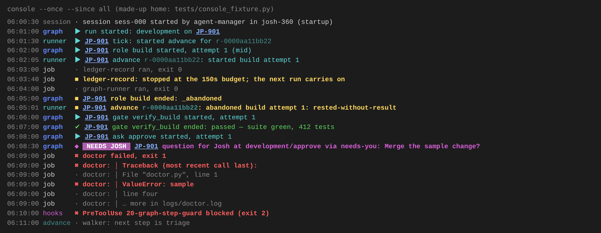
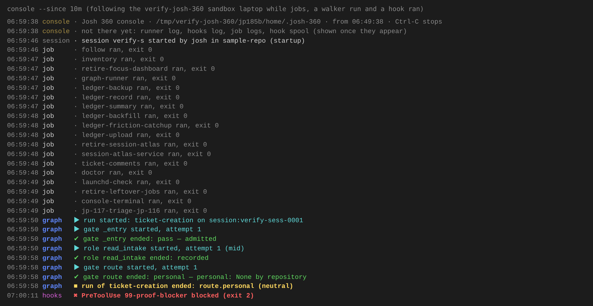

# JP-185 proof: the live console

## Contents

- [What was proved](#what-was-proved)
- [What it looks like](#what-it-looks-like)
- [Scenarios](#scenarios)
- [Sandbox laptop run](#sandbox-laptop-run)
- [Laptop check](#laptop-check)
- [Not proved here](#not-proved-here)

## What was proved

`scripts/console.py` shows what Josh 360 is doing in one colored stream: graph runs and steps from the ledger, the runner's logs, every job's log, hook blocks and failures, and sessions starting and ending. It follows new lines and new files while it runs. The `console-terminal` job keeps one Agent Manager terminal named `console` running it, and does nothing when it cannot tell whether one is already there. Made-up data only. Run on 20 November 2026 in a cloud session.

## What it looks like

Every kind of line, from the made-up home in `tests/console_fixture.py` (`console-01-colors.png`). Red is an error or a failed exit, yellow a stop or an abandon, the magenta badge a question for Josh, cyan a start, green a clean end, dim the routine. Ticket keys are underlined blue; run ids are dim cyan.

The console following the sandbox laptop while the real job runner, a walker run and a hook ran (`console-02-live-sandbox.png`, plain text in `console-02-live-sandbox.txt`). Clean job runs are one dim line each; their routine output stays in their own log.

## Scenarios

Unit test output: [`unit-tests.txt`](unit-tests.txt) (`python3 -m unittest -v tests.test_console tests.test_console_terminal_job`, 23 tests, all ok).

| Scenario | Proof |
| --- | --- |
| Activity from every source shows in one stream | `test_console.OneStream.test_every_source_in_time_order` (session, graph, runner, job, hooks and advance lines, in time order); `test_runner_lines_get_the_run_ticket`; the sandbox run below. |
| Important lines stand out | `test_important_lines_stand_out` (failed job and hook block red, abandoned step yellow, the NEEDS JOSH badge, green clean end, cyan start, highlighted ticket key); `console-01-colors.png`. |
| No color when asked or when piped | `test_no_color`, `test_no_color_when_piped`. |
| New lines and new run logs appear while it follows | `test_console.Following.test_new_lines_and_new_run_logs_show`, `test_replaced_log_is_read_from_its_start`; the sandbox run, where every line after the banner arrived while the console was following. |
| A missing or unreadable source does not stop the console | `test_console.MissingSources` (named once, the rest still shows; a damaged ledger costs only its lines). |
| The job keeps one console terminal alive | `test_console_terminal_job.JobCase.test_creates_one_terminal_and_sends_the_console`, `test_fresh_heartbeat_means_no_agent_manager_call`, `test_listed_terminal_with_a_stale_heartbeat_gets_the_command_again`, `test_adopts_a_terminal_named_console`, `test_gone_terminal_is_replaced`. |
| The job never opens a second terminal on an unknown answer | `test_unreadable_list_creates_nothing` (a failed call, non-JSON, an entry with no id), `test_no_agent_manager_is_a_report_not_a_crash`; in the sandbox the job reported `unknown` (no agent-manager there) and created nothing. |
| The off switch stops the job | `test_off_switch`. |
| Josh opens the console on the laptop (`@manual`) | Owed: see [Laptop check](#laptop-check). |

## Sandbox laptop run

The `verify-josh-360` sandbox, run `jp185b`, installed this branch and its doctor passed. The console was started in follow mode (`--color --since 10m`) before anything ran; each file in [`verify-josh-360/`](verify-josh-360/) is one step it then watched.

| Step | File | What the console showed |
| --- | --- | --- |
| Install and doctor | `launch-install.json`, `doctor.json` | (before the console started) |
| A session starts | `seed-verify-sess-0001.json`, `session-start.json` | `session verify-s started by josh in sample-repo (startup)` from the hook spool |
| One job runner pass | `run-jobs.json` | one `<job> ran, exit 0` line for each of the 18 jobs, including `console-terminal` |
| A walker run from intake | `walker-submit.json`, `walker-next-1.json`, `walker-record.json`, `walker-next-2.json` | run started, entry gate passed, `read_intake` started and recorded, the `route` gate's note, the run's neutral end, all from the ledger |
| A hook blocks | `hook-block.json` | `PreToolUse 99-proof-blocker blocked (exit 2)` in red, from `hooks.log` (a throwaway hook added to the sandbox's copy only, and removed after) |

The walker's refused start (`walker-refuse.json`) shows nothing: the walker prints a refusal and writes no log line or ledger row for it, and the console only shows what is written.

## Laptop check

Within about 10 minutes of the merge, the laptop's `follow` job installs it, and the next job pass runs `console-terminal`.

1. From the cloud: `python3 laptop/status.py show console-terminal`. Good: `"status": "started"`, then `"running"` with `"heartbeat_fresh": 1` on later passes. `unknown` or `failed` carries a `reason`; for example, Agent Manager refusing `terminal create` from a job.
2. In Agent Manager, open the `josh-360` group. There is one terminal named `console`, showing the last 30 minutes of activity in color. If the name did not apply, the console's first line ends `not renamed (...)` and says why.
3. If the job cannot open the terminal, open any Agent Manager terminal and run `python3 ~/.josh-360/repo/scripts/console.py --heartbeat --name console`. The job adopts a terminal named `console`.
4. To stop the keep-alive: `touch ~/.josh-360/state/console-off`. To run it in any other window: `python3 ~/.josh-360/repo/scripts/console.py`.

## Not proved here

- `agent-manager terminal create`, `send`, `list --json` and `rename` against the real Agent Manager: the cloud has none. The tests use a fake that answers in the shape the sprint skill's own code reads (`id` from `terminal create --json`). The list's field names (`id` or `terminal_id`, `name` or `title`) are read loosely; a shape the job cannot read makes it report `unknown` and change nothing.
- Whether a launchd job may run `terminal create`. If Agent Manager refuses it outside one of its panes, step 3 of the laptop check is the way to start it, and the job then keeps it alive.
- The colors in Josh's real terminal theme. The screenshots use a plain dark theme.
