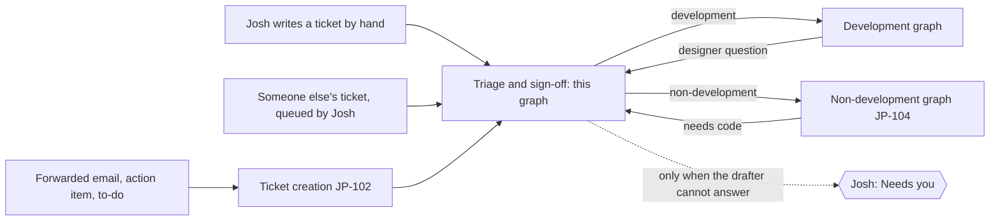
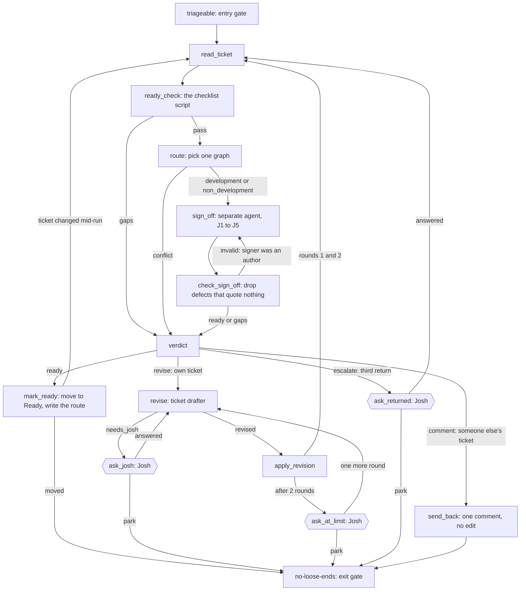

# Triage and sign-off graph: design

## Contents

- [Summary](#summary)
- [The flow at a glance](#the-flow-at-a-glance)
- [Where triage sits](#where-triage-sits)
- [Who may start a run](#who-may-start-a-run)
- [The steps](#the-steps)
- [The Ready checklist](#the-ready-checklist)
- [What the sign-off agent judges](#what-the-sign-off-agent-judges)
- [An author never signs off its own ticket](#an-author-never-signs-off-its-own-ticket)
- [Routing to exactly one graph](#routing-to-exactly-one-graph)
- [Sending a ticket back](#sending-a-ticket-back)
- [Tickets that come back from another graph](#tickets-that-come-back-from-another-graph)
- [The three gaps, closed here](#the-three-gaps-closed-here)
- [How every loop ends](#how-every-loop-ends)
- [Exact copy](#exact-copy)
- [Rules](#rules)
- [Acceptance criteria](#acceptance-criteria)
- [What other tickets build from this](#what-other-tickets-build-from-this)
- [Out of scope](#out-of-scope)
- [Questions for the JP-106 sitting](#questions-for-the-jp-106-sitting)
- [Choices made by default](#choices-made-by-default)

Ticket: JP-103 (Research). Builds in: JP-122. Draft graph: `graphs/flows/triage.yaml`, which passes `python3 graphs/tools/check_graph.py`. There is no screen, so there are no boards.

## Summary

Triage takes one drafted ticket in Not Started and ends in one of three ways:

1. **Ready.** The ticket passed every check. It moves to Ready, and its route is written on it: exactly one graph (development or non-development) and the system that graph uses to pick its agents.
2. **Sent back.** If Josh's own agents wrote the ticket, the ticket drafter fixes the gaps and the checks run again, up to two rounds. If someone else wrote it, its author gets one comment listing the gaps, and triage never edits it.
3. **One question for Josh.** This happens only for his own tickets, and only when the drafter cannot close a gap by quoting a source.

Scripts do most of the work: the Ready checklist, the routing, the defect filter and the only status move. A model judges five things a script cannot, and the model that judges never wrote the ticket. Triage needs no worktree and changes no repository, so nothing it produces can be lost at cleanup.

## The flow at a glance

Where triage sits among the four graphs. The hexagon is where Josh is asked.



The steps inside triage. Hexagons are where Josh is asked; every other box is a script or an agent.



## Where triage sits

| From | What arrives | Triage's input `reason` |
| --- | --- | --- |
| Ticket creation (JP-102) | A ticket in Not Started, in Josh's format, with the `josh360.authors` property (session ids of the steps that wrote it) and an `action-triage.spec` with a work kind | `new` |
| Josh, by hand in Jira | A ticket in Not Started | `new` |
| Someone else, handed in by Josh | A ticket in Not Started that Josh's account has queued | `new` |
| The development graph's designer (JP-115) | Its question, written on the ticket as an open question; ticket moved back to Not Started | `returned` |
| The non-development graph (JP-104) | A ticket it found needs code, with the reason written on the ticket; ticket moved back to Not Started | `returned` |
| The author, after a send-back | An edited ticket | `edited` |

Every reason takes the same path through the graph. A returned ticket now has an open question, so the Ready checklist fails it and the usual send-back handles it. Nothing special is needed.

| To | What leaves |
| --- | --- |
| The development graph | A Ready ticket whose route record says `development` |
| The non-development graph | A Ready ticket whose route record says `non-development` |
| Josh's Needs you queue | One question, only through the two ask steps |
| The ticket's author | One comment listing the gaps (someone else's ticket) |

Ready is not started. A Ready ticket waits for Josh to queue it, because prioritising stays with Josh. Two kinds of ticket are already queued and start when Ready: someone else's ticket that Josh handed in, and a returned ticket, which resumes the run that sent it back.

## Who may start a run

The entry gate `triageable` admits a ticket only when all of these hold:

1. Its type is Story, Task, Bug or Research. Epics never enter triage. A Subtask is checked inside its parent's run.
2. Its status is Not Started.
3. No other triage run is open on it.
4. Either it was created by an allowed account (an **own** ticket), or the latest change of its Agent Status to Queued was made by an allowed account (**someone else's** ticket that Josh handed in).

The allowed accounts are the ones action-triage's start gate already uses: `ACTION_AGENT_JIRA_ALLOWED_ACCOUNTS`, else Josh's own account. Josh's agents write to Jira with his account, so a ticket they create counts as his. This is the default answer to Question 1 below.

## The steps

| Step | Kind | Tier | Access | What it does |
| --- | --- | --- | --- | --- |
| `read_ticket` | gate `ticket-facts` | none | read | Reads the ticket, its changelog and properties. Returns its type, whether it is own or someone else's, its authors, and its version (a hash of summary, description, type, labels and links). It never returns priority. |
| `ready_check` | gate `ready-check` | none | read | Runs [the Ready checklist](#the-ready-checklist). `pass` or `gaps`. |
| `route` | gate `route` | none | read | Runs only on `pass`. Applies [the routing table](#routing-to-exactly-one-graph). `development`, `non_development` or `conflict`. |
| `sign_off` | role `sign-off` | mid | read | Runs only when a route was found. Judges [J1 to J5](#what-the-sign-off-agent-judges). `ready` or `defects`. |
| `check_sign_off` | gate `check-sign-off` | none | read | Drops any defect that does not name a J item and quote the ticket. Refuses the verdict (`invalid`) if the signing session is an author or the ticket changed while being judged. `invalid` gets one fresh sign-off session. |
| `verdict` | gate `triage-verdict` | none | read | Combines the results. `ready`; `revise` (own ticket with gaps); `comment` (someone else's ticket with gaps). Returns the numbered gaps. |
| `revise` | role `ticket-drafter` | mid | read | Own ticket only. Writes a revised ticket proposal that closes the numbered gaps and nothing else. Returns `needs_josh` with one question if a gap needs an answer it cannot quote from a source. |
| `apply_revision` | gate `apply-revision` | none | josh | Writes the proposal to the ticket in place, adds the drafter's session to `josh360.authors`, and comments the round. Then the run goes back to `read_ticket`. |
| `ask_josh` | ask | none | read | One question in Needs you, with the Jira flag. `answered` sends the answer to the drafter, which writes it into Decisions already made. `park` ends the run. |
| `ask_returned` | ask | none | read | A ticket came back from another graph a third time (rule 10). `answered` resets the return count and runs the checks again; `park` ends the run. |
| `ask_at_limit` | ask, at a loop limit only | none | read | The rounds ran out. `one_more_round` or `park`. |
| `send_back` | gate `send-back` | none | josh | Someone else's ticket only. Posts one comment listing the gaps. Ends the run. |
| `mark_ready` | gate `mark-ready` | none | josh | Checks that the ticket version still equals the signed-off version, writes the route record, moves the ticket to Ready and comments. A changed ticket goes back to `read_ticket`. |

Header: Jira stretch "Not Started" for every step but `mark_ready`, which is the only status move; entry gate `triageable`; exit gate `no-loose-ends` (shared, built in JP-109; for triage it confirms that the run's comment is on the ticket and its status matches the outcome); `asks_josh` is `ask_josh`, `ask_returned` and `ask_at_limit`; the ledger takes all nine fields.

## The Ready checklist

A script, `ready-check`, runs these items. Each failure names its item, the section, what was found and what would pass (`graphs/contracts/ready-checklist.md`). Ticket creation's `ticket-complete` gate runs the same list, so a drafted ticket rarely bounces.

**Every type (Story, Task, Bug, Research):**

| Id | The check |
| --- | --- |
| C1 | The type is Story, Task, Bug or Research. |
| C2 | Every required section for the type is present exactly once, as a bold label at the start of a line, in the order in `conventions/tickets.md`. |
| C3 | No section is empty or holds only a placeholder (`TBD`, `TODO`, `?`, `...`, `n/a`, `fill in`, `to be decided`). "Not in scope" and "Decisions already made" may say `None`. |
| C4 | Acceptance criteria holds exactly one `gherkin` code block, with a `Feature` line and at least one `Scenario`. |
| C5 | Every scenario has at least one Given, at most one When, and at least one Then (`And` and `But` continue the line before). |
| C6 | Every scenario carries exactly one tag: `@auto`, `@e2e` or `@manual`. This is what makes "the acceptance checks can be run" something a script can see. |
| C7 | Repository names one repository the registry knows (`scripts/conventions.py lookup --repo`), or says `none`. `none` is allowed only for a Task or a Research ticket. |
| C8 | The repository's system name is a label (unless Repository is `none`), and every label is a registry system name or `improvement`. |
| C9 | Where it runs starts with `Cloud session` or `Josh's laptop`, and a laptop line gives a reason. |
| C10 | Every ticket key under Parent or related exists, and a parent is in the same Jira space. |
| C11 | Every subtask has a Goal and a Done when that passes C4 to C6. A parent passes only when every subtask passes. |
| C12 | **No open questions** (all types but Research): no "Open questions" section with a bullet not starting `Answered:`; no line outside the Gherkin and quoted text that ends in `?`; none of `TBD`, `TODO`, `???`, `to be decided`, `ask Josh`; the Jira Flagged field is off; no triage send-back comment newer than the description's last edit. |
| C13 | The patient-data scan passes. It is the shared helper `graphs/gates/lib/patient_data.py`, which ticket creation uses too (built in JP-121). A failure names the section, never the matched text. |

**Each type adds:**

| Id | Type | The check |
| --- | --- | --- |
| B1 | Bug | A Current behaviour section after Why, with lines that start `Steps to reproduce`, `Expected`, `Actual`, `Environment` and `Affected system`, none empty. |
| B2 | Bug | Repository is not `none`. |
| S1 | Story | Repository is not `none`. |
| R1 | Research | Question, Sources and Deliverable format sections after Why, none empty. |
| R2 | Research | C12 does not apply. A Research ticket's open questions are its work, so they never send it back. |

A Task adds nothing.

## What the sign-off agent judges

The sign-off agent (`graphs/roles/sign-off`, mid tier, reads only) runs only after the checklist and the route have passed. It judges five things a script cannot:

| Id | The judgment |
| --- | --- |
| J1 | **Actionable.** The Goal is a state someone can observe, the First step is concrete, and nothing makes the worker guess. |
| J2 | **Checkable.** Each scenario's Then can be observed by its tag's method. |
| J3 | **No hidden question.** No choice is left to the worker that only Josh can make (a product choice, a shared write, a permanent deletion) unless Decisions already made settles it. Research tickets are exempt for their own questions. |
| J4 | **One cycle.** The work fits one design, plan and build cycle. |
| J5 | **Right fit.** The type and Repository match the work, so the route is right. |

Each defect must name its J item, quote the ticket's words exactly, and say what is wrong and what is needed (`graphs/contracts/sign-off-defects.md`). The gate `check-sign-off` deletes any defect that does not, before anyone sees it. This is the drafted pipeline's habit "a reviewer can only cite the plan", applied to tickets, and it is the stop rule against endless nitpicking: a defect that cites nothing cannot survive.

## An author never signs off its own ticket

Four things hold this, from the cheapest up:

1. **Different roles.** Ticket creation and triage's send-back write through `ticket-drafter`. Ready is judged only by `sign-off`, which has `may_change: false`, so the checker refuses a graph that lets it write.
2. **Different sessions.** Every session that wrote a ticket is in its `josh360.authors` property (ticket creation sets it, `apply_revision` adds to it). `check-sign-off` refuses a verdict from a session on that list, and a fresh session judges once more.
3. **Fresh sessions.** A sign-off session is always new; it is never a resumed drafter session.
4. **Pinned version.** `mark-ready` moves the ticket only if its version still equals the one that was signed off. An edit that lands mid-run goes back through the checks.

## Routing to exactly one graph

The gate `route` uses fields every ticket has (type and Repository), because hand-written tickets have no `action-triage.spec`. The table has one row per case, so a ticket gets exactly one route or none.

| Type | Repository | Route |
| --- | --- | --- |
| Bug | a registry repository | development |
| Story | a registry repository | development |
| Task | a registry repository | development |
| Task | `none` | non-development |
| Research | a registry repository | development, design stretch only: it ends at an approved spec and plan, with no build |
| Research | `none` | non-development |

When the ticket has an `action-triage.spec` work kind, it must agree: `code` with a `none` Repository is a `conflict`, and so is a non-development route for a `code` ticket. Any other combination falls outside the table and is a `conflict`. A conflict is a gap like any other: the drafter fixes it on an own ticket, and the author is told on someone else's.

The route record (`graphs/contracts/route-record.md`) holds the graph, the system, the space, the signed-off version, the run, the signing session and, for a returned ticket, the run that sent it back. The target graph picks its named agent for each role from `system`, with its own `agent: {by: system, map: …}` rule (`graphs/CONVENTION.md`, "Steps"), so the mapping from system to agent lives in one place: the graph that uses the agent.

**Working agents never see priorities.** `ticket-facts` and `route` drop the Jira priority and rank, and drop the priority that `scripts/conventions.py lookup` prints. The route record has no priority field. The sign-off and drafter instructions forbid reading `conventions/priorities.yaml`.

## Sending a ticket back

| | Own ticket | Someone else's ticket |
| --- | --- | --- |
| Who fixes it | The ticket drafter, in place, closing only the numbered gaps | Its author, by hand |
| What they receive | The numbered gap list (`graphs/contracts/send-back.md`) | One comment with the same numbered list |
| Rounds before Josh | Two drafter rounds; then `ask_at_limit` | None. Each round is a person's edit, not a loop, so there is nothing to cap. The ticket is checked again when its author edits it. |
| When Josh is asked | Only when the drafter cannot answer a gap by quoting a source (`ask_josh`), or when the rounds run out | Never. It is not Josh's ticket to fill in. |
| Edits by triage | Yes, through `apply-revision` | Never |

The drafter may answer an open question only by quoting a source: the ticket itself, a linked ticket, `conventions/`, the registry, `docs/decisions.md`, or a decision recorded in the ledger for the same system, type of work and step (once JP-116 records them). The answer goes into Decisions already made with its source. Otherwise it returns `needs_josh` with one question. Josh's answer is written into the ticket's Decisions already made, so the ticket stays a complete contract, and into the ledger, so the next ticket of that kind can quote it.

`park` (from either ask) ends the run with the ticket in Not Started and the flag on. The ticket re-enters when Josh answers on the ticket or clears the flag.

## Tickets that come back from another graph

A question from the development graph's designer, or a non-development run that finds code is needed, no longer waits inside that graph. Its gate `return-to-triage` (built with that graph):

1. writes the question or reason into the ticket's "Open questions" section,
2. moves the ticket to Not Started,
3. saves the run's working files with the run (gap 3), and ends the run.

Triage then starts with `reason: returned`. C12 fails on the open question, so the drafter tries to answer it from sources and Josh is asked only if it cannot. Once Ready, the route record's `returned_from` names the run that sent it back, so the target graph can resume from its saved spec instead of starting over. A designer on a Research ticket (the development graph's design stretch) still asks Josh in its own graph, because a Research ticket's questions are its work.

## The three gaps, closed here

| Gap | How triage closes it |
| --- | --- |
| Too many places wait on Josh | Josh is asked only in three steps, only for his own tickets, and only after the drafter has failed to answer from sources. Designer questions and non-development reroutes come here instead of waiting mid-run. Someone else's ticket never waits on Josh. |
| The Jira ticket never moves | `mark-ready` moves Not Started to Ready. `return-to-triage` moves a returned ticket back to Not Started. Each move is a script, read back, with a `result \| evidence \| next gate` comment. |
| Working files vanish at cleanup | Triage has no worktree. Its findings live on the ticket (comments, the route record) and in the run record and the ledger, including the defects `check-sign-off` dropped. |

## How every loop ends

A loop can hide in three places. The checker already closes the first. The other two are closed by the rules below, because no single graph file can see them.

**1. Loops inside one run.** Each one has a limit, and the limit ends at Josh. The checker refuses a graph without these limits.

| Loop | Limit | At the limit |
| --- | --- | --- |
| Drafter round: `apply_revision` back to `read_ticket` | 2 | `ask_at_limit` |
| Ticket edited mid-run: `mark_ready` back to `read_ticket` | 2 | `ask_at_limit` |
| Signer was an author: `check_sign_off` back to `sign_off` | 1 | `ask_at_limit` |
| Josh answered: `ask_josh` back to `revise` | 2 | `ask_at_limit` |
| Josh answered a third return: `ask_returned` back to `read_ticket` | 1 | `ask_at_limit` |
| Josh chose one more round: `ask_at_limit` back to `revise` | 1 | `ask_at_limit` again, so Josh decides every extra round |

The walker (JP-114) must count these loops the way this table assumes. A loop's counter belongs to its arrow (from step, to step) and never resets during a run, even when an outer loop runs the same steps again. Without that rule, two nested loops could reset each other's counters and run forever. With it, a run that never reaches Josh has at most 2 + 2 + 1 trips back, so it always ends.

**A cap for each model tier (Josh, 16 November).** On top of the loop limits, no role step runs more times in one run than its tier allows: `cheap` (Haiku) 5, `mid` (Sonnet) 3, `gate` (Opus) 2. The caps live in `graphs/tiers.yaml` as each tier's `max_runs`. The count goes by tier, not by the model that answered, so a Sonnet fallback under `cheap` still counts as `cheap`. The walker counts every run of the step, whichever loop caused it. When the next run would pass the cap, the run goes to that loop's `at_limit` ask, and each yes from Josh allows one more run. The checker refuses a loop whose own `max_loops` would pass the cap of a role step it runs again (`max_loops` + 1 > `max_runs`). In triage, `sign_off` and `revise` are both `mid`, so each runs at most 3 times per run, however the drafter rounds, mid-run edits and fresh sign-offs add up. This needs a change to the convention, the checker and the walker, tracked in its own ticket.

**2. Loops between runs and graphs.** Each run starts with fresh counters, so in-run limits cannot stop these:

- **Ping-pong.** The development designer returns a ticket, triage makes it Ready, and the designer returns it again with a new question. The same thing can happen with the non-development graph's "needs code".
- **Self-triggering.** A run starts whenever a ticket is edited or commented on. Triage's own edit (`apply_revision`) or comment (`send-back`) would then start another triage run.

Three rules close them:

- **A return budget for each ticket.** Every return is counted on the ticket's route record (`returns`, kept across runs). A ticket may come back to triage **twice**. At the third return, `triage-verdict` sends it straight to Josh (`ask_returned`), with every earlier question and answer listed on the ticket, instead of to the drafter. Josh's answer resets the budget, because it is new information.
- **Triage never triggers itself.** A run starts only on an edit or comment made by someone other than a triage session, judged by `josh360.authors` and the `Triage:` prefix on its comments.
- **One run per ticket at a time.** The `triageable` entry gate already refuses a second open run.

**3. Loops inside a step.** An agent session that keeps working without ending, or a gate script that keeps failing, is the binding's job. The convention keeps timeouts out of graph files. The Agent Manager binding (JP-117) gives every role step a turn cap and a time cap, and treats a step that hits either as a stop that goes to Josh, as action-triage's watchdog does today. A gate script that exits with an error is not retried by the walker. It stops the run with the error on the ticket.

A safety net covers anything these rules miss. Starting with JP-107, the ledger records every run, so a script can flag any ticket with more than five runs of any graph in 24 hours. The weekly review (JP-127) turns a repeat into a ticket.

## Exact copy

**Ask, `ask_josh`:** "{{ ticket }} needs one answer from you before it can be Ready. The question is on the ticket." Answers: **Answered**, **Park**. The question itself is posted on the ticket first:

```text
Triage: one question for Josh | run <run id> | next gate: your answer in Needs you
<one sentence, ending in a question mark>
Recommended: <the drafter's recommendation>, because <reason>.
```

**Ask, `ask_at_limit`:** "{{ ticket }} is still not Ready after the rounds allowed. Its remaining gaps are on the ticket." Answers: **One more round**, **Park**.

**Comment after a drafter round (`apply-revision`):**

```text
Triage: revised by the ticket drafter, round <n> of 2 | run <run id> | next gate: Ready check
Closed: <gap numbers>. Changed sections: <section names>.
```

**Comment to someone else's author (`send-back`):**

```text
Triage: not Ready yet | run <run id> | next gate: Ready once these are fixed
Josh's agents check tickets before they work on them. This one needs:
1. [C6, Acceptance criteria] Scenario "<name>" has no test tag. Needed: one of @auto, @e2e or @manual.
2. [J3] "<quote>". <problem>. Needed: <needed>.
It will be checked again when the ticket is edited.
```

**Comment on Ready (`mark-ready`):**

```text
Triage: Ready | run <run id>, signed off by session <id> | route: <development or non-development> (<system>) | next gate: <starts when Josh queues it | starts now>
```

## Rules

1. Triage admits only the tickets in [Who may start a run](#who-may-start-a-run).
2. A ticket is Ready only when the checklist passes, a route is found, and `check-sign-off` keeps no defect.
3. Only `mark-ready` moves a ticket, and only to Ready. Only `apply-revision` and `send-back` write to a ticket, and `send-back` only comments.
4. The sign-off role never writes, and its session is never one of the ticket's authors.
5. Every Ready ticket has exactly one route, from the routing table.
6. A Research ticket is never sent back for an open question.
7. Own tickets get at most two drafter rounds before Josh is asked. Someone else's ticket is never edited and never reaches Josh.
8. No step reads or passes priority.
9. Every run ends with a comment on the ticket in the `result | evidence | next gate` shape. No patient data in any comment, record or ledger row.
10. A ticket comes back to triage from another graph at most twice. The third return goes to Josh, and his answer resets the count.
11. Triage's own edits and comments never start a triage run.
12. Loop counters belong to their arrow and never reset during a run.

## Acceptance criteria

The ticket JP-103's own four scenarios are met by this design: rules 4 and [An author never signs off its own ticket](#an-author-never-signs-off-its-own-ticket); C12, R2 and rule 6; the routing table and rule 5; and the checker run. These are the scenarios for the build (JP-122), each tagged for its proof:

```gherkin
Feature: Ticket triage and sign-off

  @auto
  Scenario: A complete own ticket becomes Ready with one route
    Given an own Story in Not Started that passes every checklist item, with Repository "josh-360"
    And the sign-off agent returns no defects
    When the triage graph runs
    Then the ticket is in Ready
    And its route record names the development graph and the system "josh-360"
    And the record holds no priority

  @auto
  Scenario: The signing session is never an author
    Given a ticket whose josh360.authors lists session "s1"
    When a sign-off verdict comes from session "s1"
    Then check-sign-off returns invalid
    And a fresh sign-off session judges the ticket

  @auto
  Scenario: An open question sends a Story back
    Given an own Story whose Why ends with a line "Which table holds this?"
    When the Ready check runs
    Then it fails item C12

  @auto
  Scenario: A Research ticket keeps its open questions
    Given an own Research ticket with an "Open questions" section and filled Question, Sources and Deliverable format sections
    When the Ready check runs
    Then item C12 is not applied

  @auto
  Scenario: A defect that quotes nothing is dropped
    Given a sign-off defect whose quote does not appear in the ticket
    When check-sign-off runs
    Then the defect is dropped and recorded with its reason

  @auto
  Scenario: Two drafter rounds, then Josh
    Given an own ticket that still fails C3 after two drafter rounds
    When the run reaches the loop limit
    Then Josh is asked through ask_at_limit

  @auto
  Scenario: Someone else's ticket gets a comment, not an edit
    Given a Task created by an account that is not allowed, queued by Josh's account, that fails C6
    When the triage graph runs
    Then one comment lists the gap
    And the ticket's description is unchanged
    And Josh is not asked

  @auto
  Scenario: A ticket nobody queued is not admitted
    Given a Task created by an account that is not allowed, with no Agent Status set by an allowed account
    When the entry gate runs
    Then the run does not start

  @auto
  Scenario: A code work kind with no repository is a conflict
    Given an own Task with Repository "none" and work kind "code"
    When the route gate runs
    Then it returns conflict

  @auto
  Scenario: A ticket edited after sign-off is checked again
    Given a ticket signed off at version "v1"
    And the ticket is edited to version "v2" before mark-ready runs
    When mark-ready runs
    Then the ticket stays in Not Started
    And the run goes back to read_ticket

  @auto
  Scenario: A designer question returns through triage
    Given an own Story moved back to Not Started with an open question from the development graph's designer
    And the answer is in docs/decisions.md
    When the triage graph runs
    Then the drafter writes the answer into Decisions already made with its source
    And the ticket becomes Ready with returned_from set
    And Josh is not asked

  @auto
  Scenario: A third return goes to Josh, not the drafter
    Given an own Story whose route record shows two returns
    When the development graph returns it a third time
    Then the run goes to ask_returned with the earlier questions listed on the ticket
    And the drafter is not started

  @auto
  Scenario: Triage's own edit does not start a run
    Given a triage run that has just applied a drafter revision to a ticket
    When the trigger sees that edit
    Then no new triage run starts

  @auto
  Scenario: Nested loops cannot reset each other's counters
    Given a run whose mark_ready loop has gone back to read_ticket twice
    When a drafter round runs the same steps again
    Then the mark_ready loop's count is still 2

  @e2e
  Scenario: The draft graph runs on a made-up ticket end to end
    Given the walker bound to Agent Manager and a made-up JP ticket
    When triage runs on it
    Then the ledger has one row per step with all nine fields
```

## What other tickets build from this

| Ticket | What it takes from this design |
| --- | --- |
| JP-102 ticket creation | Tickets land in Not Started with `josh360.authors`; its `ticket-complete` gate imports the checklist from `ready-check`; its `ticket-drafter` role is the one triage sends back to. |
| JP-104 non-development graph | Its entry gate is `ready`; it routes a ticket that needs code back here with `return-to-triage`. |
| JP-114 walker | Starting runs for the five triggers in [Where triage sits](#where-triage-sits); setting and clearing the Jira flag on an ask; posting an ask's free-text answer on the ticket. |
| JP-115 development graph | The designer's `needs_input` becomes `return-to-triage`, not a question to Josh; resuming from `returned_from`; a Research ticket runs the design stretch only and ends at an approved spec and plan. |
| JP-116 decisions | Recording Josh's triage answers by system, type and step so the drafter can quote them. |
| JP-109 loose ends | The shared `no-loose-ends` exit gate. |
| JP-122 build | Every gate in the draft graph, which are stubs today; the `ready` gate every pipeline graph uses as its entry. |

## Out of scope

- Building any gate script or the walker. The gates in `graphs/gates/` are stubs that refuse to run.
- Prioritising tickets and choosing when a Ready ticket starts. That stays with Josh.
- Duplicate checks and splitting work into a parent and children, which ticket creation does.
- Changing Jira's own configuration (workflows, fields, automation).
- Epics. They never enter triage.

## Questions for the JP-106 sitting

Each has a recommendation. The draft follows the recommendation until Josh answers.

1. **Which tickets may triage handle and write to on its own?** This one changes the build most: it decides whether a ticket in AD or CI counts as a shared write, which would need Josh's yes every time.
   - **Recommended:** any ticket an allowed account created, in any space, plus someone else's ticket once Josh queues it. Moving one of these to Ready, or commenting on it, counts as writing something of Josh's. Someone else's ticket gets a comment and is never edited.
   - JP only. AD and CI tickets are shared, so each Ready move asks Josh first.
   - Every ticket in his spaces, including other people's, with no queueing.
   - Or tell me another rule.
2. **Which tier signs off?** Recommended: mid. Scripts carry most of the check, and the development graph has its own gate-tier hardener. The ledger's count of tickets later returned by a designer shows when to move it up. The alternative is gate, which costs more on every ticket.
3. **How many drafter rounds before Josh?** Recommended: two. A gap the drafter cannot close in two tries usually needs something only Josh knows. The alternative is three, which matches the drafted pipeline's spec loop.
4. **Must every scenario carry a test tag (C6) in every space, not only josh-360?** Recommended: yes. Without a tag no script can tell how a scenario will be proved. Today's JP-94 tickets have no tags, so each will take one drafter round the first time it is triaged. The alternative is to require tags only for josh-360 work.

## Choices made by default

These can be undone, so they follow the recommended option and are recorded in `docs/decisions.md`.

| Choice | Why |
| --- | --- |
| This spec replaces the ticket's `docs/design/triage-graph.md`, and the draft graph is `graphs/flows/triage.yaml`, not `graphs/triage/graph.yaml` | `docs/WORKFLOW.md` §2.4 names the spec path, and JP-101's convention (written after the ticket) puts every graph in `graphs/flows/`, where the suite checks it. |
| The draft's gates are stubs that refuse to run | The checker needs every named gate to exist, and a stub that refuses cannot be mistaken for a built check. |
| Routing uses type and Repository, with the work kind only as a cross-check | Hand-written tickets have no `action-triage.spec`. |
| A Research ticket with a repository routes to the development graph's design stretch; one with `none` routes to non-development | A design ticket such as this one produces a spec in a repository through the boards, spec and plan flow, which is the development graph's design stretch. An answer has no repository. The JP-104 thread proposed this, and a script can decide it from the Repository field alone. |
| Triage reuses ticket creation's `ticket-drafter` role for send-backs | One author role, so "the author never signs off" has one meaning. |
