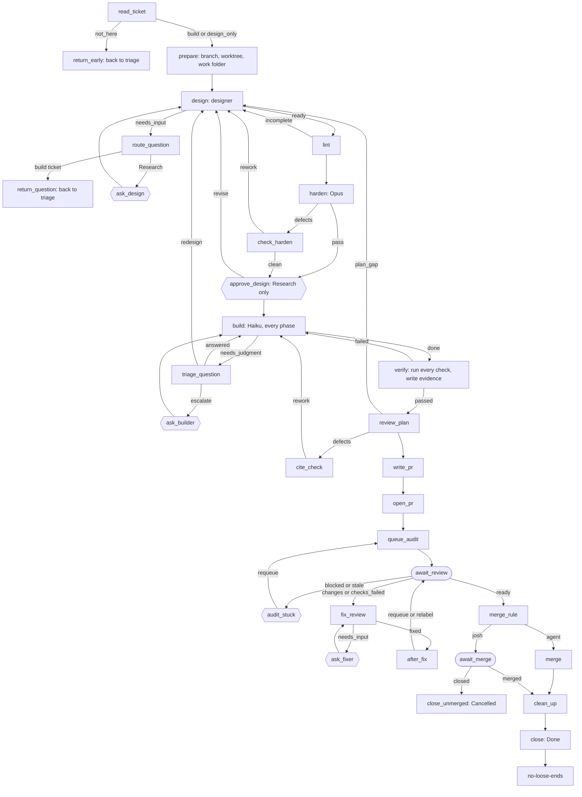
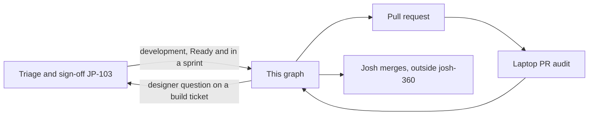

# Development graph: design

## Contents

- [Summary](#summary)
- [The flow at a glance](#the-flow-at-a-glance)
- [Where it sits](#where-it-sits)
- [The 22 draft steps, mapped](#the-22-draft-steps-mapped)
- [The steps](#the-steps)
- [The three gaps, closed](#the-three-gaps-closed)
- [Building every phase](#building-every-phase)
- [The review is the laptop's PR audit](#the-review-is-the-laptops-pr-audit)
- [Waiting without a session: the wait step](#waiting-without-a-session-the-wait-step)
- [Answers reach the next session](#answers-reach-the-next-session)
- [Merging](#merging)
- [Working files and cleanup](#working-files-and-cleanup)
- [How every loop ends](#how-every-loop-ends)
- [How to tell it's working](#how-to-tell-its-working)
- [Parts and who owns them](#parts-and-who-owns-them)
- [Rules](#rules)
- [Exact copy](#exact-copy)
- [Acceptance criteria](#acceptance-criteria)
- [What the build does](#what-the-build-does)
- [Out of scope](#out-of-scope)
- [Questions for Josh](#questions-for-josh)
- [Choices made by default](#choices-made-by-default)

Ticket JP-115 (Story; design, then plan, then build). Status: **approved by Josh on 17 November 2026** in the thread "JP-115 Write the development graph" (merged as PR #39). The build plan is `docs/superpowers/plans/2026-11-17-development-graph.md`. There is no screen, so there are no boards.

Draft graph: `docs/design/development-graph/development.yaml`. It uses one proposed addition to the convention, the `wait` step ([below](#waiting-without-a-session-the-wait-step)), so it stays out of `graphs/flows/` until the build adds that kind. With its two wait steps read as gate steps it passes today's checker (`python3 docs/design/development-graph/check_draft.py`), and the walker's own engine walks it on made-up outcomes through six scenarios (`python3 docs/design/development-graph/dry_walk.py`). Both outputs are saved in `docs/proof/2026-11-17/JP-115/`.

Sources: Josh's drafted pipeline (`docs/source-notes/jira-ticket-pipeline.yaml`, its roles and scripts, defaults and swimlane), the playbook handoff note, the graph convention (`graphs/CONVENTION.md`), the walker design (`docs/superpowers/specs/2026-11-17-walker-design.md`), the triage design (JP-103, "What JP-115 must carry"), the non-development design (JP-104), `docs/WORKFLOW.md` §4 (the review ceremony), the feature tree (A21 PR audit, S12 durable output), and the JP-146 review comment on the ticket.

## Summary

The graph takes one Ready development ticket (a Story, Bug or Task whose route record says `development`) and ends with its pull request merged and the ticket Done. On the way:

- a **designer** (Sonnet) writes a spec, a script checks its shape, and a **hardener** (Opus, one revision round) attacks it;
- a **builder** (Haiku) builds every phase in one session, and **scripts** run every check and write the evidence;
- a **plan reviewer** (Sonnet) judges the build against the spec, and a script drops every defect that does not quote it;
- a script opens the pull request, and **the laptop's PR audit** reviews it, the same audit every josh-360 PR gets today;
- a **fixer** (Sonnet) applies the findings, and a script follows the review ceremony's rule for another round;
- the graph merges in josh-360; elsewhere Josh merges, and the run waits for him without a session;
- a script cleans up only what is safe, and the spec and evidence are kept with the run.

A **Research** ticket with a repository (such as this one) runs the design stretch only. Its design and plan are hardened, approved by Josh, and merged through the same pull request stretch.

Josh is asked only for: a builder or fixer question that neither a script nor the spec settles, a blocked or silent audit, a loop limit, and, for Research tickets, the design's questions and its approval. A designer's question on a build ticket goes back to triage. His merge outside josh-360 is the one other wait, and it is his PR sign-off, not a Needs you item.

## The flow at a glance

Hexagons are where Josh is asked (limit asks are left out to keep it readable; every loop ends at one). Rounded boxes are waits.



For a Research ticket, `approve_design` runs and the build stretch (`build` to `cite_check`) is skipped.

## Where it sits



- **Who starts a run.** The runner (JP-117) starts one for a ticket that is Ready and in an open sprint, with route `development` (the triage spec's start rule). The entry gate is `ready` (JP-103). A ticket that triage made Ready after this graph sent it back resumes: the route record's `returned_from` becomes the input `resume_from`, and the designer revises the spec that run saved rather than starting over.
- **What it reads.** The ticket and its route record (type, system, repository). It does no intake and no routing of its own.
- **One runner per ticket.** While Josh's sprint skill and action-triage's Jira pickup still run, `read_ticket` returns `not_here` for a ticket whose Agent Status shows another runner holds it, so the two can never work one ticket at once. The sprint skill keeps running until this graph replaces it (JP-128).

## The 22 draft steps, mapped

| # | Draft step | In this graph | Why it changed |
| --- | --- | --- | --- |
| 1 | `design` (Sonnet) | `design` (role `designer`, mid), agent `spec-writer` or, for Research, `design-writer` | `needs_input` no longer waits on Josh for a build ticket: `route_question` sends it back to triage (gap 1) |
| 2 | `lint_spec` (script) | `lint` (gate `lint-spec`) | Also refuses a spec kept inside a worktree (gap 3) |
| 3 | `harden` (Opus) | `harden` (role `hardener`, gate tier) plus `check_harden` (gate `check-review`) | One revision round, not three: the gate tier runs at most twice per run. Its defects must quote the spec or the ticket (rule 5) |
| 4 | `approve_spec` (Josh) | Removed for build tickets; `approve_design` for Research tickets only | Gap 1. A Research ticket's design is its deliverable, so Josh approves it |
| 5 | `pick_phase` (script) | Inside the builder's session, in spec order; phase state in `work/state.json` | See [Building every phase](#building-every-phase) (Josh's decision) |
| 6 | `route` (by phase tier) | Removed | Josh chose tiers by step, not by difficulty (16 November 2026) |
| 7 | `build_cheap` (Haiku) | `build` (role `builder`, cheap) | One session builds every phase |
| 8 | `build_mid` (Sonnet) | Removed | Same as row 6 |
| | builder `needs_judgment` ask, decided by a triager | `triage_question` (role `build-triager`, mid), then `ask_builder` | The triager answers from the spec when it can; Josh only when it cannot (gap 1) |
| 9 | `verify` (script) | `verify` (gate `verify-build`) | Runs every phase's checks on the final tree |
| 10 | `evidence` (script) | Part of `verify` | With one build session, "re-run every check on the final tree" is the same run |
| 11 | `completion_review` (Sonnet) | `review_plan` (role `plan-reviewer`, mid) | |
| 12 | `check_review` (script) | `cite_check` (gate `cite-check`) | The draft's script, kept nearly as written |
| 13 | `open_pr` (Haiku publisher) | `write_pr` (role `pr-writer`, cheap, read only) plus `open_pr` (gate `open-pr`) | No model writes to Jira or GitHub; the gate screens the text for patient data first |
| 14 | `queue_audit` (script) | `queue_audit` (gate `queue-audit`) | |
| 15 | `begin_audit` (script) | Done by the laptop audit itself | It swaps the label when it starts |
| 16 | `code_review` (Opus) | The laptop's PR audit (feature A21), waited on by `await_review` | Josh's chosen reviewer for josh-360 since 16 November; one review per PR, not two |
| 17 to 19 | `audit_passed`, `audit_changes`, `audit_blocked` (script) | Done by the laptop audit (its verdict comment and label); `await_review` reads them | |
| 20 | `unblock` (Josh) | `audit_stuck` | Also asked when the audit has not answered in 48 hours |
| 21 | `fix_review` (Sonnet) | `fix_review` (role `review-fixer`, mid), then `ask_fixer` | Also fixes failed checks on the pull request |
| 22 | `after_fix` (script) | `after_fix` (gate `after-fix`) | Follows `docs/WORKFLOW.md` §4: N above 3 re-queues the audit, otherwise ready-for-human |
| new | | `read_ticket`, `return_early`, `prepare`, `route_question`, `return_question`, `merge_rule`, `merge`, `await_merge`, `close_unmerged`, `clean_up`, `close`, and the limit asks `design_stuck`, `build_stuck`, `review_stuck` | The draft stopped at the pull request and never moved the ticket or cleaned up (gaps 2 and 3) |

## The steps

| Step | Kind | Done by | Tier | Access | What it does |
| --- | --- | --- | --- | --- | --- |
| `read_ticket` | gate | `read-dev-ticket` | | read | Checks the route record says `development`, the repository is in the registry, there is no open question, and no other runner holds the ticket. `build` for a Story, Bug or Task; `design_only` for Research; `not_here` otherwise. Finds the spec a returned run saved. |
| `return_early` | gate | `return-to-triage` | | josh | Not workable here: back to Not Started with the reason as an open question. Ends the run. |
| `prepare` | gate | `prepare-worktree` | | josh | Cuts `<KEY>-<slug>` from a fresh `origin/<base>`, adds a worktree, and makes the run's work folder outside it. |
| `design` | role | `designer` (`spec-writer` or `design-writer`) | mid | josh | Writes the spec to the work folder (build ticket), or the design and plan on the branch (Research). |
| `route_question` | gate | `question-route` | | read | A designer's question: `to_triage` for a build ticket, `to_josh` for Research. |
| `return_question` | gate | `return-to-triage` | | josh | Writes the question into the ticket's Open questions, moves it to Not Started, saves the work folder, removes the untouched worktree. Ends the run. |
| `ask_design` | ask | Josh | | read | Research only: the design's question. |
| `lint` | gate | `lint-spec` | | read | The spec's shape (contract `spec`). |
| `harden` | role | `hardener` | gate | read | One pass; defects only, each quoting the spec or the ticket. |
| `check_harden` | gate | `check-review` | | josh | Drops defects that quote nothing; keeps the rest in `work/hardening.md` for the designer. |
| `approve_design` | ask | Josh | | read | Research only: approve the design and plan, or send them back. |
| `build` | role | `builder` | cheap | josh | Builds every phase in order, one fresh helper per phase, committing each. |
| `triage_question` | role | `build-triager` | mid | read | Answers a builder's question from the spec or a recorded decision, sends it back to design, or escalates. |
| `ask_builder` | ask | Josh | | read | A builder question the triager could not answer. |
| `verify` | gate | `verify-build` | | josh | Runs every check on the final tree; writes `evidence.md` and a feedback file per failing phase. |
| `review_plan` | role | `plan-reviewer` | mid | read | Judges the build against the spec only. |
| `cite_check` | gate | `cite-check` | | josh | Keeps only defects whose criterion exists in the spec and whose quote is in it; reopens their phases. |
| `write_pr` | role | `pr-writer` | cheap | read | The pull request's title and body. |
| `open_pr` | gate | `open-pr` | | josh | Screens the text, pushes the branch, opens or reuses the pull request, comments its link on the ticket. |
| `queue_audit` | gate | `queue-audit` | | josh | Adds `review:needs-agent-audit` and records the round. |
| `await_review` | wait | `review-state` | | read | Waits for the audit's verdict, then for the checks on the head. |
| `audit_stuck` | ask | Josh | | read | The audit is blocked, or silent for 48 hours: queue it again, or stop. |
| `fix_review` | role | `review-fixer` | mid | josh | Fixes the findings or the failed checks, runs every check, pushes. |
| `ask_fixer` | ask | Josh | | read | A fixer question. |
| `after_fix` | gate | `after-fix` | | josh | Runs every check again, posts the resolution, and sets the next review label by the ceremony's rule. |
| `merge_rule` | gate | `merge-rule` | | read | `agent` where the registry lets agents merge (josh-360 only today), else `josh`. |
| `merge` | gate | `merge-pr` | | josh | Squash-merges, only with ready-for-human and green checks, read fresh. |
| `await_merge` | wait | `pr-merged` | | read | Waits for Josh to merge or close the pull request. |
| `close_unmerged` | gate | `close-unmerged` | | josh | Closed unmerged: cleans up what is safe, moves the ticket to Cancelled. Ends the run. |
| `clean_up` | gate | `clean-up` | | josh | Removes the worktree and branches only when nothing in them is uncommitted or unpushed. |
| `close` | gate | `close-ticket` | | josh | The closing comment, and Done. |
| `design_stuck`, `build_stuck`, `review_stuck` | ask | Josh | | read | Reached only at a loop limit or a run cap. |

Entry gate `ready` (JP-103); exit gate `no-loose-ends` (JP-109).

## The three gaps, closed

| Gap | How this graph closes it |
| --- | --- |
| **Too many places wait on Josh** | The draft asked Josh at four points on every ticket (designer questions, spec approval, builder judgment calls, fixer questions) plus a blocked audit. Here, for a build ticket: designer questions go back to triage, whose drafter answers from sources first; spec approval is gone, because the Opus hardener is the gate; builder questions go to a Sonnet triager first, which answers from the spec and recorded decisions. What is left for Josh is what the ticket names: builder escalations the triager cannot settle, fixer questions, and blocked audits, plus the limit asks every loop must end at. Every ask parks the run with no session waiting (walker), and the waits on the audit and on his merge hold no session either. |
| **The Jira status never moves** | The header maps every step to a status, and the walker moves the ticket when the next step is in a new stretch (`move-ticket`, read back, forward only). Design and hardening are Design/Planning, building In Progress, the audit Code Review, the ready-for-human wait Validation, merge and cleanup Done. A return goes to Not Started; a PR closed unmerged goes to Cancelled. Agents never move a ticket. |
| **Working files vanish at cleanup** | Every working file (spec, phase state, evidence, feedback, answers, the audit cursor) lives in the run's work folder, `$JOSH360_RUNS/<run>/work/`, from the first step, never in the worktree, and `lint-spec` refuses a spec inside one. The walker copies the spec, evidence and feedback into the run's `saved/` folder with their hashes when the run ends, and the ledger's `run_files` rows point at them. A Research ticket's design and plan are merged, which keeps them. `clean-up` and `close-unmerged` refuse to remove a worktree that holds anything uncommitted or unpushed. |

## Building every phase

The draft built one phase per builder session and looped back for the next. Josh's run cap (JP-139) counts every run of a role step in a graph run, loops included: cheap 5, mid 3, gate 2. A five-phase ticket would spend all five Haiku runs on its first pass and leave none for a retry. Josh also chose (16 November) not to pick a tier per phase, so the draft's cheap and mid builders become one.

**Chosen by Josh on 17 November, and drawn in the draft:** one builder session builds every phase in spec order. It hands each phase to a fresh helper with only that phase's tasks and checks, so no phase inherits another's context, which is how this project's own build threads work. Then `verify` runs every phase's checks on the final tree. A failing phase gets a feedback file and the builder runs again, doing only those items. The builder's five runs are all retries after the first. The per-phase record is kept in `work/state.json` and the evidence file, so the ledger can still say which phases failed first time.

The two alternatives he turned down, and what each would have changed:

- **One run per phase, cap counted per phase.** The convention gains a way to count a step's cap per phase (and to mark the loop that moves to the next phase as progress, not a retry), and the checker and walker change with it. The graph gets the draft's `pick_phase` loop back.
- **One run per phase, at most three phases.** No rule changes; `lint-spec` refuses a spec with more phases than the cap leaves room for, and the designer returns the ticket to triage to be split.

## The review is the laptop's PR audit

Josh chose the laptop's action-triage PR audit as josh-360's only reviewer on 16 November, and the feature tree names it "the review step of the development graph" (A21). So the graph runs no Opus code reviewer of its own. It adds `review:needs-agent-audit` (`queue_audit`), the audit picks the pull request up, posts one verdict comment and sets its label, and `await_review` reads the result. This is the same ceremony as `docs/WORKFLOW.md` §4, run by scripts:

- **changes** (`review:changes-requested`): the fixer applies the findings. `after_fix` counts N, the findings in the verdict comment (optional ones excluded). N above 3 re-queues the audit; N of 3 or fewer removes the other review labels and adds `review:ready-for-human`.
- **ready** (`review:ready-for-human`): the wait goes on until the required checks on the head finish (in josh-360, CI starts on that label). Green moves on; red is **checks_failed**, and the fixer fixes them. A fix for failed checks is a new code push, so it goes back to the audit (§4.4).
- **blocked** (`review:audit-blocked`), or **stale** (no verdict 48 hours after queueing, for example the laptop was off for two days): Josh is asked whether to queue it again.

The plan reviewer is still a model in the graph, because it answers a different question (did the build do what the spec assigned?) and may cite only the spec. The audit judges the code itself.

## Waiting without a session: the wait step

The graph has to wait twice for something outside it: the laptop's audit, which can take hours, and Josh's merge outside josh-360, which can take days. Today's convention has no step for this. A gate script must answer at once, an ask is for Josh, and a role step would keep a model session open for hours.

**Proposed addition to the convention (built by JP-115):** a step kind `wait`, naming a gate script:

```yaml
- id: await_review
  wait: review-state
  inputs: [repo, pr_number, work_dir]
  outcomes: [ready, changes, checks_failed, blocked, stale]
```

- The script runs like any gate and answers at once. `{"outcome": "pending"}` means "not yet": the walker records nothing, prints `waiting` (a fifth answer beside `run`, `parked`, `done` and `stopped`), and the runner calls `next` again later. Any declared outcome ends the wait like a gate's.
- No session is open, no loop is counted, and a wait never changes anything (its access is `read`; it takes no `effects`). `pending` is reserved and never declared.
- The checker refuses a wait with effects or with access other than `read`. A wait that can last long names its own deadline in its script and answers a declared outcome when it passes (`review-state` answers `stale` after 48 hours). `pr-merged` has no deadline, because it waits for Josh's own merge; the runner's status lists every run that has waited more than seven days, and JP-109's loose ends show the open pull request.
- The change is additive: no graph file becomes invalid, so the convention stays at version 1.

## Answers reach the next session

A builder that asked a question is run again after the answer, and it must be able to read it. Step inputs can only name outputs of steps above, and the answer comes from a step below (the triager) or from Josh (an ask). So the build adds one walker duty: every answered ask, and every step output named `answer`, is appended to `<run folder>/work/answers.md` with the step and the time. The designer, builder and fixer read that file. It never goes to Jira by itself; the walker still posts Josh's typed answers on the ticket after the patient-data screen, as it does today.

## Merging

| Repository | Who merges | How the run ends |
| --- | --- | --- |
| josh-360 (registry `merges: agent`) | The graph, through `merge-pr`, once the pull request carries `review:ready-for-human` and every required check on its head is green | Done |
| Every other repository (the default) | Josh, on GitHub, as today. A merge to a default branch is a deployment step under his global rules, and the graph never makes it | Done when he merges; Cancelled if he closes it unmerged |

The registry gains a `merges` field (`agent` or `josh`, default `josh`), set to `agent` for josh-360 only. The graph never makes a shared write, so no step needs an approving ask.

## Working files and cleanup

```text
$JOSH360_RUNS/<run id>/          outside every repository (default ~/.josh-360/runs/)
  run.json                       the walker's inputs and outputs
  work/
    spec.yaml                    contract spec (build tickets)
    state.json                   phase status, attempts, checks a review added
    evidence.md                  contract evidence
    hardening.md, feedback/      contract feedback (kept defects)
    withdrawn.md                 defects a script dropped, and why
    answers.md                   answers to earlier questions
    pr-cursor.json               the audit round: pull request, head commit, time
  saved/                         copies with hashes, made by the walker at the end
```

`clean-up` removes the worktree and the local branch only when the pull request is merged and nothing in the worktree is uncommitted or unpushed (the same check as the worktree removal guard, S13). It deletes the remote branch only when GitHub kept it. It refuses rather than delete anything at risk, which stops the run for Josh's `retry`. A returned ticket's untouched worktree is removed by `return-to-triage`; one with commits is kept for the resumed run, which reuses the branch.

This replaces the feature tree's note that the graph would send working files to the durable output folder (S12): the run folder is outside every repository already, and the ledger indexes it.

## How every loop ends

**Loops inside one run.** Every loop has a limit, and every limit ends at a Josh ask. The caps per run are cheap 5, mid 3, gate 2, counted across all loops (walker).

| Loop | `max_loops` | At the limit |
| --- | --- | --- |
| `ask_design` answered → `design` | 2 | `design_stuck` |
| `lint` incomplete → `design` | 2 | `design_stuck` |
| `check_harden` rework → `design` | 1 (the hardener is gate tier: 2 runs) | `design_stuck` |
| `approve_design` revise → `design` | 1 | `design_stuck` |
| `triage_question` answered → `build` | 2 | `build_stuck` |
| `triage_question` or `ask_builder` redesign → `design` | 1 | `design_stuck` |
| `ask_builder` answered → `build` | 2 | `build_stuck` |
| `verify` failed → `build` | 2 | `build_stuck` |
| `review_plan` plan_gap → `design` | 1 | `design_stuck` |
| `cite_check` rework → `build` | 2 | `build_stuck` |
| `audit_stuck` requeue → `queue_audit` | 2 | `review_stuck` |
| `ask_fixer` answered → `fix_review` | 2 | `review_stuck` |
| `after_fix` requeue or relabel → `await_review` | 2 (one arrow) | `review_stuck` |
| `after_fix` checks_failed → `fix_review` | 2 | `review_stuck` |
| A limit ask's retry, redesign or requeue | 1 | the same limit ask, so Josh decides every extra round |

**Role steps and their caps.** However the loops add up, one run uses at most:

| Step | Tier | Most runs before Josh is asked |
| --- | --- | --- |
| `design` | mid | 3 |
| `harden` | gate | 2 (one revision round) |
| `build` | cheap | 5 |
| `triage_question`, `review_plan`, `fix_review` | mid | 3 each |
| `write_pr` | cheap | 5 (in practice 1: no loop goes back past the pull request) |

**Between runs.** A new run starts with fresh counts, so these rules bound repeats:

- A run starts only for a ticket that is Ready and in an open sprint, or for a returned ticket made Ready again (the triage spec's rule). The graph's own label, comment and status writes never start a run.
- A designer's question goes back through triage, which takes a ticket back at most twice; the third return goes to Josh (JP-103).
- The walker refuses a sixth run on one ticket in 24 hours.

**Inside a step.** A role session that never ends is the binding's (JP-117): every role step gets a turn cap and a time cap. A gate script that fails stops the run and is not retried by the walker. A wait has no loop to count; its own deadline, or the runner's seven-day list, covers it.

## How to tell it's working

Every number comes from the ledger rows the walker writes for each step (run, step, outcome, loop count, session, tier, ticket, start, end, graph version, model), joined to session cost and to later runs on the same ticket. No model is needed to compute any of them.

| Question | Measure | Good direction |
| --- | --- | --- |
| Does the spec hold up? (effective) | Share of runs whose first `harden` passes; builder questions and redesigns per run | Up; down |
| Does the build pass first time? (effective) | Share of runs whose first `verify` passes; builder runs per merged pull request | Up; down |
| Is the plan review honest? (effective) | Share of its defects that `cite_check` drops for citing nothing | Down |
| Does the audit find little? (effective) | Findings (N) in the first audit verdict; share of pull requests needing a second audit round | Down |
| Does it spare Josh? (effective) | Asks per run, split by step, and how long each waits; share of runs that reach a limit ask | Down |
| Does Ready mean ready? (effective, scored against triage) | Share of runs that end `return_early` or `return_question` | Down |
| What does a merged pull request cost? (efficient) | Model cost by tier per merged pull request; Opus runs per run | Down |
| How long does it take? (efficient) | Time from Ready to pull request opened, and from opened to merged, with the audit wait and the wait for Josh's merge shown apart | Down |

How each run ends (the graph's `end_states`): `finished` (merged and Done, through the exit gate) is `success`. `return_early.returned`, `return_question.returned` and `close_unmerged.cancelled` are `neutral`. `design_stuck.stop`, `build_stuck.stop`, `review_stuck.stop`, `audit_stuck.stop` and `ask_fixer.stop` are `needs-josh`, and so is `exit_refused`, a run whose `no-loose-ends` gate refused.

## Parts and who owns them

| Part | Names | Owner | Notes |
| --- | --- | --- | --- |
| Roles | `designer` (mid, changes), `hardener` (gate, reads, reviewer), `builder` (cheap, changes), `build-triager` (mid, reads), `plan-reviewer` (mid, reads, reviewer), `pr-writer` (cheap, reads), `review-fixer` (mid, changes) | JP-115 | Files in `graphs/roles/` now |
| Agents | `spec-writer`, `design-writer` (both fill `designer`) | JP-115 | Per-system builders (for example a PIMS builder) come later, by an agent rule on `system` |
| Gates, new | `read-dev-ticket`, `prepare-worktree`, `question-route`, `lint-spec`, `verify-build`, `cite-check`, `open-pr`, `queue-audit`, `review-state` (wait), `after-fix`, `merge-rule`, `merge-pr`, `pr-merged` (wait), `close-unmerged`, `clean-up` | JP-115 | Refusing stubs in `graphs/gates/` now |
| Gates, shared | `ready` (JP-122), `no-loose-ends` (JP-109), `move-ticket`, `return-to-triage` (with JP-103 and JP-104), `check-review` and `close-ticket` (JP-123) | Their owners | Whichever build lands first writes the script; the others use it. `return-to-triage` gains an optional `worktree` input. Whether it sets the Jira flag is JP-122's to settle (JP-146 review, C3) |
| Contracts | `spec` (new); `evidence` and `feedback` gain the development fields | JP-115 | `graphs/contracts/spec.md` now; the other two in the build |
| Library | `graphs/gates/lib/jira.py`, `gate_io.py`, `patient_data.py` | Walker spec, "The shared gate library" | Used as they are |
| Convention | the `wait` step; the answers file | JP-115 build | Convention, checker and walker change together, with tests |
| Registry | `merges` field | JP-115 build | `conventions/registry.yaml` and its check |

## Rules

1. The graph starts only from a Ready development ticket in an open sprint, or a returned one made Ready again (entry gate `ready`).
2. It does no intake or routing. It reads the ticket and its route record.
3. A ticket another runner holds (the sprint skill, action-triage's Jira pickup) is `not_here`.
4. A designer's question on a build ticket goes back to triage, never to Josh. A Research ticket's questions are its work, so Josh answers them.
5. Every working file lives in the run's work folder, never in a worktree.
6. A spec has a definition of done and phases, each with a task list and at least one check that a script can run.
7. The hardener and the plan reviewer list defects only, each quoting the spec (or, for the hardener, the ticket). A script drops the rest before anyone reads them.
8. Scripts decide whether the build passed: every phase check, run again on the final tree.
9. Only gate scripts move tickets, set labels, push, comment, merge or clean up. No model writes to Jira or GitHub.
10. Text bound for GitHub or Jira passes the patient-data screen first (`patient_data.scan`, `external=True`). When `phi` is true, comments carry paths only.
11. The pull request is reviewed by the laptop's audit, and the ceremony's N rule decides another round.
12. The graph merges only where the registry allows agents to merge, and only with ready-for-human and green checks. Everywhere else Josh merges.
13. Cleanup never removes anything uncommitted or unpushed.
14. Every loop has a limit that ends at Josh, and no role step runs more often in one run than its tier allows.
15. A wait holds no session and changes nothing.

## Exact copy

The asks' questions are in the graph file. Comments, all in the workflow's `result | evidence | next gate` shape:

`open_pr`, on the ticket:

> Pull request opened | `<PR url>` · checks `<passed>/<total>` on `<head commit>` | next gate: the PR audit

`return_question`, written into the ticket's **Open questions** section, with a comment:

> Returned to triage | the designer needs: `<question>` · run `<run id>`, spec saved | next gate: triage answers it, then this run resumes

`after_fix`, on the pull request (with the Claude Code footer):

> Review fixes pushed (`<N>` finding(s) addressed) | `<resolution>` | next gate: `<another audit round | ready for human>`

`close`, on the ticket:

> Done | merged `<PR url>` as `<merge commit>` · spec and evidence saved with run `<run id>` | next gate: none

`close_unmerged`, on the ticket:

> Cancelled | `<PR url>` was closed without merging · spec and evidence saved with run `<run id>` | next gate: Josh reopens the ticket if he wants it built again

## Acceptance criteria

The ticket's four scenarios, tagged, plus three for the gaps.

```gherkin
Feature: The development graph

  @auto
  Scenario: The graph passes the checker
    Given graphs/flows/development.yaml
    When the checker runs
    Then it exits cleanly

  @auto
  Scenario: Only the named points wait on Josh
    Given the graph's header
    When every step's outcomes are read
    Then the only steps that can ask Josh are the ones the header lists

  @auto
  Scenario: A dry run reaches the end
    Given made-up outcomes for each step
    When the walker walks the graph
    Then the run passes through each Jira status in the mapping
    And it ends at Done with a pull request step behind it

  @auto
  Scenario: A defect must cite the plan
    Given a reviewer finding that quotes nothing from the spec
    When the gate script runs
    Then the finding is dropped

  @auto
  Scenario: A designer's question on a build ticket goes back to triage
    Given a Story whose designer ends needs_input
    When the walker walks the graph
    Then the ticket is moved to Not Started with the question in its Open questions
    And no question is put to Josh

  @auto
  Scenario: The working files outlive the worktree
    Given a run that merged its pull request and cleaned up
    When the run ends
    Then its spec and evidence are in the run's saved folder with their hashes
    And no working file was ever inside the worktree

  @auto
  Scenario: The graph merges only where agents may merge
    Given a pull request in a repository whose registry entry does not allow agent merges
    When the review is ready
    Then the graph waits for Josh's merge and does not merge
```

| Scenario | Proof today (design) | Proof after the build |
| --- | --- | --- |
| The graph passes the checker | `docs/proof/2026-11-17/JP-115/01-draft-passes-checker.txt` (wait steps read as gates) | The checker on `graphs/flows/development.yaml`, in CI |
| Only the named points wait on Josh | The checker's header rule (`asks_josh` is exactly the ask steps); [The three gaps](#the-three-gaps-closed) | Same, plus a test that every outcome of every non-ask step leads to a step or an end that is not an ask, except the limit and named ones |
| A dry run reaches the end | `docs/proof/2026-11-17/JP-115/02-dry-walk-six-scenarios.txt` | `walker.py` with fake gates, `tests/test_development_graph.py` |
| A defect must cite the plan | The draft's `check-review.py`, kept as `cite-check` | `cite-check` tests |
| A designer's question goes back to triage | Dry walk scenario 4 | Walker test with a fake `return-to-triage` |
| The working files outlive the worktree | [Working files and cleanup](#working-files-and-cleanup) | `lint-spec`, `clean-up` and walker save tests |
| The graph merges only where agents may merge | Dry walk scenarios 2, 3 and 6 | `merge-rule` and `merge-pr` tests |

## What the build does

The plan thread turns this into tasks; the build thread does them. In outline:

1. Add the `wait` step to the convention, the checker and the walker, and the answers file to the walker, with tests first.
2. Move the draft to `graphs/flows/development.yaml`, compile it, and delete `check_draft.py` and `dry_walk.py`.
3. Write every new gate script, with tests on made-up repositories (a scratch git repository and a fake `gh`). Write the shared gates this graph needs that no other build has landed yet.
4. Add the registry's `merges` field and its check; extend the `evidence` and `feedback` contracts.
5. The dry run through `walker.py`, and the proof page under `docs/proof/`.
6. Update the feature tree's S12 note, `graphs/flows/README.md`, and this spec's "As built" section.

The binding to Agent Manager and the first real ticket are JP-117.

## Out of scope

- Running a real ticket, and anything specific to Agent Manager (JP-117).
- Changing or removing the sprint skill (JP-128 retires it once this graph has replaced it).
- Tiers chosen by difficulty, and moving up a tier after failures (declined by Josh on 16 November).
- Changing the laptop's PR audit. The graph only labels and reads.
- Merging outside josh-360.
- Starting other graphs. A run only returns a ticket to triage.

## Questions for Josh

1. **How should the builder work through a ticket's phases, given the run caps?** Answered on 17 November: one builder run per ticket, building every phase in order (the recommended option). See [Building every phase](#building-every-phase).

No questions are open. Josh approved the design on 17 November 2026.

## Choices made by default

These can be undone, so they take the recommended option and are recorded in `docs/decisions.md`.

| # | Choice | Taken | How to undo |
| --- | --- | --- | --- |
| 1 | The code review | The laptop's PR audit, read by a wait step; no Opus code reviewer in the graph | Add a `code-reviewer` role step and the draft's record-audit gates |
| 2 | Waiting for the audit and for Josh's merge | A new `wait` step kind, additive to convention 1 | Model each wait as a role step whose binding does the waiting |
| 3 | Tiers | Designer mid; hardener gate with one revision round; builder cheap; triager, plan reviewer and fixer mid; PR writer cheap | Change a role's `tier`; the checker re-checks the loops |
| 4 | Spec approval | None for build tickets (gap 1); Josh approves a Research ticket's design | Add an approval ask after `check_harden` |
| 5 | Who merges | The graph in josh-360 (registry `merges: agent`); Josh everywhere else | Set `merges` per system |
| 6 | Where working files live | `$JOSH360_RUNS/<run>/work/` from the first step, not the durable output folder (S12) | Point `prepare-worktree` at another folder outside the worktree |
| 7 | Where the draft lives | `docs/design/development-graph/` until the `wait` step exists | Not needed once the build moves it |
| 8 | Where the spec lives | This file (`docs/WORKFLOW.md` §2.4), and the graph at `graphs/flows/development.yaml` (JP-146 review), not `graphs/development/graph.yaml` | |
| 9 | How answers reach a session | The walker appends answered asks and `answer` outputs to `work/answers.md` | Pass answers through ticket comments |
| 10 | A pull request closed unmerged | Clean up what is safe, ticket to Cancelled, run ends neutral | Send it back to triage instead |
| 11 | Failed checks after the audit | The same fixer fixes them, and the fix goes back to the audit (§4.4) | A separate checks fixer that keeps ready-for-human |
| 12 | A ticket another runner holds | `not_here`, back to triage | Wait for the other runner instead |
| 13 | Research tickets | Design and plan on the branch, hardened, approved by Josh, merged through the same review stretch; the ticket is Done when they merge | End the run at Josh's approval and leave the pull request to him |
