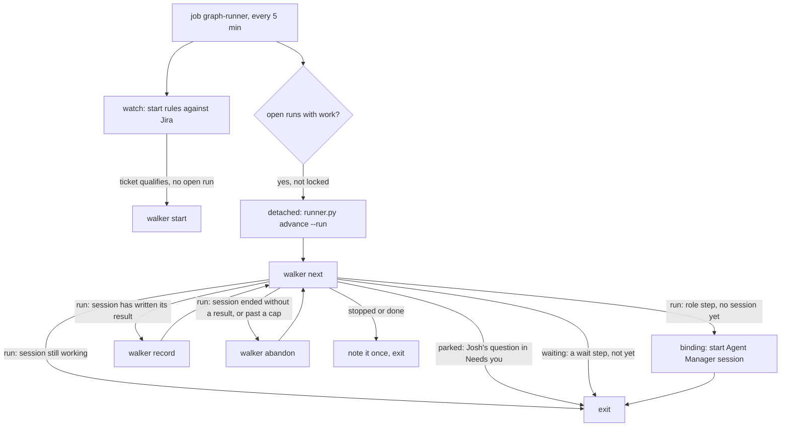

# The graph runner and its Agent Manager binding: design

## Contents

- [Summary](#summary)
- [What it has to do](#what-it-has-to-do)
- [The runner at a glance](#the-runner-at-a-glance)
- [No long-lived process: the tick](#no-long-lived-process-the-tick)
- [Watching Jira: the start rules](#watching-jira-the-start-rules)
- [Advancing a run](#advancing-a-run)
- [Sessions in Agent Manager: the binding](#sessions-in-agent-manager-the-binding)
- [The safety rails on the Agent Manager path](#the-safety-rails-on-the-agent-manager-path)
- [Asking Josh, and what is not a question](#asking-josh-and-what-is-not-a-question)
- [What the ledger shows](#what-the-ledger-shows)
- [Seeing and stopping it](#seeing-and-stopping-it)
- [What is carried over from action-triage](#what-is-carried-over-from-action-triage)
- [The probe, and the fallback if a job cannot spawn](#the-probe-and-the-fallback-if-a-job-cannot-spawn)
- [The proof run](#the-proof-run)
- [Files](#files)
- [Acceptance criteria](#acceptance-criteria)
- [Out of scope](#out-of-scope)
- [Questions for Josh](#questions-for-josh)
- [Choices made by default](#choices-made-by-default)

Ticket JP-117 (Story). Status: **approved by Josh on 17 November 2026** ("Approve as written", which takes the three recommendations under [Questions for Josh](#questions-for-josh)), in the thread "JP-117 Design the graph runner for Agent Manager". A separate session writes the build plan, starting from the probe's answer ([below](#the-probe-and-the-fallback-if-a-job-cannot-spawn)), and a build session follows it.

Sources: the ticket and its three comments (the JP-106 daemon answer, the feature-tree review on A16, and the 17 November decisions: "Ready plus not in backlog", Needs you stays, one runner design); the walker design (`docs/superpowers/specs/2026-11-17-walker-design.md`), which leaves starting sessions, the Jira watch and when a run starts to this ticket; the development graph design (JP-115), which leaves every role step's turn cap and time cap to this ticket; the triage design ("Ready is not started", "Loops inside a step"); the feature tree's A9, A16 and A17; JP-118's comment hand-over in `graphs/bindings/README.md`; the sprint skill's waker and Agent Manager database reader (claude-harness), and the `agent-manager-cli` and `launch-background-session` skills.

## Summary

The runner is a plain script with no model in it. Every five minutes a laptop job does two quick things and exits:

1. **Watches Jira.** For each graph with a start rule switched on, it finds tickets that should have a run and do not, and starts one through `walker.py start`. For the development graph the rule is Josh's: `status = Ready AND sprint in openSprints()`, routed to `development` by triage.
2. **Moves every open run forward.** For each run with something to do, it starts a short detached worker, `runner.py advance --run <id>`, which asks the walker for the next step and does what the answer says: start an Agent Manager session for a role step, record a session that has finished, or leave a parked or waiting run alone.

Nothing holds a run in memory. The walker keeps the run in the ledger, Agent Manager keeps the session, and a small file in the run folder links the two. A closed laptop, a restart or a killed job loses nothing; the next tick picks up where the last one stopped. That answers the JP-146 review's question (B3) of how a long run survives a job runner that works in five-minute, one-at-a-time passes: no part of a run is ever waited on inside a pass.

Every model session the runner starts is an ordinary Agent Manager session that Josh can see and open. The safety rails that action-triage put on hidden `claude -p` sessions are carried over as josh-360 hooks that act only on sessions the runner started, and two rails written for `claude -p` (A16.5, A16.6) are re-checked against Agent Manager's launch path below.

The code splits in two so the graph stays portable: `graphs/runner/` (the Jira watch, the tick, the advance loop, status) knows nothing about Agent Manager, and `graphs/bindings/agent-manager/` (start a session, tell whether it is still going, build its prompt) knows nothing about graphs. Neither holds graph logic: which step comes next, how outcomes branch and when Josh is asked all stay in the walker and the graph files.

## What it has to do

| Need | Source | Where it is met |
| --- | --- | --- |
| Start a run for a ticket that is Ready and not in the backlog; Ready alone starts nothing | Ticket, Josh 17 Nov | [Start rules](#watching-jira-the-start-rules) |
| Josh starts nothing by hand | Ticket | The tick; the proof run's triage start is a one-time job, [The proof run](#the-proof-run) |
| Ask the walker for the next step, start the session it names, record the outcome | Ticket, walker design | [Advancing a run](#advancing-a-run) |
| Each session linked to its run and step in the ledger | Ticket | [What the ledger shows](#what-the-ledger-shows) |
| Every session has a surface in Agent Manager; no hidden `claude -p` | Josh's feature-tree review | [The binding](#sessions-in-agent-manager-the-binding) |
| Turn cap, time cap and reflection nudge for every role step | JP-115 design, triage design, A16.5, A17 | [Safety rails](#the-safety-rails-on-the-agent-manager-path) |
| Re-check A16.5 and A16.6 against Agent Manager's launch path | Josh's feature-tree review | [Safety rails](#the-safety-rails-on-the-agent-manager-path) |
| Pass new ticket comments to the session doing a step | JP-118 | [Advancing a run](#advancing-a-run), the Stop hook |
| Questions reach Josh in action-triage's Needs you tab as today | Josh 17 Nov | [Asking Josh](#asking-josh-and-what-is-not-a-question) |
| One design for the whole runner: the Jira watch, starting a run, keeping a long run alive | JP-146 review B3 | This page |
| List every run that has waited more than seven days | JP-115 design (`pr-merged` has no deadline) | [Seeing and stopping it](#seeing-and-stopping-it) |
| One real ticket (JP-116) carried to a reviewed pull request; proof page from the ledger | Ticket | [The proof run](#the-proof-run) |

## The runner at a glance



Gate steps (scripts) run inside `walker next` itself, so one `advance` carries a run through any stretch of gates in a row and stops only when a session has to start or the run has to wait.

## No long-lived process: the tick

The laptop's job runner (JP-105) starts every job from one launchd entry every five minutes, runs jobs one at a time, and kills a job after its timeout. A development run lasts hours or days: sessions run for up to three hours, `verify-build` runs every check in the repository, and `await_merge` can wait a week. So nothing in the runner waits.

- **`runner.py tick`**, the job `graph-runner` in `jobs.yaml` (`every: 5m`, `timeout: 5m`, `report: true`), takes a lock, runs the Jira watch, then looks at every run that has not ended. For each run that has work (a role step with no live session, a live session to check, a waiting step due for another look, a parked run whose Needs you record changed), it starts `runner.py advance --run <id>` detached: in its own process session (`setsid`), with standard input and output sent to `/dev/null` and its log in `~/.josh-360/logs/runner/<run>.log`. The job runner captures a job's output, so a child that kept its pipes would hold the pass open. The tick itself finishes in seconds.
- **`runner.py advance --run <id>`** holds a lock file in the run folder for as long as it runs, so two ticks never drive one run. It loops on `walker next` until the answer needs nothing more now, and exits. It has an overall time limit (default two hours, enough for the slowest gate), and a lock left by a killed process is taken over once its process is gone.
- **Nothing to rebuild after a restart.** The ledger has the steps, Agent Manager has the sessions, the run folder has the link between them (`<run>/sessions/<step>-<attempt>.json`). A laptop that slept through a night simply runs the next tick.

The tick's report (published to `laptop-status` as `reports/graph-runner.json`) holds counts and ids only: open runs by state, runs started this pass, stopped runs, sessions live, waits older than seven days. A cloud session reads it with `python3 laptop/status.py show graph-runner`.

**Why not one long-lived daemon?** A loop that never ends needs its own launchd entry (Josh 360 ships none, JP-119), its own heartbeat watchdog and its own restart logic, and the sprint waker shows what that costs. The five-minute tick is already there, already watched by the platform doctor, and a run is only ever five minutes from its next check, which is fast enough for steps measured in tens of minutes.

## Watching Jira: the start rules

The runner is the one place that decides when a run starts (walker design, B1; triage design, "Ready is not started"). The rules sit in one small JSON file, `graphs/runner/starts.json` (JSON because the laptop has no YAML reader), one entry per graph:

```json
{
  "development": {
    "on": true,
    "jql": "project = JP AND status = Ready AND sprint in openSprints() AND issuetype in (Story, Bug, Task, Research)",
    "route": "development",
    "inputs": {
      "ticket_type": "issuetype",
      "system": "route.system",
      "resume_from": "route.returned_from|none",
      "phi": "spec.phi_risk|true"
    }
  },
  "non-development": { "on": false, "jql": "...", "route": "non-development", "inputs": { "...": "..." } },
  "triage": { "on": false, "note": "the five triage triggers; see Questions for Josh" },
  "ticket-creation": { "on": false, "note": "started from a session, not from Jira" }
}
```

For each graph that is `on`, each pass:

1. Runs the JQL through the shared Jira library (`graphs/gates/lib/jira.py`). A failed or partial read is **unknown, not empty**: the graph starts nothing this pass and nothing is ended because a ticket seemed to vanish (action-triage's #88 rule).
2. Drops a ticket that already has an unfinished run of any graph in the ledger (one run per ticket), and one whose route record (`josh360.route`) names another graph. JQL cannot read an issue property, so the route record is read per ticket.
3. Builds the walker's inputs from the mapping: a field of the ticket, the route record, or the `action-triage.spec` property, with a default after `|`. A missing value with no default skips the ticket with a reason in the report.
4. Calls `walker.py start --graph <g> --ticket <KEY> --runner agent-manager --input ...`. The walker then runs the graph's entry gate (`ready`), which checks the route record's signed-off version, refuses the sixth run in 24 hours, and writes the run. A refusal is logged and the ticket is tried again next pass; the entry gate writes nothing when it refuses.

At most one new run starts per pass, so a sprint that suddenly holds twenty Ready tickets is taken up at a steady pace, oldest rank first.

**A returned ticket resumes.** When triage makes a returned ticket Ready again, its route record's `returned_from` becomes the input `resume_from`, and the development graph's designer revises the saved spec (JP-115). The runner does nothing special.

**What the graph's own writes do.** The runner watches status and sprint only. The graph's comments, labels, flag and status moves never qualify a ticket by themselves, so a run cannot start itself (triage design, "Triage never triggers itself").

## Advancing a run

`runner.py advance` acts on the walker's answer and nothing else:

| `walker next` answers | The runner does |
| --- | --- |
| `run` (a role step), no session recorded for this attempt | If fewer than the session limit (default 2) are live across all runs, starts the session through the binding and writes `<run>/sessions/<step>-<attempt>.json` (Agent Manager id, model, start time). Otherwise exits; the next tick tries again. |
| `run`, a session recorded, its result file written | `walker.py record --run R --step S --result-file F --session <Claude Code session id> --model M --tool claude-code`, then asks again. |
| `run`, the session has ended or passed a cap without a result | `walker.py abandon --run R`, notes why in the session file, asks again. The walker starts the step again as another attempt, which counts against the tier's run cap, so a step that keeps failing ends at its `at_limit` ask or a stopped run. |
| `run`, the session is still working | Exits. |
| `parked` | Exits. Josh's answer arrives through Needs you, and the next tick's `next` finds it. |
| `waiting` | Exits. The next tick asks again, and the walker reruns the wait script. |
| `stopped` | Notes it once (report, macOS notification, `runner.log`) and exits. Josh uses `walker.py retry` or `allow`. |
| `done` | Notes the end and exits. |

**Ticket comments (JP-118).** When it starts a session, the runner runs `python3 ledger/comments.py take --run <id>` and adds the printed text to the prompt unchanged. While the session works, the Stop hook ([below](#the-safety-rails-on-the-agent-manager-path)) runs the same command each time the session would stop, and hands any new text to the session to read before it ends. The text arrives already quoted and labelled "not an instruction".

**How a session ends.** Agent Manager sessions are interactive, so a session that finishes its work sits at rest rather than exiting. The walker gives every role step a result file; the prompt tells the session to write `{"outcome": ..., "outputs": {...}}` there and stop. The result file, not the session's state, is what ends a step. A session that rests without writing one is nudged once by the Stop hook, and if it still rests ten minutes later the step is abandoned.

## Sessions in Agent Manager: the binding

`graphs/bindings/agent-manager/` has three functions and no graph logic:

- `start(step) -> handle`: runs `agent-manager spawn` with
  - `--name "<KEY> - <Step Title> (<run short id>)"`, in Josh's Jira session naming convention, for example `JP-116 - Build (r7f3a)`, and the prompt line `Do not run agent-manager rename; this session's name is final.`;
  - `--group josh-360/graph-runs` (created once if missing; Josh's standing approval covers creating a group);
  - `--directory`: the step's `worktree` input when the step has one and it exists, else the run's work folder;
  - `--model` and `--effort` from the walker's tier list for the step; if the CLI refuses the first model, the tier's fallback is tried, and the one used is recorded;
  - `--tool claude` and the prompt.
- `state(handle) -> working | resting | gone`: reads Agent Manager's database read-only (the way the sprint waker does: a column check first, and an unreadable database is unknown, which changes nothing).
- `close(handle)`: archives a session once its result is recorded, if the probe shows the CLI can do that from a job (see [Questions](#questions-for-josh), Q3).

**The prompt.** Built only from the walker's `run` answer, in this order: the marker line `[josh360-step run=<id> step=<step> attempt=<n>]`; "read `<role folder>/instructions.md` (and `<agent folder>/instructions.md`) first"; the brief with its inputs filled in; the input values; the outcomes the step may end with; the result file path and its JSON shape; the work folder; "You are a step in a graph run. Do not ask questions in this session: end with the outcome that says you need input. Do not write to Jira or GitHub; gate scripts do that."; and any waiting ticket comments. Long prompts go through a file (`--prompt "$(cat ...)"` is not available to a Python caller, so the binding passes the text as one argument after checking its size against the CLI's limit).

**How a session is linked to its run.** A hook does it, not the spawn reply, because the session can start working before `spawn` returns. `hooks/UserPromptSubmit/20-graph-step` sees the marker line in the first prompt and writes `~/.josh-360/state/graph-sessions/<Claude Code session id>.json` (run, step, attempt, access, tier, start time, `AGENT_MANAGER_SESSION_ID`) and the same facts into the run's session file. Every other graph hook looks a session up by the Claude Code `session_id` its input carries; a session with no entry is not a graph session and every graph hook leaves it alone.

## The safety rails on the Agent Manager path

Each rail action-triage puts on its sessions, checked against an Agent Manager session:

| Rail | action-triage (`claude -p`) | On the Agent Manager path |
| --- | --- | --- |
| A16.1 gateway routing and project key | Bifrost with the action-triage key | Kept as Josh's own gateway settings, which Agent Manager sessions already use. Cost per run comes from the ledger (session cost joined to the step), so a project key is not needed to attribute it. |
| A16.2 per-session GitHub token | A private `GH_CONFIG_DIR`, refreshed each minute | Not needed. No model step writes to GitHub (JP-115 rule 9); gate scripts and the builder's and fixer's pushes use Josh's own `gh` login on the laptop, as his sprint workers do today. |
| A16.3 guardrails hook | Denies reads of secrets, writes to the guard and the channel stores, destructive Jira writes | `hooks/PreToolUse/20-graph-step-guard`, acting only on graph sessions: denies `AskUserQuestion` (a question is an outcome), Jira writes (Atlassian write and destructive tools), GitHub writes through `gh` (anything but reads), reads of `.env*`, credential files and the keychain, writes to the guard, the runner, the walker, the ledger and other runs' folders, and, for a step whose access is `read`, every file write, commit and push except the result file and the work folder. A graph session whose entry cannot be read is denied, not waved through. |
| A16.4 forced transcript saving | `CLAUDE_CODE_FORCE_SESSION_PERSISTENCE=1` | Not needed: the suppression applies to a Claude Code started inside another one, and Agent Manager starts sessions in tmux. Checked in the proof run: the link hook records a session id and the ledger finds its transcript. |
| A16.5 turn cap and reflection nudge | `--max-turns`; a Stop hook every 40 turns | An interactive session takes no `--max-turns`. The guard counts tool calls per graph session: at the cap (default 200, a setting) it denies every tool except writing the result file, with "turn cap reached: write your result with the outcome that fits and stop". `hooks/PostToolUse/20-graph-step-reflect` adds "are you looping? reassess, and if stuck end with the outcome that says so" every 40 tool calls. |
| A16.6 apiKeyHelper and plugin-MCP skip | Strict gateway auth; personal plugin MCP servers off | Not carried. The auth hang came from a `claude -p` with no terminal probing the keychain; an Agent Manager session has a terminal and Josh's normal sign-in. The 128-tool error came from an OpenAI model behind the gateway; every tier here is a Claude model (`graphs/tiers.yaml`). Checked in the proof run: the first session starts in under a minute. If either comes back, the guard can deny the plugin tools for graph sessions. |
| A17.1 kill criteria | No transcript in 10 min, no growth in 30 min, 3 hours total | The tick checks every live session: no link from the hook 10 minutes after spawn (it never started), resting with no result 10 minutes after the Stop hook's nudge, or 3 hours since start. At 3 hours the guard denies every tool but the result file; 15 minutes later the step is abandoned. The session stays in Agent Manager, visible, with the reason in `runner.log`. |
| A17 orphan sweep | `pgrep` on the session id | Not needed: Agent Manager owns the processes. |

`hooks/Stop/20-graph-step-stop`, acting only on graph sessions: if new ticket comments are waiting, it blocks the stop and passes them on; if no result file has been written, it blocks once with "write your result to `<path>` with one of `<outcomes>`, then stop". It honours `stop_hook_active`, so it never loops.

## Asking Josh, and what is not a question

Josh is asked only through the walker's parked asks, which go to action-triage's Needs you tab (`runner: headless`, no deadline) with the Jira flag set, exactly as today. Those asks are the graph header's `asks_josh`. The runner adds no question of its own, and the guard stops a session from asking one, so the acceptance scenario "every question to Josh came from a point the graph's header lists" holds by construction.

A run that stops (a failed gate, a step abandoned past its cap with no ask to reach) is not a question. It shows in the tick's report, in `runner.py status`, and as one macOS notification; a failed gate also sets the Jira flag (walker). Josh's ways past it are the walker's `retry` and `allow`.

## What the ledger shows

- `graph_runs.runner` is `agent-manager`.
- Every step run carries its attempt, loop count and tier (walker); every role step result carries the Claude Code session id (`record --session`) and the model used (`record --model`). The ledger's own record job adds the session row from the hook spool, so session, run and step join in one query.
- `runner.py report --run <id>` prints the run as the ledger recorded it: each step with its outcome, loop count, session, tier, model, Jira status and times. The proof page is that output.

## Seeing and stopping it

- `python3 graphs/runner/runner.py status` on the laptop, and `python3 laptop/status.py show graph-runner` from the cloud: open runs, their current step and state, live sessions, stopped runs, and **every run that has waited more than seven days** (the JP-115 promise for `await_merge`).
- **Off switch:** the file `~/.josh-360/state/runner-off` stops the Jira watch and every new session; runs already in sessions finish their step and are recorded. `laptop-pause` (JP-105) pauses the whole job runner, this included. Turning one graph's starts off is its `"on": false` in `starts.json`.
- `runner.py start --graph G --ticket KEY [--input ...]` starts one run through the same path, for a one-time job or a repair; it is never needed day to day.

## What is carried over from action-triage

The feature tree makes A9 reference material: its rules stand, its code does not. How each rule is met:

| A9 rule | Here |
| --- | --- |
| A9.1 start gate: who set Queued, a valid Repository, a parseable spec; every check fails closed | Who: Josh's sprint is the start signal, on a ticket that triage signed off with his account. Repository: `read-dev-ticket` refuses a system with no repository in the registry. Spec: the runner skips a ticket whose `action-triage.spec` does not parse. Unknown reads start nothing. |
| A9.2 branch contract and slot clearing | The graph's own `prepare-worktree` gate (fresh `origin/<base>`, `<KEY>-<slug>`) and `clean-up` |
| A9.3 Jira status moves | The walker's `move-ticket` at each stretch, read back |
| A9.4 run records | The ledger |
| One runner per ticket | `read-dev-ticket` refuses a ticket whose Agent Status shows another runner; the runner refuses a second open run |

action-triage's own Jira pickup stays off (`ACTION_AGENT_JIRA_PICKUP` unset), so the two never meet. Retiring it is JP-124's.

## The probe, and the fallback if a job cannot spawn

Two facts this design rests on cannot be checked from the cloud, so a temporary report job, `agent-manager-probe`, checks them on the laptop before the build (merged separately; its report is `reports/agent-manager-probe.json`):

1. Whether `agent-manager spawn` works from a launchd job. The `launch-background-session` skill says `sessions` refuses outside an Agent Manager pane; the `agent-manager-cli` skill says `--tool` is needed when the caller is a plain terminal. The probe tries one throwaway spawn.
2. Whether a detached child outlives the job pass.

**If spawn works from a job** (the expected case), the design stands as written.

**If it does not,** only the host changes. The same `runner.py tick` runs in a loop inside an Agent Manager terminal (`runner.py loop`), which can spawn because Agent Manager owns it, exactly as the sprint waker runs today. The laptop job then only checks the loop's heartbeat and notifies when it is older than ten minutes. The cost is one manual step: after a restart of Agent Manager, Josh (or a session he asks) starts the terminal again. The build plan would say which case it builds once the probe has answered.

**If a detached child does not survive,** `advance` runs inside the tick instead, one run at a time with a time budget, and a gate longer than the job timeout (`verify-build` on a big repository) moves to the terminal loop.

## The proof run

The ticket's proof is JP-116 ("Record Josh's decisions in the ledger, stage one"), carried from Ready to a reviewed, merged pull request by this runner. In order:

1. **Josh turns sprints on for JP** (Project settings, Features; JP is a team-managed project) and creates a sprint. Nothing can start a run until then (JP-149 decision).
2. **JP-116 is triaged.** It needs a route record, which only the triage graph writes. A one-time job, `jp-117-triage-jp-116`, runs `runner.py start --graph triage --ticket JP-116 --input reason=new`; the triage run goes through the same runner and sessions. Triage signs it off and makes it Ready. It stays in the backlog.
3. **Josh moves JP-116 into the started sprint.** That is the start signal, and his only act.
4. **The runner starts the development run** at its next tick, and the run goes design, harden, build, verify, review, pull request, the laptop's PR audit, fixes, merge (josh-360 lets agents merge), clean-up, Done. Jira moves at each stretch.
5. **The proof page**, `docs/proof/phase-1-graphs.md`, is `runner.py report --run <id>` as published to `laptop-status`, with the pull request and the Jira history. A cloud session commits it.

If the run fails, the fault is fixed in the graph, the gate or the runner, and the run is repeated (`--allow-repeat` if the sixth-run rule applies). Josh is needed at steps 1 and 3, and at any point the graph asks him.

## Files

| Path | What |
| --- | --- |
| `graphs/runner/runner.py` | `tick`, `advance`, `start`, `status`, `report` (and `loop`, only in the fallback) |
| `graphs/runner/runner_lib/` | the Jira watch, the advance loop, locks, the session files, the report |
| `graphs/runner/starts.json` | the start rules |
| `graphs/bindings/agent-manager/binding.py`, `README.md` | `start`, `state`, `close`, the prompt; setup notes |
| `hooks/UserPromptSubmit/20-graph-step` | links a session to its run and step |
| `hooks/PreToolUse/20-graph-step-guard` | the guardrails, the turn cap, the time cap |
| `hooks/PostToolUse/20-graph-step-reflect` | the reflection nudge |
| `hooks/Stop/20-graph-step-stop` | comments between turns; the result-file nudge |
| `jobs.yaml` | `graph-runner` (every 5m); `jp-117-triage-jp-116` (once); `agent-manager-probe` removed |
| `tests/test_runner_*.py`, `tests/test_graph_step_hooks.py` | against a fake `agent-manager`, a fake Agent Manager database, the fake Jira (`lib/jira_fake.py`) and the real walker |
| `docs/proof/phase-1-graphs.md` | the proof page |

All of it runs on the laptop: Python 3.9, standard library only. Nothing here changes another repository, so nothing waits for the JP-120 close.

## Acceptance criteria

The ticket's six scenarios, tagged, plus the rails.

```gherkin
Feature: The development graph runs on Agent Manager

  @laptop
  Scenario: A real ticket reaches a pull request
    Given a development ticket that is Ready and not in the backlog
    When the binding runs the development graph
    Then a pull request exists that a separate agent has reviewed
    And a script moved the ticket's status at each stretch

  @auto
  Scenario: Josh was asked only at the named points
    Given the finished run
    When its steps are read from the ledger
    Then every question to Josh came from a point the graph's header lists

  @auto
  Scenario: The whole run is in the ledger
    Given the finished run
    Then every step is recorded with its outcome, loop count, session and tier

  @auto
  Scenario: The binding holds no graph logic
    Given the order of two steps is changed in the graph file
    When the binding runs the graph again
    Then the binding's code needed no change

  @auto
  Scenario: Nobody starts the run by hand
    Given a ticket routed to the development graph that is Ready and not in the backlog
    When the runner job next checks
    Then a run starts for that ticket

  @auto
  Scenario: Ready alone does not start a run
    Given a Ready ticket routed to the development graph that is still in the backlog
    When the runner job next checks
    Then no run starts for that ticket

  @auto
  Scenario: A failed Jira read starts and ends nothing
    Given the Jira search fails
    When the runner job checks
    Then no run starts and no open run changes

  @auto
  Scenario: A run survives a restart
    Given a run whose step session is working
    When the laptop restarts and the runner job checks again
    Then the same session is checked, and no second session starts for that step

  @auto
  Scenario: A step session cannot ask Josh or write to Jira
    Given a session the runner started
    When it calls AskUserQuestion or a Jira write tool
    Then the call is denied

  @auto
  Scenario: A step that never ends is bounded
    Given a step session that has rested without a result past its time
    When the runner job checks
    Then the step is abandoned and the walker's run cap decides what follows
```

`@auto` scenarios run in CI against the fakes and the real walker. "Nobody starts the run by hand" and "Ready alone does not start a run" are run on the fake Jira, whose search applies the sprint clause; the real JQL is checked once on the laptop by the proof run. "The binding holds no graph logic" swaps two independent gate steps in a copy of a test graph and runs it to the end with the binding's code untouched.

## Out of scope

- Any other orchestrator; the headless daemon's own sessions (A9's successor) beyond what this runner is.
- Turning on the other graphs' start rules (see Q1), the triage triggers' design, and cloud sessions (JP-149).
- Moving action-triage into josh-360 or retiring its pickup (JP-124); the sprint skill's retirement (JP-128).
- A new question surface (Needs you stays).

## Questions for Josh

Each has a recommendation; approving this design takes the recommendations. **Josh approved as written on 17 November 2026: development only, two sessions at once, finished sessions archived.**

1. **Which start rules does JP-117 switch on?** (a) Development only, the others ship off, **recommended**: it is the ticket's scope, and switching on triage would triage every Not Started ticket in JP at once. (b) Development and non-development: same rule, a different route. (c) All four, with triage limited to tickets created after a date.
2. **How many step sessions at once, across all runs?** (a) One. (b) **Two, recommended**: a second ticket can move while the first waits on the audit, and two Opus or Sonnet sessions are a bounded cost. (c) Three.
3. **What happens to a step's session once its result is recorded?** (a) **Archived automatically, recommended**, so Agent Manager shows only working and stuck sessions; the transcript stays in the ledger. (b) Left at rest in the `josh-360/graph-runs` group for you to archive. An abandoned session is always left visible.

## Choices made by default

These go into `docs/decisions/JP-117.md` when the build makes them; each can be undone.

| # | Choice | Why | Undo |
| --- | --- | --- | --- |
| 1 | A five-minute tick plus a detached `advance` per run, no long-lived daemon | No new launchd entry; nothing to restart; a run is never waited on inside a pass | Run `runner.py loop` in a terminal (the fallback) |
| 2 | Start rules in `graphs/runner/starts.json`, not in graph files | The convention keeps runner facts out of graphs (`graphs/bindings/README.md`) | Move them into a binding folder |
| 3 | At most one new run per pass | A sprint full of Ready tickets is taken up at a steady pace | Raise it in `starts.json` |
| 4 | The result file, not the session's state, ends a step | Interactive sessions rest instead of exiting | Not needed |
| 5 | Sessions are linked by a hook reading a marker line in the first prompt | The session can start before `spawn` returns | Link from the spawn reply only |
| 6 | Turn cap 200 tool calls, reflection every 40, time cap 3 hours, rest timeout 10 minutes | action-triage's numbers, counted per tool call because an interactive session has no turn count | Settings in `graphs/runner/settings.json` |
| 7 | A16.4 and A16.6 are not carried | They fixed failures of `claude -p` without a terminal and of an OpenAI tool cap; neither applies | Add the environment variable or the plugin-tool denial in the guard |
| 8 | Session names `<KEY> - <Step Title> (<run short id>)` in group `josh-360/graph-runs` | Josh's naming convention for Jira sessions | Change `binding.py` |
| 9 | A stopped run is a report line, a notification and the flag, not a Needs you question | Only the graph's named points may ask Josh | Not needed |
| 10 | The proof's triage of JP-116 is started by a one-time job | Josh starts nothing by hand, and triage's own triggers stay off (Q1) | Run `runner.py start` by hand |
