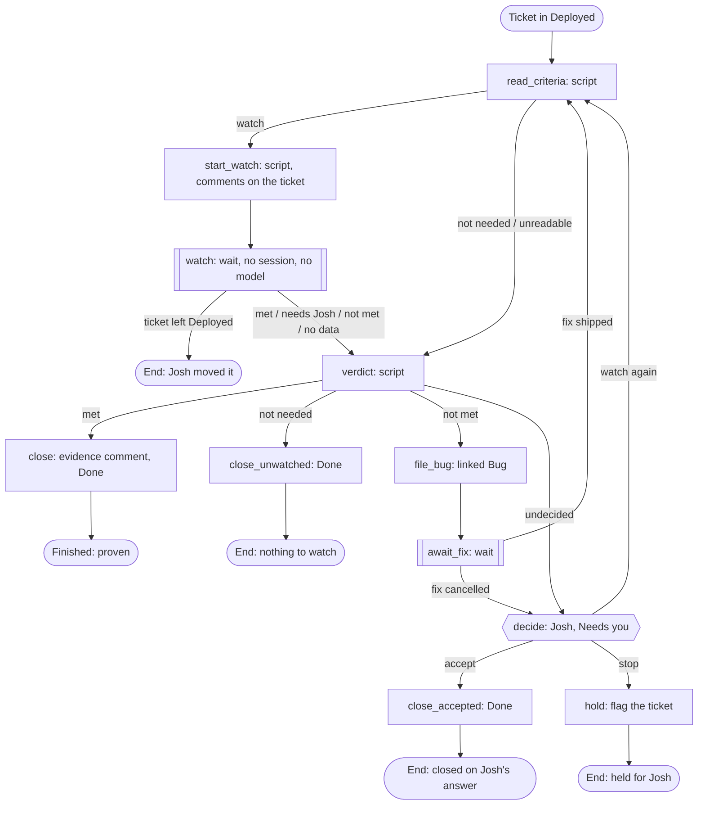

# Post-deploy validation: the Validation section, the Deployed status and the validation graph: design

## Contents

- [Summary](#summary)
- [What it has to do](#what-it-has-to-do)
- [The three statuses](#the-three-statuses)
- [Who moves a ticket into and out of Deployed](#who-moves-a-ticket-into-and-out-of-deployed)
- [The Validation section of a ticket](#the-validation-section-of-a-ticket)
- [How a script reads the section](#how-a-script-reads-the-section)
- [Collectors](#collectors)
- [The Ready check](#the-ready-check)
- [The flow at a glance](#the-flow-at-a-glance)
- [The steps](#the-steps)
- [How the watch runs](#how-the-watch-runs)
- [When the criteria are not met](#when-the-criteria-are-not-met)
- [When no data arrives, and the one question](#when-no-data-arrives-and-the-one-question)
- [Evidence, and what the ticket shows](#evidence-and-what-the-ticket-shows)
- [Starting a run](#starting-a-run)
- [Loose ends](#loose-ends)
- [The subtask rule](#the-subtask-rule)
- [What changes outside the graph](#what-changes-outside-the-graph)
- [How every loop ends](#how-every-loop-ends)
- [How to tell it's working](#how-to-tell-its-working)
- [Exact copy](#exact-copy)
- [Rules](#rules)
- [Acceptance criteria](#acceptance-criteria)
- [What the build does](#what-the-build-does)
- [Out of scope](#out-of-scope)
- [Questions for Josh](#questions-for-josh)
- [Choices made by default](#choices-made-by-default)

Ticket JP-164 (Research). Status: **approved by Josh on 18 November 2026** ("Approve: I judge them, once", which takes option A under [Questions for Josh](#questions-for-josh)), in the thread "JP-164 Design post-deploy validation". Nothing here is built. A separate session writes the build plan and files the build tickets under JP-94.

Sources: the ticket and its two comments (the Jira facts read back on 18 November 2026); Josh's decisions in the thread on 18 November 2026 (subtasks only for work outside the running graph; a standard set of validation information on the ticket; a Deployed status; validation as its own graph); `conventions/tickets.md`; `docs/WORKFLOW.md` §4 and §5; `graphs/CONVENTION.md` ("Wait steps", "Scoring a run", "The run cap"); `graphs/flows/development.yaml`, `non-development.yaml` and `triage.yaml`; the graph runner design (`2026-11-17-graph-runner-design.md`) and `graphs/runner/runner_lib/watch.py`; the triage design (`2026-11-16-triage-graph-design.md`, "The Ready checklist"); `ledger/loose_ends.py`; `laptop/run_jobs.py` and `laptop/status.py`; action-triage's `CLAUDE.md` ("Jira ticket pickup").

The graph began as a draft beside this file and was moved by JP-167 to `graphs/flows/validation.yaml`, with its contracts in `graphs/contracts/`. The graph checker passes it (`python3 graphs/tools/check_graph.py`).

## Summary

Today nothing looks at a change after it merges. The ticket goes to Done the moment the pull request lands, whether or not the change works for real.

This design adds the missing step in three parts:

1. **Every ticket says how it will be proven.** A new **Validation** section on every Story, Task and Bug answers Josh's three questions: is a watch needed after the change ships, what shows the change is doing its job in production, and when is that checked, how often, and when is it enough. It is written so that a script can read it.
2. **A ticket waits in Deployed while it is watched.** Validation keeps its meaning (checked, about to ship). Deployed means shipped and being watched. Done means shipped and proven, or shipped with nothing to watch.
3. **A small validation graph does the watching.** It reads the section, collects a reading for each criterion on the ticket's own timetable, and grades the readings with a script. It moves the ticket to Done when the criteria are met. When they are not, it files a linked Bug and watches again once the fix ships. Josh is asked only when the watch cannot finish on its own.

No step in the graph uses a model. A check is a script reading a number, such as a job's exit code, a count in a report, or a Jira search. A watch that runs for three weeks costs nothing in model spend and holds no session open.

## What it has to do

| Need | Source | Where it is met |
| --- | --- | --- |
| A standard set of validation information on the ticket: is it needed, what are the criteria, when and how often is it checked, when is it complete | Josh, 18 Nov | [The Validation section](#the-validation-section-of-a-ticket) |
| A script reads the section; no model | Ticket | [How a script reads the section](#how-a-script-reads-the-section) |
| The Ready check refuses a missing section or a signal nothing can read | Ticket | [The Ready check](#the-ready-check) |
| One meaning each for Validation, Deployed and Done; every move named | Ticket | [The three statuses](#the-three-statuses), [Who moves a ticket](#who-moves-a-ticket-into-and-out-of-deployed) |
| The validation graph, step by step, with its start rule and end states | Ticket | [The steps](#the-steps), [Starting a run](#starting-a-run) |
| No model on each check | Epic rule | [How the watch runs](#how-the-watch-runs) |
| A first set of signals, and how one is added | Ticket | [Collectors](#collectors) |
| Evidence as counts and links, never patient data | Patient-data rule | [Evidence](#evidence-and-what-the-ticket-shows) |
| A failed watch: ticket stays in Deployed, linked Bug, watch again after the fix | Ticket | [When the criteria are not met](#when-the-criteria-are-not-met) |
| A watch with no data | Ticket | [When no data arrives](#when-no-data-arrives-and-the-one-question) |
| A watched ticket is not a loose end | Ticket | [Loose ends](#loose-ends) |
| Where the subtask rule is written | Ticket | [The subtask rule](#the-subtask-rule) |
| Nothing Josh has to babysit | Josh, epic | One question at most per watch round; [How every loop ends](#how-every-loop-ends) |

## The three statuses

| Status | Meaning | Jira |
| --- | --- | --- |
| Validation | The work has been checked and is about to ship: the review is clean and the pull request is ready to merge, or the deliverable is with Josh for sign-off. This is its meaning today and it does not change. | id 10511, transition `2` |
| Deployed | The change has shipped and is being watched in production against the ticket's criteria. | id 10582, category In progress, transition `7` |
| Done | The change has shipped and its criteria were met in production. For a ticket that needs no watch, it has shipped. | id 10513, transition `4` |

A ticket whose Validation section says no watch is needed goes from Validation to Done and never shows in the Deployed column.

Deployed exists in JP only. AD and CI are not changed by this design.

## Who moves a ticket into and out of Deployed

Into Deployed:

| Who | When |
| --- | --- |
| The development graph, new step `hand_to_watch` (a gate script) | The pull request has merged and the ticket's Validation section says a watch is needed. Otherwise its `close` step moves the ticket to Done, as today. |
| The non-development graph, the same two steps | After Josh's sign-off, by the same rule. |
| A thread that merges its own pull request (`docs/WORKFLOW.md` §5.1) | After the merge, the thread reads the Validation section: "Needed: yes" moves the ticket to Deployed (transition `7`), anything else to Done. |
| action-triage's ticket daemon | It is written to move every merged JP ticket to Deployed. It is not changed. Its pickup is off today, so it moves nothing. |
| Josh, by hand | Any time. |

Out of Deployed:

| Who | To | When |
| --- | --- | --- |
| The validation graph, step `close` | Done | The criteria were met. |
| The validation graph, step `close_unwatched` | Done | The ticket has nothing to watch: no Validation section, or "Needed: no". |
| The validation graph, step `close_accepted` | Done | Josh answered the graph's question with "accept". |
| Josh, by hand | Anywhere | Any time. The run sees the move within the hour and ends without touching the ticket. |

Nothing else moves a ticket out of Deployed. A ticket whose watch failed stays in Deployed with a linked Bug. A ticket Josh told the graph to stop watching stays in Deployed with the Jira flag set.

**One reader, so the movers can be simple.** Every mover applies the same rule, but the validation graph does not depend on them getting it right. Any ticket that lands in Deployed is read by the graph within five minutes. If it has nothing to watch, the graph says so in a comment and moves it to Done. That is why action-triage needs no change, and why tickets written before this design need no Validation section added.

## The Validation section of a ticket

A new required section on every Story, Task and Bug, placed after Acceptance criteria. Research tickets, Epics and Subtasks do not carry one: a Research ticket ships a document, and the tickets built from it carry their own.

| Field | What it answers | Allowed values |
| --- | --- | --- |
| Needed | Does this ticket need a watch after it ships? | `yes`, or `no.` followed by one sentence saying why |
| Starts | When does the watch begin? | `at Deployed`, `on 2026-12-01` (a date), or `after JP-170 is Done` (another ticket shipping). [When the watch begins](#how-the-watch-runs) says how each is held |
| Check every | How often is a reading taken? | `<n> hours` or `<n> days`, from 1 hour to 7 days |
| Complete when | When is it enough? | `<n> checks in a row pass`, or `after <n> events` |
| Give up after | How long does it watch before stopping without an answer? | `<n> days`, up to 90 |
| Fail after (optional) | How many failing checks in a row end the watch early? | `<n> checks in a row fail`; 3 when the line is left out |
| Criteria | What shows the change does its job in production? | One or more scenarios tagged `@validate`, in a `gherkin` block |

When Needed is `no`, the section is that one line and nothing else.

**A filled-in example** (a Bug whose fix is "the hourly Session Atlas retirement job stops failing"):

````markdown
**Validation:**

- Needed: yes
- Starts: at Deployed
- Check every: 1 day
- Complete when: 7 checks in a row pass
- Give up after: 21 days

```gherkin
@validate
Scenario: The retirement job runs clean
  When the watch reads job retire-session-atlas
  Then last_exit is 0
  And hours_since_run is at most 2

@validate
Scenario: The doctor reports no failed check
  When the watch reads report doctor summary.fail
  Then value is 0
```
````

Read aloud: once the ticket is in Deployed, look once a day; when the job's last run exited clean, ran in the last two hours, and the doctor shows no failed check, seven days running, the ticket is proven. If that has not happened in 21 days, stop.

**The second way to say "enough": a count of real events.** For a change that is proven by things happening rather than by days passing:

````markdown
**Validation:**

- Needed: yes
- Starts: at Deployed
- Check every: 1 day
- Complete when: after 20 events
- Give up after: 30 days

```gherkin
@validate
Scenario: Forwarded emails end with a signed-off deliverable
  When the watch reads ledger-runs non-development
  Then needs_josh is at most 1
```
````

Read aloud: wait until 20 non-development runs have ended since the watch started, then look once: at most one of them may have ended needing Josh.

**A ticket that needs no watch:**

```markdown
**Validation:**

- Needed: no. The change is a document; nothing runs in production.
```

**When is the answer yes?** When the change's effect can only be seen once it runs for real: a background job, a hook, a pipeline, a graph, anything whose proof is "it kept working" or "the numbers moved". The answer is no for a document, a design, a change fully proven by its tests, or a one-time script whose result is already in the pull request's proof.

**A criterion only a person can confirm.** A scenario may be tagged `@validate @manual` and end with `Then Josh confirms that <statement>`. Scripts watch the other criteria. When those are met, Josh gets one question listing the manual ones. The sign-off agent sends a ticket back if a manual criterion could have been a measured one.

## How a script reads the section

The section is found the way every other section is: `lib/ticket_text.parse_sections` gains the name "Validation". Inside it the script reads lines, not prose:

1. **The field lines.** Each is `<Field>: <value>`, optionally as a list item. The value must match that field's pattern from the table above, for example `^(\d+) (hours?|days?)$` for "Check every". A value that does not match is a named problem ("Check every: 'daily' is not '<n> hours' or '<n> days'").
2. **The scenarios.** Each scenario in the `gherkin` block tagged `@validate` is one criterion. It has exactly one `When` line and one or more `Then` or `And` lines:
   - `When the watch reads <collector> <argument>`: the first word after "reads" names a collector; the rest of the line is its argument.
   - `Then <field> <comparison> <value>`: the field is one that collector returns; the comparison is one of `is`, `is not`, `is at least`, `is at most`, `is above`, `is below`; the value is a number or a single word.
   - For a `@manual` scenario: `Then Josh confirms that <statement>`, and no `When` line is needed.
3. **Cross-checks.** "Give up after" must leave room for "Complete when" (for `7 checks in a row` at `1 day`, at least 7 days). `after <n> events` needs every measured criterion to use a collector that counts events.

The same parser serves the Ready check, the validation graph's first step, and the movers' rule, so a section that passed Ready is one the graph can read. The argument on a `When` line is data handed to a collector's own reader. It is never run as a command.

## Collectors

A collector is a small read-only function that returns one reading: a handful of named numbers and short codes, plus a link a person can follow. A criterion names one on its `When` line.

The first set covers what Josh 360 itself can see from the laptop:

| Collector | Argument | Fields it returns | Reads |
| --- | --- | --- | --- |
| `job` | a job id from `jobs.yaml` | `last_exit` (0 is a clean run), `hours_since_run` | the job runner's state file |
| `report` | a report id and a dotted path, such as `doctor summary.fail` | `value`, `age_hours` | the report that job last wrote (the same one published to `laptop-status`) |
| `doctor` | a doctor check id, such as `backfills.retire-session-atlas` | `status` (`pass`, `warn`, `fail`, `skip`) | the doctor's last report |
| `ledger-runs` | a graph id | `events` (runs ended since the watch started), `success`, `neutral`, `needs_josh` | the ledger, read-only |
| `jira-count` | a JQL search | `count`, `events` (the same number) | Jira's search, with the runner's own credentials |
| `github-runs` | `owner/repo` and a workflow file name | `events` (runs on the default branch since the watch started), `failed`, `last` (`success` or `failure`) | GitHub, read-only |

Rules for every collector:

- It only reads. It never runs text from a ticket: no shell command, no SQL from the ticket, no file path outside the places named above.
- When it cannot read (the laptop is offline, Jira is down, a report is missing), it answers "unknown". Unknown is never read as a pass or a fail.
- It returns numbers and short codes only. It never returns text copied from the system it read, so a reading cannot carry patient data.

**Adding one.** A collector is one module in `graphs/gates/lib/collectors/` with a `read(argument, since)` function and the list of fields it returns, one row in the table in `graphs/contracts/validation-section.md`, and its tests. The Ready check and the watch load the same list, so a ticket can name a new collector the day it merges. The first one worth adding after this build is a named-query collector for Josh's databases (a count from a reviewed, read-only query kept in the repository), which is what would let AD and CI tickets use validation. It is out of scope here.

## The Ready check

The Ready checklist (`graphs/gates/lib/triage/checklist.py`) gains seven items for Story, Task and Bug. A script runs them; ticket creation's `ticket-complete` gate runs the same list, so a drafted ticket rarely bounces.

| Item | Passes when |
| --- | --- |
| V1 | The ticket has a Validation section with a `Needed:` line that says `yes` or `no` |
| V2 | "Needed: no" carries a reason of at least four words |
| V3 | "Needed: yes" has Starts, Check every, Complete when and Give up after, each in its allowed form. A Starts date is a real calendar date, and a Starts ticket is not the ticket itself |
| V4 | "Needed: yes" has at least one `@validate` scenario, and at least one of them is measured (not `@manual`) |
| V5 | Every measured scenario names a collector on the list, with an argument in that collector's shape |
| V6 | Every `Then` names a field that collector returns and a comparison on the list |
| V7 | The timetable can finish: "Give up after" leaves room for "Complete when", and `after <n> events` is used only with collectors that count events |

The sign-off agent, which already judges every ticket once, gets one more item and no extra run:

- **J6 Proves the goal.** If Needed is yes, the criteria would show the Goal happening in production, not merely that something ran. If Needed is no, the reason holds for this ticket. A manual criterion is used only where no collector could measure it.

The ticket drafter's instructions gain the section, its example and the "when is the answer yes" guidance above.

## The flow at a glance



## The steps

Eleven steps. None uses a model, so no step has a tier.

| Step | Kind | Access | What it does | Outcomes |
| --- | --- | --- | --- | --- |
| `read_criteria` | gate `read-validation` | read | Reads the Validation section with the parser above. | `watch`, `not_needed` (says no, or no section), `unreadable` |
| `start_watch` | gate `start-watch` | josh | Writes this round's plan to the run's work folder, with the time the watch begins when the Starts line already fixes it, and posts the start comment on the ticket. | `started` |
| `watch` | wait `watch-criteria` | read | Answers "not yet" until the watch has begun and a check is due; then takes a reading for each criterion, logs it and grades the log. | `met`, `needs_josh` (measured criteria met, a manual one is left), `not_met`, `no_data`, `left_deployed` (ends the run) |
| `verdict` | gate `validation-verdict` | read | Adds up the section and the watch into one answer, and writes the evidence table and, when Josh is needed, the card he reads. | `met`, `not_needed`, `not_met`, `undecided` |
| `close` | gate `close-watch` | josh, moves the ticket | Posts the evidence and moves the ticket to Done. | `closed` |
| `close_unwatched` | gate `close-watch` | josh, moves the ticket | Says there was nothing to watch and moves the ticket to Done. Ends the run. | `closed` |
| `file_bug` | gate `file-validation-bug` | josh | Files one linked Bug from a fixed template, or reuses the one already open. | `filed` |
| `await_fix` | wait `fix-closed` | read | Answers "not yet" while the Bug is open. | `shipped` (back to `read_criteria`), `cancelled`, `left_deployed` (ends the run) |
| `decide` | ask | read | The one question to Josh, in Needs you, with the Jira flag. | `watch_again` (back to `read_criteria`), `accept`, `stop` |
| `close_accepted` | gate `close-watch` | josh, moves the ticket | Records Josh's answer with the evidence so far and moves the ticket to Done. Ends the run. | `closed` |
| `hold` | gate `hold-watch` | josh | Sets the Jira flag and says how to start the watch again. Ends the run. | `held` |

Entry gate `deployed`: the ticket is in Deployed and not flagged. Exit gate `no-loose-ends`, unchanged.

How a run can end, and its score:

| End | Score | Meaning |
| --- | --- | --- |
| `finished` | success | The criteria were met in production and the ticket is Done. |
| `close_unwatched.closed` | neutral | Nothing to watch. |
| `close_accepted.closed` | neutral | Josh closed it on his own judgment (after no data, a manual criterion, or a failed watch). |
| `watch.left_deployed`, `await_fix.left_deployed` | neutral | Josh moved the ticket himself. |
| `hold.held` | needs-josh | Josh chose stop; the ticket is in Deployed, flagged. |

## How the watch runs

The runner's job already wakes every five minutes and asks the walker to move each open run forward. For a run sitting at `watch`, that means running the `watch-criteria` script.

**Almost every call does nothing.** The script opens one small file in the run's folder, sees that the next check is not due, and answers "not yet". No network, no model, no session. With "Check every: 1 day", 287 of each day's 288 calls end there.

**When a check is due**, the script:

1. Confirms the ticket is still in Deployed. If Josh has moved it, the run ends and nothing else happens. (It also looks once an hour between checks, so a ticket Josh moves is released within the hour.)
2. Runs each measured criterion's collector and compares the reading with the criterion's `Then` lines.
3. Adds one line to the check log: the time, each criterion's reading, and pass, fail or unknown for each.
4. Grades the whole log, as below.

**When the watch begins.** A round starts when `start_watch` runs. The watch itself begins at the moment the ticket's Starts line names, and never before the round starts:

| Starts line | The watch begins |
| --- | --- |
| `at Deployed` | When the round starts. |
| `on <date>` | At the start of that day by the laptop's clock, or when the round starts if that is later. |
| `after <KEY> is Done` | When the watch script first reads that ticket in Done. It looks once an hour, in the same hourly look that confirms the watched ticket is still in Deployed. |

Until the watch has begun, the script answers "not yet": it takes no reading, so nothing can be graded and no Bug can be filed for a change that does not exist yet. "Give up after" is counted from the moment the watch begins, not from the start of the round, so the timetable the Ready check passed (V7) is the timetable the watch gets.

Waiting to begin has its own end, so a watch cannot wait for ever. The watch ends as `no_data`, and Josh is asked, when the named ticket is Cancelled or does not exist, or when 90 days have passed since the round started and the watch has still not begun. A Jira read that fails is unknown, not an answer: the script keeps waiting.

`start_watch` writes the beginning time into the watch file for the first two forms. For the third it leaves it empty, and the watch script records it as the first line of its check log when it sees the other ticket in Done.

**The first check** is taken one "Check every" after the watch begins, never at the beginning. A merge takes about ten minutes to install on the laptop, and a reading taken before that would grade the old code.

**A check passes** when every measured criterion passes. It **fails** when any fails. It is **unknown** when no criterion failed and at least one could not be read. An unknown check does not count toward a run of passes and does not break one.

The section's "Fail after" number travels with the rest of the timetable: `read_criteria` returns it as `fail_after` (3 when the line is left out), `start_watch` writes it to the watch file, and the watch script reads it from there.

**Grading, for "`<n>` checks in a row pass":**

| The log shows | The watch ends as |
| --- | --- |
| The last `n` known checks all passed | `met` (or `needs_josh` if the ticket has a manual criterion) |
| The last `f` known checks all failed, where `f` is the number on the "Fail after" line, or 3 when the ticket has none | `not_met`, early |
| "Give up after" has passed, and at least one check failed | `not_met` |
| "Give up after" has passed, and no check ever failed (too few readings, or none) | `no_data` |
| The watch never began (see "When the watch begins") | `no_data` |
| None of these | not yet |

**Grading, for "after `<n>` events":** nothing is graded until every measured criterion's `events` has reached `n`. Then the readings are compared once: all pass is `met`, any fail is `not_met`. If "Give up after" passes first, the watch ends as `no_data`.

**When the laptop is closed**, nothing runs, and nothing is lost: the next wake-up finds the check overdue and takes it. Missed checks are not made up, so "7 checks in a row" means seven readings, each at least a day apart, not seven calendar days.

**The check log is the watch's own notebook.** A wait step is read-only (`graphs/CONVENTION.md`), and this one changes nothing outside its run: no ticket, no label, no repository. Its one write is the log in the run's own work folder, which is run state in the same way the walker's `run.json` is. The build adds that sentence to "Wait steps" in the convention.

**Waiting a long time is normal here.** The runner's status lists any run that has waited more than seven days, which is right for a review or a merge and wrong for a watch that is meant to last three weeks. The `watch` step is left off that list, because it has its own deadline ("Give up after"). The `await_fix` step stays on it: a fix that has sat for a week is worth seeing.

## When the criteria are not met

1. **The ticket stays in Deployed.** It shipped, and it is not proven.
2. **One linked Bug is filed**, by a script, from a fixed template: which criteria failed, the counts, and where to look. It lands in Not Started like any drafted ticket, so triage completes it and signs it off, and it starts when Josh gives it the `ready-to-run` label. That label is Josh's lever: the graph tells him the change failed, and he decides when the fix is worth doing. The Bug carries the label `validation-failure`, and its own Validation section says "Needed: no. The watch on JP-<n> proves this fix."
3. **The run waits for the Bug.** No session, no model, a Jira read at most once an hour.
4. **When the Bug reaches Done, the watch starts again from the top**: the section is read afresh (so an edit to the criteria counts), a new round begins, and the first check is one interval later. The Starts line is applied again, so a date that has passed or a ticket that is already Done lets the new round begin at once.
5. **When the Bug is cancelled**, Josh is asked what should happen to the ticket.
6. **After two fixes have shipped**, Josh is asked before a third round of watching.

If a Bug with the `validation-failure` label is already open and linked to the ticket, it is reused. A run never files a second Bug for the same failure.

## When no data arrives, and the one question

The graph has one question for Josh, and six ways to reach it:

| What happened | What the card says |
| --- | --- |
| "Give up after" passed with too few readings | Which criteria had no readings, and why the collector could not read |
| The watch never began | Which Starts line it was waiting on, and why it cannot begin (the ticket was cancelled or does not exist, or 90 days passed) |
| The measured criteria are met and a manual criterion is left | Each manual criterion's statement, to confirm |
| The Validation section cannot be read | Each line the script could not read, and what would pass |
| The fix for a failed watch was cancelled | Which criteria still fail, and which Bug was cancelled |
| Two fixes have shipped | The counts from both failed rounds |

The answers are the same each time:

- **Watch again**: the section is read afresh and a new round starts. Use it after fixing the section, after the missing data has a source, or for one more round after a fix.
- **Accept**: the ticket goes to Done with a comment saying Josh closed it and the evidence so far.
- **Stop**: the ticket stays in Deployed with the Jira flag set, and nothing watches it. Clearing the flag starts a fresh watch; moving the ticket anywhere else is also fine.

While the question waits, the run holds no session and the ticket carries the Jira flag, as every parked question does today.

## Evidence, and what the ticket shows

| Where | What | When |
| --- | --- | --- |
| The ticket, one comment | What is being watched: the criteria, the timetable, when the first check is due | The watch starts |
| The run's work folder (`~/.josh-360/runs/<run>/work/watch/`) | The plan for each round, and the check log: one line per check | Every check |
| The ledger | One row per step when it ends, with a one-line summary (for example "7 of 9 checks passed; met on check 9") | Each step ends |
| The ticket, one comment | The evidence table: per criterion, checks made, passed, failed, unknown, the last reading, and a link | The watch ends, either way |
| The linked Bug | The failed criteria and their counts | A watch fails |

Everything in that list is a count, a short code or a link. A reading never holds text copied from the system it read, so no check log, comment or Bug can carry a patient's details. The two scripts that write to Jira run the patient-data screen (`graphs/gates/lib/patient_data.py`) over what they write, as every gate does.

Per-check rows are not added to the ledger in this build. The run folder holds them, and the ledger holds each watch's result. A ledger table for individual checks waits until a view needs one.

## Starting a run

One new rule in `graphs/runner/starts.json`:

```json
"validation": {
  "on": true,
  "jql": "project = JP AND status = Deployed AND Flagged is EMPTY",
  "route_record": false,
  "inputs": {}
}
```

The runner needs two small changes for it:

1. **A rule may say it needs no route record.** Today every start rule requires the ticket's `josh360.route` record to name the rule's graph, because triage routes a ticket to development or non-development. Validation is not a route: it applies to any ticket in Deployed, including one shipped by a thread that never went through triage. `"route_record": false` skips that read.
2. **The seven-day waiting list leaves out named steps** (`"wait_flag_exempt": ["validation.watch"]` in `settings.json`), as described under [How the watch runs](#how-the-watch-runs).

Two things already in the runner do the rest: a ticket with an open run is never started twice, and one start per five-minute pass keeps a busy day from starting many runs at once.

**The flag is the off switch.** "Flagged is EMPTY" is what stops the runner from picking a ticket up again after Josh chose stop, and what keeps it away while a question is parked. Josh can also set the flag himself on any ticket in Deployed to say "do not watch this yet".

## Loose ends

`ledger/loose_ends.py` lists a ticket a session was linked to as a loose end unless it is in a Done-category status. Deployed is in the In progress category, so without a change every watched ticket would be listed.

The rule becomes: a linked ticket is not a loose end when it is Done, Cancelled, or **in Deployed and not flagged** (it has been handed to the watch). A ticket in Deployed that is flagged is listed, with the words "validation needs you". The no-loose-ends exit gate uses the same finder, so it follows the same rule.

## The subtask rule

Josh decided on 18 November 2026: a subtask exists only for work outside the running graph. The build writes it in two places:

- `conventions/tickets.md`, "Issue types", the Subtask row, and a short paragraph under it: a subtask is for work that happens at a different time, a step someone else owns, or a piece a reviewer could accept on its own. A graph's steps and an agent's plan phases never get subtasks: the Jira status, the ledger and the plan file already record them.
- `graphs/roles/decomposer/instructions.md`: the same three cases, and "never one subtask per step or per phase".

Post-deploy validation itself needs no subtask under this design: the ticket carries its own criteria and waits in Deployed.

## What changes outside the graph

| Where | Change |
| --- | --- |
| `conventions/tickets.md` | The Validation section (required sections, with the example); the Ready rule's new items; "Statuses and who moves them" gains the Deployed row and the rule for choosing Deployed or Done after a merge; the subtask rule |
| `graphs/contracts/` | New `validation-section.md` (the format and the collector table), `validation-plan.md`, `watch-result.md`; `ready-checklist.md` names V1 to V7 |
| `graphs/gates/lib/` | The section parser, the collectors, the V items in the checklist |
| `graphs/roles/` | `ticket-drafter` and `sign-off` instructions (the section, J6); `decomposer` (the subtask rule) |
| `graphs/flows/development.yaml` | After `clean_up`: a `validation_rule` gate, then `close` (Done) or the new `hand_to_watch` (Deployed). Both end the run as `finished`. |
| `graphs/flows/non-development.yaml` | The same pair after Josh's sign-off |
| `graphs/runner/` | The start rule and the two changes under [Starting a run](#starting-a-run) |
| `ledger/loose_ends.py` | The Deployed rule under [Loose ends](#loose-ends) |
| `docs/WORKFLOW.md` §4 and §5.1, `.claude/skills/ticket-lifecycle` | The status list gains Deployed; a merging thread moves its ticket to Deployed or Done by the rule |
| `.claude/workflow.config.md` | Deployed and transition `7` (added with this spec, since Jira already has them) |
| `scripts/doctor_lib/` | One check: the validation start rule is on, and no watch is past its "Give up after" without having ended |
| action-triage | Nothing |
| Jira | Nothing more. Deployed is in place. The two JP automation rules stay off. |

## How every loop ends

| Loop | Limit | At the limit |
| --- | --- | --- |
| `await_fix` shipped, back to `read_criteria` (a fix shipped, watch again) | 1 | `decide`: Josh chooses whether to watch a third time |
| `decide` watch again, back to `read_criteria` | 2 | `decide` again; each yes allows one more round |

There is no role step, so the run cap has nothing to count. Both waits end on their own: `watch` at "Give up after" (90 days at most), and `await_fix` when the Bug closes or the ticket leaves Deployed, with the runner's seven-day list showing a fix that sits.

## How to tell it's working

Every number comes from the ledger rows the walker writes and the run's check log. No model is needed for any of them.

| Question | Measure | Good direction |
| --- | --- | --- |
| Do shipped changes hold up? (effective) | Share of watches that end `met` on the first round | Up |
| Does it catch real failures? (effective) | Share of `validation-failure` Bugs that end Done rather than Cancelled | Up |
| Are the criteria readable? (effective) | Share of watches that end `no_data`, and share of readings that are unknown | Down |
| Does it spare Josh? (effective) | Share of runs that reach `decide` | Down |
| Do tickets ask for a watch when they should? | Share of Story, Task and Bug tickets with "Needed: yes" | Watched, no target |
| What does a watch cost? (efficient) | Model cost per run | Zero |
| How long is a ticket in Deployed? (efficient) | Days from Deployed to Done, against the ticket's own "Complete when" | Close to the timetable |

## Exact copy

The start comment (`start_watch`):

> Watching this change in production | {n} criteria; a check every {interval}; complete when {complete_when}; gives up after {give_up} | next gate: first check due {time}.

When the Starts line names another ticket, `{time}` reads "one check after {KEY} is Done".

The closing comment when the criteria are met (`close`), followed by the evidence table:

> Validated in production | {complete_when}, reached on check {k} of round {r} | next gate: none.

The closing comment when there is nothing to watch (`close_unwatched`):

> Nothing to watch | {the ticket says "Needed: no": <reason> / the ticket has no Validation section} | next gate: none.

The comment on the ticket when a watch fails (`file_bug`), followed by the evidence table:

> Not met in production | {failed criteria, each with its counts} | next gate: {BUG-KEY}; the watch starts again when it ships.

The question (`decide`), followed by the card:

> The watch on {KEY} cannot finish on its own. What happened is below, and the evidence so far is on the ticket.

The closing comment on Josh's accept (`close_accepted`), followed by the evidence table:

> Closed on Josh's answer ({date}) | the watch had not shown the criteria met: {one line from the card} | next gate: none.

The hold comment (`hold`):

> Watch stopped at Josh's request | this ticket stays in Deployed and is flagged, so nothing is watching it | next gate: clear the flag to start a fresh watch, or move the ticket.

**The Bug a failed watch files.** Summary: `{KEY} did not meet its validation: {first failed criterion's name}`. Type Bug, status Not Started, labels `validation-failure` and the ticket's system label, linked to the ticket. Description, in the standard sections: Goal ("{KEY}'s validation criteria are met in production"); First step ("Read {KEY}'s Validation section and the evidence table in its last comment"); Current behaviour (the failed criteria and their counts); Acceptance criteria (one scenario per failed criterion, restating its `Then` lines); Validation ("Needed: no. The watch on {KEY} proves this fix."); Parent or related ({KEY}). Triage fills whatever its checklist still asks for.

## Rules

1. Every Story, Task and Bug carries a Validation section. Research tickets, Epics and Subtasks do not.
2. A script reads the section. No model reads it, and no model runs on any check.
3. A collector only reads, never runs text from a ticket, and returns numbers and short codes only.
4. Unknown is not a pass and not a fail.
5. The watch begins no earlier than its Starts line says, and takes no reading before then. The first check is one interval after it begins.
6. A ticket is moved to Done by the validation graph only when its criteria were met, when it has nothing to watch, or on Josh's accept. Each case leaves a comment saying which.
7. A failed watch leaves the ticket in Deployed and files at most one open Bug.
8. A flagged ticket in Deployed is never picked up.
9. The graph never moves a ticket Josh has moved out of Deployed.
10. Nothing that identifies a patient goes into a reading, a check log, a comment or a Bug.
11. Deployed is JP only until a later ticket says otherwise.

## Acceptance criteria

For the build tickets, to be split across them by the plan.

```gherkin
Feature: Post-deploy validation

  @auto
  Scenario: A complete Validation section is read
    Given a ticket whose Validation section is the first example in the spec
    When the section parser reads it
    Then it returns two criteria, a check every 24 hours, "7 checks in a row pass" and 21 days

  @auto
  Scenario: A section the script cannot read names each problem
    Given a ticket whose "Check every" line says "daily"
    When the Ready check runs
    Then item V3 fails and names the line and the form that would pass

  @auto
  Scenario: A criterion naming an unknown collector is refused
    Given a ticket whose criterion reads "When the watch reads weather today"
    When the Ready check runs
    Then item V5 fails

  @auto
  Scenario: A watch that is not due does nothing
    Given a watch whose next check is tomorrow
    When the watch script runs
    Then it answers pending without reading Jira or any collector

  @auto
  Scenario: Seven passing checks in a row end the watch as met
    Given a watch with "Complete when: 7 checks in a row pass"
    When seven checks in a row pass
    Then the watch ends as met

  @auto
  Scenario: An unreadable check neither counts nor breaks the run
    Given a watch with three passing checks
    When the next check cannot be read and the one after passes
    Then the run of passing checks stands at four

  @auto
  Scenario: Three failing checks in a row end the watch early
    Given a watch with no "Fail after" line
    When three checks in a row fail
    Then the watch ends as not_met before "Give up after"

  @auto
  Scenario: A "Fail after" line changes when a watch ends early
    Given a watch with "Fail after: 5 checks in a row fail"
    When three checks in a row fail
    Then the watch has not ended

  @auto
  Scenario: A watch that starts on a date takes no reading before it
    Given a watch with "Starts: on" a date three days away
    When the watch script runs today
    Then it answers pending without running any collector
    And the first check is due one interval after the start of that date

  @auto
  Scenario: A watch that waits for another ticket begins when that ticket is Done
    Given a watch with "Starts: after JP-170 is Done" and JP-170 in Code Review
    When JP-170 reaches Done
    Then the watch begins and "Give up after" is counted from that moment

  @auto
  Scenario: A watch whose start can never come ends as no data
    Given a watch with "Starts: after JP-170 is Done"
    When JP-170 is Cancelled
    Then the watch ends as no_data and Josh is asked

  @auto
  Scenario: A watch with no readings ends as no data
    Given a watch whose collector answers unknown every time
    When "Give up after" passes
    Then the watch ends as no_data and Josh is asked

  @auto
  Scenario: A failed watch files one linked Bug and keeps the ticket in Deployed
    Given a watch that ended as not_met
    When the graph moves on
    Then one Bug labelled validation-failure is linked to the ticket
    And the ticket is still in Deployed

  @auto
  Scenario: The watch starts again when the fix ships
    Given a run waiting on its linked Bug
    When the Bug reaches Done
    Then the Validation section is read again and a new round starts

  @auto
  Scenario: A ticket with nothing to watch goes straight to Done
    Given a ticket in Deployed with no Validation section
    When a validation run starts for it
    Then it is moved to Done with a comment saying there was nothing to watch

  @auto
  Scenario: A flagged ticket is not picked up
    Given a ticket in Deployed with the Jira flag set
    When the runner's watch pass runs
    Then no validation run starts for it

  @auto
  Scenario: A ticket Josh moved is left alone
    Given a run watching a ticket
    When the ticket is moved out of Deployed by hand
    Then the run ends as left_deployed and writes nothing to the ticket

  @auto
  Scenario: The development graph hands a ticket to the watch
    Given a merged ticket whose Validation section says "Needed: yes"
    When the development graph closes its run
    Then the ticket is in Deployed and the run ended as finished

  @auto
  Scenario: A watched ticket is not a loose end
    Given a session linked to a ticket that is in Deployed and not flagged
    When the loose-ends finder runs
    Then the ticket is not listed

  @auto
  Scenario: No reading carries text from the system it read
    Given any collector in the first set
    When it returns a reading
    Then every value is a number or a short code

  @e2e
  Scenario: One real ticket is watched to Done on the laptop
    Given a JP ticket with a Validation section, merged and in Deployed
    When the graph runner runs on Josh's laptop until the watch completes
    Then the ticket is Done with the evidence table in its last comment
    And the run made no model call
```

## What the build does

The plan decides the exact split. The likely shape, each a ticket under JP-94:

1. **The ticket format.** The section in `conventions/tickets.md` and its contract, the parser, the Ready items V1 to V7, the drafter and sign-off instructions, and the subtask rule.
2. **Collectors and the watch script.** The six collectors, the grading rules, the check log, all tested on made-up data.
3. **The validation graph.** The graph file and its gate scripts, the start rule and the two runner changes, the loose-ends rule, the doctor check.
4. **The movers.** The development and non-development graphs' new last steps, and the `docs/WORKFLOW.md` and skill text for merging threads.
5. **The proof run.** One real ticket watched on the laptop to Done, with a short proof page.

Tickets 1 and 2 do not depend on each other. Ticket 3 needs both, ticket 4 needs 1, and ticket 5 needs all four.

## Out of scope

- Building any of it.
- A model that judges a criterion. Josh chose option A under [Questions for Josh](#questions-for-josh); option B can be added later.
- Validation in the AD and CI spaces, and the named-query collector that would make it useful there.
- Adding a Validation section to tickets that already exist.
- A ledger table of individual checks, and any screen showing watches (the phase 3 views).
- Any change to action-triage.
- Subtasks for graph steps or plan phases (decided against).

## Questions for Josh

**Q1. Who judges a criterion that a script cannot measure?**

Most criteria are numbers: a job's exit code, a count of failures, a Jira search. Some are not, such as "the session summaries read as plain English". The ticket's own decision says a model is used "at most once per criterion that needs judgment", so both answers fit it.

- **A. You do, once, at the end of the watch (recommended, and what the draft graph does). Josh chose this on 18 November 2026.** Scripts watch everything they can measure. If the ticket also has a `@manual` criterion, you get one question when the rest is met. The graph has no model step at all, no text from a production system is handed to a model, and the build is smaller. The sign-off agent keeps manual criteria rare.
- **B. A model does.** One extra step: a mid-tier agent reads a sample a collector gathered, and a script keeps only a judgment that quotes the sample. You are asked only if it is unsure. This costs one model run per watch that needs it, a new kind of collector that copies text into the run folder, and a patient-data screen on what the judge writes.
- **C. Nobody: every criterion must be measurable.** The Ready check refuses a manual criterion.

A can become B later without changing a ticket already written: a `@manual` criterion would simply be read by the judge first.


## Choices made by default

Each can be undone. Josh approved the spec with these as written.

| Choice | Why | The other way |
| --- | --- | --- |
| A ticket in Deployed with no Validation section is moved to Done with a comment, not put to Josh | It keeps action-triage and older tickets working with no backfill, and the comment makes it visible | Ask Josh for each one |
| A failed watch files its Bug without asking | Everything with a deliverable becomes a ticket first; Josh's `ready-to-run` label still decides when it is worked | Ask before filing |
| Three failing checks in a row end a watch early | A week of red before a Bug is filed is too slow; one red check is too jumpy | A different number, or the optional "Fail after" line made required |
| The first check is one interval after the watch begins | The laptop needs about ten minutes to install a merge | A separate "wait before first check" field |
| A watch that has not begun 90 days after its round started ends as `no_data` | The same bound as "Give up after"; a start that never comes should reach Josh, not wait for ever | Another bound, or no "on a date" and "after a ticket" forms at all |
| Josh is asked after two shipped fixes, not three | Two failed fixes usually means the criteria or the approach is wrong | A limit of 2 |
| Stop leaves the ticket in Deployed, flagged | The flag is already how a ticket says "needs Josh", and it shows on the board | Move it back to In Progress |
| "Give up after" is capped at 90 days, "Check every" runs from 1 hour to 7 days | A watch longer than a quarter is a standing measure, not a ticket | Other bounds |
| The Bug's own Validation says "Needed: no" | The parent's watch already proves the fix; two watches on one failure would double the noise | The Bug carries its own criteria |
| Per-check results live in the run folder, not the ledger | No view needs them yet, and the ledger's tables are a separate design | A ledger table now |
| The runner's seven-day list leaves out the `watch` step | A three-week watch is not stuck | Keep it listed |
